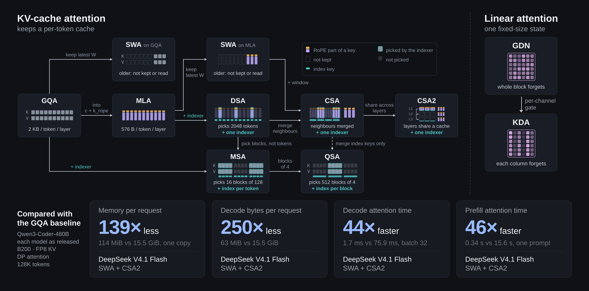

# Beyond GQA: Characterizing Modern Attention Variants with ServingStudio

*Top: the eleven attention designs in today's open models. Bottom: the best new model on each measure, against the GQA baseline at 128K tokens.*

## Introduction

A few years ago, most open LLMs used the same attention design: grouped-query attention (GQA), in which multiple Query vectors attend to the same Key-Value vector to save memory. The optimization of attention did not stop there. Recent models use much
more diverse attention mechanisms, and these mechanisms drastically change the HBM consumption, the memory loading, and the TFLOPs spent on the attention. 

In this post, we look at eleven recent models: DeepSeek V4.1 Flash, DeepSeek V4 Pro, GLM-5.3-Flash, Qwen3.8 Flash
Next, MiMo V2.6 Flash, Inkling, GLM-5.3, MiniMax-M3.1 Flash, Kimi K3, Kimi K3.1 Pro and Qwen3.8 27B. We compare them with
Qwen3-Coder-480B-A35B, a GQA model of similar size to most of them.

At a 128K-token context, the new models need far less than the baseline:

- **Memory.** A request keeps up to 139× less attention state (DeepSeek V4.1 Flash).
- **Decode.** Each step loads up to 250× fewer bytes, and its attention runs up to 44× faster (DeepSeek V4.1 Flash).
- **Prefill.** A prompt needs up to 183× fewer attention FLOPs (Qwen3.8 Flash Next), and its attention runs up to
  46× faster (DeepSeek V4.1 Flash).

These changes matter beyond the numbers themselves. Much of today's performance analysis of LLM inference still
rests on older GQA models: when a step is bound by attention and when by the FFN, how many requests fit in memory,
and which kernels are worth tuning. The new attention designs change these answers.

Our main takeaway

The attention landscape has changed, and inference research needs to catch up.

New attention designs change how much memory a request needs, how many bytes each step moves, and how much it
computes. As a result, the bottlenecks and optimization opportunities of GQA models do not always carry over. Future
inference research should study these new models directly, instead of reusing conclusions drawn from GQA models.

## Architectures

All models except Qwen3.8 27B are mixture-of-experts (MoE) transformers. Their attention layers differ. The baseline uses GQA in every layer. GLM-5.3 replaces GQA with DSA in every layer, and MiniMax-M3.1
Flash replaces it with MSA. The other nine models mix two or more kinds of attention layers. The table below lists
their size and attention choices.

**Figure data: The models and their attention layers**

*Models*

| Model | Role | Facts | Attention layers |
|---|---|---|---|
| Qwen3-Coder-480B-A35B | Baseline | 480B total; 35B active; 262K context | Grouped-query attention (GQA) ×62 (Full attention) |
| MiMo V2.6 Flash | — | 309B total; 15B active; 1M context | Sliding-window attention (SWA) ×39 (Sliding window); Grouped-query attention (GQA) ×9 (Full attention) |
| Inkling | — | 975B total; 41B active; 1M context | Sliding-window attention (SWA) ×55 (Sliding window); Grouped-query attention (GQA) ×11 (Full attention) |
| GLM-5.3 | — | 753B total; ~40B active; 1M context | DeepSeek Sparse Attention (DSA) ×78 (Sparse attention) |
| MiniMax-M3.1 Flash | — | ~428B total; ~23B active; 1M context | MiniMax Sparse Attention (MSA) ×60 (Sparse attention) |
| DeepSeek V4 Pro | — | 1.6T total; 49B active; 1M context | Compressed Sparse Attention (CSA) ×30 (Sparse attention); Heavily Compressed Attention (HCA) ×31 (Full attention) |
| DeepSeek V4.1 Flash | — | 552B backbone; 8B active in prefill; 16B active in decode; 1M context | Sliding-window attention (SWA) ×40 (Sliding window); Compressed Sparse Attention (CSA2) ×38 (Sparse attention) |
| Kimi K3 | — | 2.8T total; 104B active; 1M context | Kimi Delta Attention (KDA) ×69 (Linear attention); Gated MLA ×24 (Full attention) |
| Kimi K3.1 Pro | — | 2.8T total; 104B active; 1M context | Kimi Delta Attention (KDA) ×69 (Linear attention); Gated DSA ×24 (Sparse attention) |
| GLM-5.3-Flash | — | 320B total; 18B active; 1M context | Kimi Delta Attention (KDA) ×34 (Linear attention); DeepSeek Sparse Attention (DSA) ×11 (Sparse attention) |
| Qwen3.8 Flash Next | — | 125B total; 6B active; 51B n-gram embedding; 262K context, 1M with YaRN | Gated DeltaNet (GDN) ×36 (Linear attention); Qwen Sparse Attention (QSA) ×12 (Sparse attention) |
| Qwen3.8 27B | — | 27B dense; 262K context, 1M with YaRN | Gated DeltaNet (GDN) ×48 (Linear attention); Gated attention (GQA) ×16 (Full attention) |

Storage parts behind the memory and decode-read figures, one copy per request (DP attention: each GPU runs all heads, a request sits on one GPU). Kept bytes = fixed + bytes per token × min(context, window). A decode step reads, per part, (readBytes, or bytes per token × tokens per entry) × the entries it reads, where entries = min(context, window) ÷ tokens per entry, capped at top-k for a sparse layer; a fixed state is read and written back.

*Storage parts per model*

| Model | Part | Kind | Bytes per token | Window | Fixed | Tokens per entry | Top-k read | Read bytes per entry |
|---|---|---|---|---|---|---|---|---|
| Qwen3-Coder-480B-A35B | GQA K/V, 62 layers | Whole-context cache | 126,976 B | — | — | — | — | — |
| MiMo V2.6 Flash | Global K/V, 9 layers | Whole-context cache | 11,520 B | — | — | — | — | — |
| MiMo V2.6 Flash | 128-token windows, 39 layers | Window | 99,840 B | 128 | — | — | — | — |
| Inkling | Global K/V, 11 layers | Whole-context cache | 22,528 B | — | — | — | — | — |
| Inkling | 512-token windows, 55 layers | Window | 225,280 B | 512 | — | — | — | — |
| Inkling | Short-conv state (BF16), 66 layers | Fixed state | — | — | 8.08 MiB | — | — | — |
| GLM-5.3 | MLA cache, 78 DSA layers | Whole-context cache | 44,928 B | — | — | — | 2,048 | — |
| GLM-5.3 | Indexer keys, 21 indexing layers | Index | 2,772 B | — | — | — | — | — |
| MiniMax-M3.1 Flash | MSA K/V, 60 layers | Whole-context cache | 61,440 B | — | — | — | 2,048 | — |
| MiniMax-M3.1 Flash | Index keys, 60 layers | Index | 7,680 B | — | — | — | — | — |
| DeepSeek V4 Pro | CSA compressed cache, 30 layers (4 tokens an entry) | Whole-context cache | 4,380 B | — | — | 4 | 1,024 | — |
| DeepSeek V4 Pro | HCA compressed cache, 31 layers (128 tokens an entry) | Whole-context cache | 141.438 B | — | — | 128 | — | — |
| DeepSeek V4 Pro | Indexer keys, 30 CSA layers | Index | 990 B | — | — | 4 | — | — |
| DeepSeek V4 Pro | 128-token windows, 61 layers | Window | 35,624 B | 128 | — | — | — | — |
| DeepSeek V4 Pro | Compressor state (FP32) | Fixed state | — | — | 17.8 MiB | — | — | — |
| DeepSeek V4.1 Flash | Compressed cache, layers 2, 8, 14 (2 tokens an entry) | Whole-context cache | 432 B | — | — | 2 | 512 | 5,184 B |
| DeepSeek V4.1 Flash | Compressed cache, layer 20 | Whole-context cache | 288 B | — | — | — | 512 | 5,760 B |
| DeepSeek V4.1 Flash | Indexer keys (FP4), layers 2, 8, 14 | Index | 102 B | — | — | 2 | — | — |
| DeepSeek V4.1 Flash | Indexer keys (FP4), layer 20 | Index | 68 B | — | — | — | — | 340 B |
| DeepSeek V4.1 Flash | 128-token windows, 40 layers | Window | 21,120 B | 128 | — | — | — | — |
| DeepSeek V4.1 Flash | Compressor ring | Fixed state | — | — | 96.0 KiB | — | — | — |
| Kimi K3 | MLA cache, 24 Gated MLA layers | Whole-context cache | 13,824 B | — | — | — | — | — |
| Kimi K3 | KDA state (FP32), 69 layers | Fixed state | — | — | 429 MiB | — | — | — |
| Kimi K3.1 Pro | MLA cache (fp8_ds_mla), 24 Gated DSA layers | Whole-context cache | 15,744 B | — | — | — | 2,048 | — |
| Kimi K3.1 Pro | Indexer keys, 24 layers | Index | 3,168 B | — | — | — | — | — |
| Kimi K3.1 Pro | KDA state (FP32), 69 layers | Fixed state | — | — | 429 MiB | — | — | — |
| GLM-5.3-Flash | MLA cache, 11 DSA layers | Whole-context cache | 5,632 B | — | — | — | 2,048 | — |
| GLM-5.3-Flash | Pooled index (1 key / 4 tokens) | Index | 363 B | — | — | — | — | — |
| GLM-5.3-Flash | KDA state, 34 layers | Fixed state | — | — | 141 MiB | — | — | — |
| GLM-5.3-Flash | Pooled-index tail (last partial block) | Fixed state | — | — | 22.0 KiB | — | — | — |
| Qwen3.8 Flash Next | QSA K/V, 12 layers | Whole-context cache | 12,288 B | — | — | — | 2,048 | — |
| Qwen3.8 Flash Next | Block index (1 key / 4 tokens) | Index | 384 B | — | — | — | — | — |
| Qwen3.8 Flash Next | QSA ring | Fixed state | — | — | 12.0 KiB | — | — | — |
| Qwen3.8 Flash Next | GDN state, 36 layers | Fixed state | — | — | 110 MiB | — | — | — |
| Qwen3.8 Flash Next | PLE conv state | Fixed state | — | — | 180 KiB | — | — | — |
| Qwen3.8 27B | GQA K/V, 16 layers | Whole-context cache | 32,768 B | — | — | — | — | — |
| Qwen3.8 27B | GDN state, 48 layers | Fixed state | — | — | 147 MiB | — | — | — |

All analysis below assumes the model is deployed on B200 GPUs with data-parallel (DP) attention: each GPU runs every attention head of a
layer, and each request stays on one GPU. We borrow kernels from vLLM or SGLang and measure them with ServingStudio.

## Attention Variants

We first go through how each attention design works. They fall into two branches. The first keeps an entry for
every earlier token in the cache. On this branch, GQA and MLA make each entry smaller, while sliding windows, DSA, CSA
and HCA cut how much of the cache is kept or read. The second branch, linear attention, 
folds the whole context into a state of fixed size.

### Grouped-query attention (GQA)

**Figure data: GQA in one layer of Qwen3-Coder-480B-A35B**

*Prefill: data flow*

- Main row: x (N × 6,144) → Projection → QK-norm → RoPE → Scores → Causal mask → Softmax → Weighted sum → Output projection → out (to the MoE FFN)
- Write: RoPE (k) and Projection (v (no norm, no RoPE)) → Write K, V → KV cache, kept for the whole request
- Scores reads K from the cache: reads K: L earlier + N in chunk
- Weighted sum reads V from the cache: reads V: L earlier + N in chunk

*Prefill at Chunk N = 8,192, Prefix L = 128K: every operation*

| Operation | Kind | Formula | What it does | Operands [axis size] dtype | FLOPs | Bytes | Intensity |
|---|---|---|---|---|---|---|---|
| Projection | GEMM · weights | x · W_q, W_k, W_v | Turns each token's hidden state into a query, a key and a value. | Input: x [N 8K, D 6,144] BF16 \| Weight: W_q [D 6,144, H_q·d 12,288] BF16; W_k [D 6,144, H_kv·d 1,024] BF16; W_v [D 6,144, H_kv·d 1,024] BF16 \| Output: q [N 8K, H_q 96, d 128] BF16; k [N 8K, H_kv 8, d 128] BF16; v [N 8K, H_kv 8, d 128] BF16 | 1.44 TFLOP | 488 MiB | 2,820 FLOP/B |
| QK-norm | per element | q, k ÷ rms × γ | Rescales each head's q and k to the same size, so scores stay in range. | Input: q [N 8K, H_q 96, d 128] BF16; k [N 8K, H_kv 8, d 128] BF16 \| Weight: γ_q [d 128] BF16; γ_k [d 128] BF16 \| Output: q [N 8K, H_q 96, d 128] BF16; k [N 8K, H_kv 8, d 128] BF16 | 436 MFLOP | 416 MiB | 1.00 FLOP/B |
| RoPE | per element | rotate by position | Turns each pair of dimensions by an angle set by the token's position. cos, sin hold 64 values each, looked up by position. | Input: q [N 8K, H_q 96, d 128] BF16; k [N 8K, H_kv 8, d 128] BF16; cos, sin [N 8K, d 128] BF16 \| Output: q [N 8K, H_q 96, d 128] BF16; k [N 8K, H_kv 8, d 128] BF16 | 327 MFLOP | 418 MiB | 0.75 FLOP/B |
| Scores | GEMM · cache | q · Kᵀ ÷ √128 | Compares every query in the chunk with the keys of the L earlier tokens and of the chunk's own tokens. Each KV head serves 12 query heads. | Input: q [N 8K, H_q 96, d 128] BF16 \| Cache: K [L+N 136K, H_kv 8, d 128] FP8 \| Output: S [N 8K, H_q 96, L+N 136K] on chip | 27.2 TFLOP | 328 MiB | 79,123 FLOP/B |
| Causal mask | per element | score = −∞ where key > query | Hides the tokens that come later in the chunk, so each token sees only itself and earlier ones. | Input: S [N 8K, H_q 96, L+N 136K] on chip \| Output: S [N 8K, H_q 96, L+N 136K] on chip | 0 | 0, on chip | — |
| Softmax | per element | exp, ÷ row sum | Turns each row of scores into weights that add up to 1. | Input: S [N 8K, H_q 96, L+N 136K] on chip \| Output: P [N 8K, H_q 96, L+N 136K] on chip | 532 GFLOP | 0, on chip | — |
| Weighted sum | GEMM · cache | P · V | Adds up the values of the tokens it may see, each times its weight. | Input: P [N 8K, H_q 96, L+N 136K] on chip \| Cache: V [L+N 136K, H_kv 8, d 128] FP8 \| Output: o [N 8K, H_q 96, d 128] BF16 | 27.2 TFLOP | 328 MiB | 79,123 FLOP/B |
| Output projection | GEMM · weights | concat(o) · W_o | Joins the 96 heads into 12,288 numbers and maps them back to 6,144. | Input: o [N 8K, H_q·d 12,288] BF16 \| Weight: W_o [H_q·d 12,288, D 6,144] BF16 \| Output: out [N 8K, D 6,144] BF16 | 1.24 TFLOP | 432 MiB | 2,731 FLOP/B |
| Write K, V | cache write | quantize, append | Stores the chunk's keys and values in FP8, so later chunks and tokens can read them. | Input: k [N 8K, H_kv 8, d 128] BF16; v [N 8K, H_kv 8, d 128] BF16 \| Output: K [N 8K, H_kv 8, d 128] FP8; V [N 8K, H_kv 8, d 128] FP8 | 16.8 MFLOP | 48.0 MiB | 0.33 FLOP/B |

*Decode: data flow*

- Main row: x (B × 6,144) → Projection → QK-norm → RoPE → Scores → Softmax → Weighted sum → Output projection → out (to the MoE FFN)
- Write: RoPE (k) and Projection (v (no norm, no RoPE)) → Write K, V → KV cache, kept for the whole request
- Scores reads K from the cache: reads K: all L tokens
- Weighted sum reads V from the cache: reads V: all L tokens

*Decode at Batch B = 32, Context L = 128K: every operation*

| Operation | Kind | Formula | What it does | Operands [axis size] dtype | FLOPs | Bytes | Intensity |
|---|---|---|---|---|---|---|---|
| Projection | GEMM · weights | x · W_q, W_k, W_v | Turns each token's hidden state into a query, a key and a value. | Input: x [B 32, D 6,144] BF16 \| Weight: W_q [D 6,144, H_q·d 12,288] BF16; W_k [D 6,144, H_kv·d 1,024] BF16; W_v [D 6,144, H_kv·d 1,024] BF16 \| Output: q [B 32, H_q 96, d 128] BF16; k [B 32, H_kv 8, d 128] BF16; v [B 32, H_kv 8, d 128] BF16 | 5.64 GFLOP | 169 MiB | 31.8 FLOP/B |
| QK-norm | per element | q, k ÷ rms × γ | Rescales each head's q and k to the same size, so scores stay in range. | Input: q [B 32, H_q 96, d 128] BF16; k [B 32, H_kv 8, d 128] BF16 \| Weight: γ_q [d 128] BF16; γ_k [d 128] BF16 \| Output: q [B 32, H_q 96, d 128] BF16; k [B 32, H_kv 8, d 128] BF16 | 1.70 MFLOP | 1.63 MiB | 1.00 FLOP/B |
| RoPE | per element | rotate by position | Turns each pair of dimensions by an angle set by the token's position. cos, sin hold 64 values each, looked up by position. | Input: q [B 32, H_q 96, d 128] BF16; k [B 32, H_kv 8, d 128] BF16; cos, sin [B 32, d 128] BF16 \| Output: q [B 32, H_q 96, d 128] BF16; k [B 32, H_kv 8, d 128] BF16 | 1.28 MFLOP | 1.63 MiB | 0.75 FLOP/B |
| Scores | GEMM · cache | q · Kᵀ ÷ √128 | Compares q with the key of every token in the cache. Each KV head serves 12 query heads. | Input: q [B 32, H_q 96, d 128] BF16 \| Cache: K [B 32, L 128K, H_kv 8, d 128] FP8 \| Output: S [B 32, H_q 96, L 128K] on chip | 103 GFLOP | 4.00 GiB | 24.0 FLOP/B |
| Softmax | per element | exp, ÷ row sum | Turns each row of scores into weights that add up to 1. | Input: S [B 32, H_q 96, L 128K] on chip \| Output: P [B 32, H_q 96, L 128K] on chip | 2.01 GFLOP | 0, on chip | — |
| Weighted sum | GEMM · cache | P · V | Adds up the values of the tokens it may see, each times its weight. | Input: P [B 32, H_q 96, L 128K] on chip \| Cache: V [B 32, L 128K, H_kv 8, d 128] FP8 \| Output: o [B 32, H_q 96, d 128] BF16 | 103 GFLOP | 4.00 GiB | 24.0 FLOP/B |
| Output projection | GEMM · weights | concat(o) · W_o | Joins the 96 heads into 12,288 numbers and maps them back to 6,144. | Input: o [B 32, H_q·d 12,288] BF16 \| Weight: W_o [H_q·d 12,288, D 6,144] BF16 \| Output: out [B 32, D 6,144] BF16 | 4.83 GFLOP | 145 MiB | 31.8 FLOP/B |
| Write K, V | cache write | quantize, append | Stores this token's k and v in FP8, so every later token can read them. | Input: k [B 32, H_kv 8, d 128] BF16; v [B 32, H_kv 8, d 128] BF16 \| Output: K [B 32, H_kv 8, d 128] FP8; V [B 32, H_kv 8, d 128] FP8 | 65.5 KFLOP | 192 KiB | 0.33 FLOP/B |

*Axes*

| Symbol | Meaning |
|---|---|
| B | requests |
| N | tokens in the chunk |
| L | prefill: earlier tokens in the cache; decode: tokens in each request's cache, the new one included |
| H_q | query heads |
| H_kv | KV heads |
| d | head dim |
| D | hidden size |

*Cache*

- Prefill: KV cache, kept for the whole request; rows: K, V
- Decode: KV cache, kept for the whole request; rows: K, V
- 8 KV heads × 128 × (K + V) = 2 KiB per token and layer in FP8; 124 KiB per token over 62 layers

In standard multi-head attention, every query head has its own key head and value head. GQA lets a group of query
heads share one key-value head, so each token keeps fewer keys and values. Our baseline, Qwen3-Coder-480B-A35B, has
96 query heads and 8 key-value heads in each layer, so 12 query heads share each key-value head.

The token's hidden state is first projected into queries, keys and values, and
QK-norm and RoPE normalize the queries and keys and encode their positions. The keys and values are stored in the KV
cache, where they stay for the entire lifecycle of the request. To compute its output, a new token compares its
queries with the keys of all earlier tokens, turns these scores into weights with a softmax, and takes the weighted
sum of the earlier tokens' values. The two blue arrows show these two reads from the cache: computing the scores
reads every key, and the weighted sum reads every value.

### Multi-head latent attention (MLA)

**Figure data: Gated MLA in one layer of Kimi K3**

*Prefill: data flow*

- Main row: x (N × 7,168) → Down-projection → RMSNorm → Query up-projection → Scores → Causal mask → Softmax → Weighted sum → Output gate → Output projection → out (to the MoE FFN)
- Parallel branch: from x (x) → Gate projection → joins Output gate (g)
- Parallel branch: from Query up-projection → Expand K, V → joins Scores (K)
- V goes from Expand K, V straight to Weighted sum
- Write: RMSNorm (c_kv) and Down-projection (k_s, not normalized) → Write c_kv, k_s → Latent cache, kept for the whole request
- Expand K, V reads c_kv, k_s from the cache: reads c_kv, k_s: L earlier + N in chunk

*Prefill at Chunk N = 8,192, Prefix L = 128K: every operation*

| Operation | Kind | Formula | What it does | Operands [axis size] dtype | FLOPs | Bytes | Intensity |
|---|---|---|---|---|---|---|---|
| Gate projection | GEMM · weights | g = x · W_G | Projects each token's hidden state into 12,288 gate values g, one for each number of the attention output. | Input: x [N 8K, D 7,168] BF16 \| Weight: W_G [D 7,168, H·d_v 12,288] BF16 \| Output: g [N 8K, H·d_v 12,288] BF16 | 1.44 TFLOP | 472 MiB | 2,916 FLOP/B |
| Down-projection | GEMM · weights | x · [W_DQ, W_DKV, W_KS] | Compresses each token's hidden state into c_q for the query and the latent c_kv for the key and the value. It also gives k_s, a 64-number key part that all heads share. | Input: x [N 8K, D 7,168] BF16 \| Weight: W_DQ [D 7,168, r_q 1,536] BF16; W_DKV [D 7,168, r_kv 512] BF16; W_KS [D 7,168, d_s 64] BF16 \| Output: c_q [N 8K, r_q 1,536] BF16; c_kv [N 8K, r_kv 512] BF16; k_s [N 8K, d_s 64] BF16 | 248 GFLOP | 174 MiB | 1,360 FLOP/B |
| RMSNorm | per element | c_q, c_kv ÷ rms × γ | Rescales c_q and c_kv, each with its own learned weights. k_s is not normalized. | Input: c_q [N 8K, r_q 1,536] BF16; c_kv [N 8K, r_kv 512] BF16 \| Weight: γ_q [r_q 1,536] BF16; γ_kv [r_kv 512] BF16 \| Output: c_q [N 8K, r_q 1,536] BF16; c_kv [N 8K, r_kv 512] BF16 | 67.1 MFLOP | 64.0 MiB | 1.00 FLOP/B |
| Query up-projection | GEMM · weights | c_q · W_UQ | Expands c_q into a 192-number query for each of the 96 heads: q_u (128) meets the key rebuilt from c_kv, and q_s (64) meets k_s. Kimi K3 rotates neither part by position. | Input: c_q [N 8K, r_q 1,536] BF16 \| Weight: W_UQ [r_q 1,536, H·(d_u+d_s) 18,432] BF16 \| Output: q_u [N 8K, H 96, d_u 128] BF16; q_s [N 8K, H 96, d_s 64] BF16 | 464 GFLOP | 366 MiB | 1,209 FLOP/B |
| Expand K, V | GEMM · weights | K = [c_kv · W_UK, k_s],  V = c_kv · W_UV | Rebuilds every head's key and value from the latent, for the L earlier tokens and the N tokens in the chunk. Each key ends with the shared k_s. The engine expands the earlier tokens a slice at a time, and drops each slice after use. | Weight: W_UK [r_kv 512, H·d_u 12,288] BF16; W_UV [r_kv 512, H·d_v 12,288] BF16 \| Cache: c_kv, k_s [L+N 136K, r_kv+d_s 576] FP8 \| Output: K [L+N 136K, H 96, d_u+d_s 192] BF16; V [L+N 136K, H 96, d_v 128] BF16 | 3.50 TFLOP | 8.07 GiB | 405 FLOP/B |
| Scores | GEMM · cache | Q · Kᵀ ÷ √192 | Compares every query in the chunk with the expanded keys of the L earlier tokens and of the chunk's own tokens, head by head. | Input: q_u, q_s [N 8K, H 96, d_u+d_s 192] BF16; K [L+N 136K, H 96, d_u+d_s 192] BF16 \| Output: S [N 8K, H 96, L+N 136K] on chip | 40.8 TFLOP | 5.06 GiB | 7,509 FLOP/B |
| Causal mask | per element | score = −∞ where key > query | Hides the tokens that come later in the chunk, so each token sees only itself and earlier ones. | Input: S [N 8K, H 96, L+N 136K] on chip \| Output: S [N 8K, H 96, L+N 136K] on chip | 0 | 0, on chip | — |
| Softmax | per element | exp, ÷ row sum | Turns each row of scores into weights that add up to 1. | Input: S [N 8K, H 96, L+N 136K] on chip \| Output: P [N 8K, H 96, L+N 136K] on chip | 532 GFLOP | 0, on chip | — |
| Weighted sum | GEMM · cache | weights · V | Adds up the expanded values of the tokens each query may see, each times its weight. The engine merges the partial sums of the earlier-token slices and of the chunk. | Input: P [N 8K, H 96, L+N 136K] on chip; V [L+N 136K, H 96, d_v 128] BF16 \| Output: o [N 8K, H 96, d_v 128] BF16 | 27.2 TFLOP | 3.38 GiB | 7,509 FLOP/B |
| Output gate | per element | o × sigmoid(g) | Squashes each of the 12,288 gate values g into (0, 1) and scales the matching number of o by it. | Input: o [N 8K, H·d_v 12,288] BF16; g [N 8K, H·d_v 12,288] BF16 \| Output: o [N 8K, H·d_v 12,288] BF16 | 503 MFLOP | 576 MiB | 0.83 FLOP/B |
| Output projection | GEMM · weights | concat(o) · W_O | Joins the 96 gated heads into 12,288 numbers and maps them back to 7,168. | Input: o [N 8K, H·d_v 12,288] BF16 \| Weight: W_O [H·d_v 12,288, D 7,168] BF16 \| Output: out [N 8K, D 7,168] BF16 | 1.44 TFLOP | 472 MiB | 2,916 FLOP/B |
| Write c_kv, k_s | cache write | quantize, append | Stores the chunk's latents and shared keys in FP8, so later chunks and tokens can read them. | Input: c_kv [N 8K, r_kv 512] BF16; k_s [N 8K, d_s 64] BF16 \| Output: c_kv, k_s [N 8K, r_kv+d_s 576] FP8 | 4.72 MFLOP | 13.5 MiB | 0.33 FLOP/B |

*Decode: data flow*

- Main row: x (B × 7,168) → Down-projection → RMSNorm → Query up-projection → Absorb W_UK → Scores → Softmax → Weighted sum → Absorb W_UV → Output gate → Output projection → out (to the MoE FFN)
- Parallel branch: from x (x) → Gate projection → joins Output gate (g)
- q_s goes from Query up-projection straight to Scores
- Write: RMSNorm (c_kv) and Down-projection (k_s, not normalized) → Write c_kv, k_s → Latent cache, kept for the whole request
- Scores reads c_kv, k_s from the cache: reads c_kv, k_s: all L tokens
- Weighted sum reads c_kv, k_s from the cache: same c_kv, as the values

*Decode at Batch B = 32, Context L = 128K: every operation*

| Operation | Kind | Formula | What it does | Operands [axis size] dtype | FLOPs | Bytes | Intensity |
|---|---|---|---|---|---|---|---|
| Gate projection | GEMM · weights | g = x · W_G | Projects each token's hidden state into 12,288 gate values g, one for each number of the attention output. | Input: x [B 32, D 7,168] BF16 \| Weight: W_G [D 7,168, H·d_v 12,288] BF16 \| Output: g [B 32, H·d_v 12,288] BF16 | 5.64 GFLOP | 169 MiB | 31.8 FLOP/B |
| Down-projection | GEMM · weights | x · [W_DQ, W_DKV, W_KS] | Compresses each token's hidden state into c_q for the query and the latent c_kv for the key and the value. It also gives k_s, a 64-number key part that all heads share. | Input: x [B 32, D 7,168] BF16 \| Weight: W_DQ [D 7,168, r_q 1,536] BF16; W_DKV [D 7,168, r_kv 512] BF16; W_KS [D 7,168, d_s 64] BF16 \| Output: c_q [B 32, r_q 1,536] BF16; c_kv [B 32, r_kv 512] BF16; k_s [B 32, d_s 64] BF16 | 969 MFLOP | 29.4 MiB | 31.4 FLOP/B |
| RMSNorm | per element | c_q, c_kv ÷ rms × γ | Rescales c_q and c_kv, each with its own learned weights. k_s is not normalized. | Input: c_q [B 32, r_q 1,536] BF16; c_kv [B 32, r_kv 512] BF16 \| Weight: γ_q [r_q 1,536] BF16; γ_kv [r_kv 512] BF16 \| Output: c_q [B 32, r_q 1,536] BF16; c_kv [B 32, r_kv 512] BF16 | 262 KFLOP | 260 KiB | 0.98 FLOP/B |
| Query up-projection | GEMM · weights | c_q · W_UQ | Expands c_q into a 192-number query for each of the 96 heads: q_u (128) meets the key rebuilt from c_kv, and q_s (64) meets k_s. Kimi K3 rotates neither part by position. | Input: c_q [B 32, r_q 1,536] BF16 \| Weight: W_UQ [r_q 1,536, H·(d_u+d_s) 18,432] BF16 \| Output: q_u [B 32, H 96, d_u 128] BF16; q_s [B 32, H 96, d_s 64] BF16 | 1.81 GFLOP | 55.2 MiB | 31.3 FLOP/B |
| Absorb W_UK | GEMM · weights | q̃ = q_u · W_UKᵀ, head by head | Moves each head's key matrix onto its query. q̃ · c_kv gives the same score as q_u · (c_kv · W_UK), so no key is ever built. | Input: q_u [B 32, H 96, d_u 128] BF16 \| Weight: W_UK [H 96, d_u 128, r_kv 512] BF16 \| Output: q̃ [B 32, H 96, r_kv 512] BF16 | 403 MFLOP | 15.8 MiB | 24.4 FLOP/B |
| Scores | GEMM · cache | [q̃, q_s] · [c_kv, k_s]ᵀ ÷ √192 | Compares each head's q̃ with every earlier token's c_kv, and its q_s with that token's k_s. All 96 heads read the same cache row. | Input: q̃ [B 32, H 96, r_kv 512] BF16; q_s [B 32, H 96, d_s 64] BF16 \| Cache: c_kv, k_s [B 32, L 128K, r_kv+d_s 576] FP8 \| Output: S [B 32, H 96, L 128K] on chip | 464 GFLOP | 2.25 GiB | 192 FLOP/B |
| Softmax | per element | exp, ÷ row sum | Turns each row of scores into weights that add up to 1. | Input: S [B 32, H 96, L 128K] on chip \| Output: P [B 32, H 96, L 128K] on chip | 2.01 GFLOP | 0, on chip | — |
| Weighted sum | GEMM · cache | weights · c_kv | Adds up the earlier tokens' c_kv, each times its weight. Each head gets its own mix of latents. | Input: P [B 32, H 96, L 128K] on chip \| Cache: c_kv [B 32, L 128K, r_kv 512] reused \| Output: o_c [B 32, H 96, r_kv 512] BF16 | 412 GFLOP | 3.00 MiB | 131,072 FLOP/B |
| Absorb W_UV | GEMM · weights | o = o_c · W_UV, head by head | Applies each head's value matrix after the sum: once for the new token, instead of once for every earlier token. | Input: o_c [B 32, H 96, r_kv 512] BF16 \| Weight: W_UV [H 96, r_kv 512, d_v 128] BF16 \| Output: o [B 32, H 96, d_v 128] BF16 | 403 MFLOP | 15.8 MiB | 24.4 FLOP/B |
| Output gate | per element | o × sigmoid(g) | Squashes each of the 12,288 gate values g into (0, 1) and scales the matching number of o by it. | Input: o [B 32, H·d_v 12,288] BF16; g [B 32, H·d_v 12,288] BF16 \| Output: o [B 32, H·d_v 12,288] BF16 | 1.97 MFLOP | 2.25 MiB | 0.83 FLOP/B |
| Output projection | GEMM · weights | concat(o) · W_O | Joins the 96 gated heads into 12,288 numbers and maps them back to 7,168. | Input: o [B 32, H·d_v 12,288] BF16 \| Weight: W_O [H·d_v 12,288, D 7,168] BF16 \| Output: out [B 32, D 7,168] BF16 | 5.64 GFLOP | 169 MiB | 31.8 FLOP/B |
| Write c_kv, k_s | cache write | quantize, append | Stores this token's c_kv and k_s in FP8, so every later token can read them. | Input: c_kv [B 32, r_kv 512] BF16; k_s [B 32, d_s 64] BF16 \| Output: c_kv, k_s [B 32, r_kv+d_s 576] FP8 | 18.4 KFLOP | 54.0 KiB | 0.33 FLOP/B |

*Axes*

| Symbol | Meaning |
|---|---|
| B | requests |
| N | tokens in the chunk |
| L | prefill: earlier tokens in the cache; decode: tokens in each request's cache, the new one included |
| H | heads |
| D | hidden size |
| r_q | query latent |
| r_kv | KV latent c_kv |
| d_u | query part that meets the rebuilt key |
| d_s | shared key part k_s / q_s |
| d_v | value head dim |

*Cache*

- Prefill: Latent cache, kept for the whole request; rows: c_kv, k_s
- Decode: Latent cache, kept for the whole request; rows: c_kv, k_s
- c_kv (512 numbers) and k_s (64), read by all heads: 576 B per token and layer in FP8; 13.5 KiB over 24 layers

MLA makes each entry smaller in a different way. Instead of storing keys and values per head, an MLA layer caches one
compressed vector per token, the latent $c_{kv}$, which all query heads share. Each head can rebuild its own key and value
from $c_{kv}$ with two learned matrices, $W_{UK}$ and $W_{UV}$.

In prefill, the engine rebuilds the keys and values of the earlier tokens from their cached latents with $W_{UK}$ and
$W_{UV}$ (Expand K, V), and then computes attention as in GQA. The rebuild is paid once and shared
by the thousands of tokens in the chunk.

In decode, only one new token arrives at each step, so rebuilding every
earlier key and value just for it would be wasteful. Instead, the engine folds $W_{UK}$ into the new token's query
(Absorb $W_{UK}$) and applies $W_{UV}$ after the weighted sum (Absorb $W_{UV}$). Attention then works on the cached latents
directly, so both blue arrows start from the same cache row.

Absorbing $W_{UK}$ does not work if RoPE rotates the keys, because the rotation depends on each token's position. The
original MLA in DeepSeek V2 therefore caches one more small key part per token, $k_s$, which all heads share, and
applies RoPE only to $k_s$.

Kimi K3, whose layer the figure shows, changes MLA in two small ways. It drops RoPE, so $k_s$ is a plain key that
carries no position. It also adds an output gate. A separate projection of the input
gives a gate $g$, and before the output projection each number of the attention output is scaled by $sigmoid(g)$.

### Sliding-window attention

**Figure data: Sliding window in one window layer of MiMo V2.6 Flash**

Costs are for one whole layer on one GPU, as in the other figures.

*Prefill: data flow*

- Main row: x (N × 4,096) → Projection → RoPE → Scores → Window mask → Softmax → Weighted sum → Output projection → out (to the MoE FFN)
- Write: RoPE (k, v) → Write K, V → Window cache: only the last 128 tokens
- Scores reads K from the cache: reads K: last 127 + N in chunk
- Weighted sum reads V from the cache: reads V: last 127 + N in chunk

*Prefill at Chunk N = 8,192, Prefix L = 128K: every operation*

| Operation | Kind | Formula | What it does | Operands [axis size] dtype | FLOPs | Bytes | Intensity |
|---|---|---|---|---|---|---|---|
| Projection | GEMM · weights | x · W_qkv | Turns each token's hidden state into a query, a key and a value. Q and K heads have 192 numbers, V heads 128. | Input: x [N 8K, D 4,096] FP8 + scales \| Weight: W_qkv [D 4,096, H_q·d_qk+H_kv·(d_qk+d_v) 14,848] FP8 + scales \| Output: q [N 8K, H_q 64, d_qk 192] BF16; k [N 8K, H_kv 8, d_qk 192] BF16; v [N 8K, H_kv 8, d_v 128] BF16 | 996 GFLOP | 322 MiB | 2,949 FLOP/B |
| RoPE | per element | rotate 64 of 192 channels | Turns the first 64 channels of each q and k head by an angle set by the token's position. The same kernel scales v by 0.707. | Input: q [N 8K, H_q 64, d_qk 192] BF16; k [N 8K, H_kv 8, d_qk 192] BF16; v [N 8K, H_kv 8, d_v 128] BF16; cos, sin [N 8K, d_rot 64] BF16 \| Output: q [N 8K, H_q 64, d_qk 192] BF16; k [N 8K, H_kv 8, d_qk 192] BF16; v [N 8K, H_kv 8, d_v 128] BF16 | 122 MFLOP | 465 MiB | 0.25 FLOP/B |
| Scores | GEMM · cache | q · Kᵀ ÷ √192 | Compares every query in the chunk with the keys of the 127 tokens before it, at most. Each KV head serves 8 query heads. | Input: q [N 8K, H_q 64, d_qk 192] BF16 \| Cache: K [W−1+N 8,319, H_kv 8, d_qk 192] FP8 \| Output: S [N 8K, H_q 64, W 128] on chip | 25.8 GFLOP | 204 MiB | 120 FLOP/B |
| Window mask | per element | score = −∞ where key > query or key ≤ query − 128 | Hides the later tokens of the chunk and every token more than 127 positions back. | Input: S [N 8K, H_q 64, W 128] on chip \| Output: S [N 8K, H_q 64, W 128] on chip | 0 | 0, on chip | — |
| Softmax | per element | exp, ÷ (row sum + e^sink) | Turns each row of scores into weights. A learned sink per head joins the sum, so the weights may add up to less than 1. | Input: S [N 8K, H_q 64, W 128] on chip \| Weight: sink [H_q 64] FP32 \| Output: P [N 8K, H_q 64, W 128] on chip | 336 MFLOP | 256 B | 1,310,720 FLOP/B |
| Weighted sum | GEMM · cache | weights · V | Adds up the values of the tokens in the window, each times its weight. | Input: P [N 8K, H_q 64, W 128] on chip \| Cache: V [W−1+N 8,319, H_kv 8, d_v 128] FP8 \| Output: o [N 8K, H_q 64, d_v 128] BF16 | 17.2 GFLOP | 136 MiB | 120 FLOP/B |
| Output projection | GEMM · weights | concat(o) · W_o | Joins the 64 heads into 8,192 numbers and maps them back to 4,096. | Input: o [N 8K, H_q·d_v 8,192] BF16 \| Weight: W_o [H_q·d_v 8,192, D 4,096] BF16 \| Output: out [N 8K, D 4,096] BF16 | 550 GFLOP | 256 MiB | 2,048 FLOP/B |
| Write K, V | cache write | write into a 128-token window | Stores the chunk's keys and values. Once the chunk is done, only its last 128 tokens stay; the older slots are freed. | Input: k [N 8K, H_kv 8, d_qk 192] BF16; v [N 8K, H_kv 8, d_v 128] BF16 \| Output: K [N 8K, H_kv 8, d_qk 192] FP8; V [N 8K, H_kv 8, d_v 128] FP8 | 21.0 MFLOP | 60.0 MiB | 0.33 FLOP/B |

*Decode: data flow*

- Main row: x (B × 4,096) → Projection → RoPE → Scores → Softmax → Weighted sum → Output projection → out (to the MoE FFN)
- Write: RoPE (k, v) → Write K, V → Window cache: only the last 128 tokens
- Scores reads K from the cache: reads K: last 127 + this token
- Weighted sum reads V from the cache: reads V: last 127 + this token

*Decode at Batch B = 32, Context L = 128K: every operation*

| Operation | Kind | Formula | What it does | Operands [axis size] dtype | FLOPs | Bytes | Intensity |
|---|---|---|---|---|---|---|---|
| Projection | GEMM · weights | x · W_qkv | Turns each token's hidden state into a query, a key and a value. Q and K heads have 192 numbers, V heads 128. | Input: x [B 32, D 4,096] FP8 + scales \| Weight: W_qkv [D 4,096, H_q·d_qk+H_kv·(d_qk+d_v) 14,848] FP8 + scales \| Output: q [B 32, H_q 64, d_qk 192] BF16; k [B 32, H_kv 8, d_qk 192] BF16; v [B 32, H_kv 8, d_v 128] BF16 | 3.89 GFLOP | 59.0 MiB | 62.9 FLOP/B |
| RoPE | per element | rotate 64 of 192 channels | Turns the first 64 channels of each q and k head by an angle set by the token's position. The same kernel scales v by 0.707. | Input: q [B 32, H_q 64, d_qk 192] BF16; k [B 32, H_kv 8, d_qk 192] BF16; v [B 32, H_kv 8, d_v 128] BF16; cos, sin [B 32, d_rot 64] BF16 \| Output: q [B 32, H_q 64, d_qk 192] BF16; k [B 32, H_kv 8, d_qk 192] BF16; v [B 32, H_kv 8, d_v 128] BF16 | 475 KFLOP | 1.82 MiB | 0.25 FLOP/B |
| Scores | GEMM · cache | q · Kᵀ ÷ √192 | Compares q with the keys of the last 127 tokens and its own, never more. Each KV head serves 8 query heads. | Input: q [B 32, H_q 64, d_qk 192] BF16 \| Cache: K [B 32, W 128, H_kv 8, d_qk 192] FP8 \| Output: S [B 32, H_q 64, W 128] on chip | 101 MFLOP | 6.75 MiB | 14.2 FLOP/B |
| Softmax | per element | exp, ÷ (row sum + e^sink) | Turns each row of scores into weights. A learned sink per head joins the sum, so the weights may add up to less than 1. | Input: S [B 32, H_q 64, W 128] on chip \| Weight: sink [H_q 64] FP32 \| Output: P [B 32, H_q 64, W 128] on chip | 1.31 MFLOP | 256 B | 5,120 FLOP/B |
| Weighted sum | GEMM · cache | weights · V | Adds up the values of the tokens in the window, each times its weight. | Input: P [B 32, H_q 64, W 128] on chip \| Cache: V [B 32, W 128, H_kv 8, d_v 128] FP8 \| Output: o [B 32, H_q 64, d_v 128] BF16 | 67.1 MFLOP | 4.50 MiB | 14.2 FLOP/B |
| Output projection | GEMM · weights | concat(o) · W_o | Joins the 64 heads into 8,192 numbers and maps them back to 4,096. | Input: o [B 32, H_q·d_v 8,192] BF16 \| Weight: W_o [H_q·d_v 8,192, D 4,096] BF16 \| Output: out [B 32, D 4,096] BF16 | 2.15 GFLOP | 64.8 MiB | 31.6 FLOP/B |
| Write K, V | cache write | write into a 128-token window | Stores this token's k and v, and drops the token that falls out of the window, 128 positions back. | Input: k [B 32, H_kv 8, d_qk 192] BF16; v [B 32, H_kv 8, d_v 128] BF16 \| Output: K [B 32, H_kv 8, d_qk 192] FP8; V [B 32, H_kv 8, d_v 128] FP8 | 81.9 KFLOP | 240 KiB | 0.33 FLOP/B |

*Axes*

| Symbol | Meaning |
|---|---|
| B | requests |
| N | tokens in the chunk |
| L | prefill: earlier tokens in the context; decode: tokens in each request's context, the new one included |
| W | window: 128 keys a query sees, itself included |
| H_q | query heads |
| H_kv | KV heads |
| d_qk | query and key head dim |
| d_v | value head dim |
| D | hidden size |

*Cache*

- Prefill: Window cache: only the last 128 tokens; rows: K, V
- Decode: Window cache: only the last 128 tokens; rows: K, V
- 8 KV heads × (192 + 128) = 2.5 KiB per token and layer in FP8; 320 KiB per layer at most, 12 MiB over 39 window layers

A sliding-window layer attends only to the last $W$ tokens. Older tokens are never read again, so the cache keeps
only $W$ entries and stops growing once the context passes the window. The window can sit on top of either GQA or
MLA. MiMo V2.6 Flash uses GQA-based windows in most of its layers, and DeepSeek V4.1 Flash uses MLA-based windows in
all of its layers. Both use $W$ = 128.

In prefill, each token in the chunk compares its query only with the last $W$ tokens up to itself, so the scores form
a narrow band along the diagonal. In decode, each step adds the new token's entry and drops the oldest one.

Inkling also mixes window layers, with $W$ = 512, and GQA layers. Instead of RoPE, it encodes positions with a
learned bias that it adds to each score, based on how far apart the two tokens are. Its attention kernel must
therefore compute this bias as well.

### DeepSeek Sparse Attention (DSA)

**Figure data: Gated DSA in one layer of Kimi K3.1 Pro**

*Prefill: data flow*

- Main row: x (N × 7,168) → Down-projection → Norms → Query up-projection → Absorb W_UK → Sparse scores → Softmax → Weighted sum → Absorb W_UV → Output gate → Output projection → out (to the MoE FFN)
- Parallel branch: from x (x) → Gate projection → joins Output gate (g)
- Parallel branch: from Query up-projection (q_I) → Index scores → Top-k → joins Sparse scores (2,048 selected)
- w goes from Down-projection straight to Index scores
- q_s goes from Query up-projection straight to Sparse scores
- Write: Norms (k_I, c_kv) and Down-projection (k_s, not normalized) → Write caches → Two caches, kept for the whole request
- Index scores reads k_I from the cache: reads k_I: L earlier + N in chunk
- Sparse scores reads c_kv, k_s from the cache: reads only the 2,048 selected rows
- Weighted sum reads c_kv, k_s from the cache: same rows, as the values

*Prefill at Chunk N = 8,192, Prefix L = 128K: every operation*

| Operation | Kind | Formula | What it does | Operands [axis size] dtype | FLOPs | Bytes | Intensity |
|---|---|---|---|---|---|---|---|
| Gate projection | GEMM · weights | g = x · W_G | Projects each token's hidden state into 12,288 gate values g, one for each number of the attention output. | Input: x [N 8K, D 7,168] BF16 \| Weight: W_G [D 7,168, H·d_v 12,288] BF16 \| Output: g [N 8K, H·d_v 12,288] BF16 | 1.44 TFLOP | 472 MiB | 2,916 FLOP/B |
| Down-projection | GEMM · weights | x · [W_DQ, W_DKV, W_KS, W_IK, W_IW] | Gives the MLA inputs c_q, c_kv and k_s, as in Kimi K3. The same GEMM also gives the indexer's key k_I and one weight per index head, w. | Input: x [N 8K, D 7,168] BF16 \| Weight: W_DQ [D 7,168, r_q 1,536] BF16; W_DKV [D 7,168, r_kv 512] BF16; W_KS [D 7,168, d_s 64] BF16; W_IK [D 7,168, d_I 128] BF16; W_IW [D 7,168, H_I 32] BF16 \| Output: c_q [N 8K, r_q 1,536] BF16; c_kv [N 8K, r_kv 512] BF16; k_s [N 8K, d_s 64] BF16; k_I [N 8K, d_I 128] BF16; w [N 8K, H_I 32] BF16 | 267 GFLOP | 179 MiB | 1,425 FLOP/B |
| Norms | per element | RMSNorm(c_q), RMSNorm(c_kv), LayerNorm(k_I) | Rescales c_q, c_kv and k_I, each with its own learned weights. k_s is not normalized. | Input: c_q [N 8K, r_q 1,536] BF16; c_kv [N 8K, r_kv 512] BF16; k_I [N 8K, d_I 128] BF16 \| Weight: γ_q [r_q 1,536] BF16; γ_kv [r_kv 512] BF16; γ_I, β_I [2·d_I 256] BF16 \| Output: c_q [N 8K, r_q 1,536] BF16; c_kv [N 8K, r_kv 512] BF16; k_I [N 8K, d_I 128] BF16 | 72.4 MFLOP | 68.0 MiB | 1.01 FLOP/B |
| Query up-projection | GEMM · weights | c_q · [W_UQ, W_IQ] | Expands c_q into the attention query, q_u and q_s for each of the 96 heads, and into the indexer's query q_I for each of its 32 heads. Nothing is rotated by position. | Input: c_q [N 8K, r_q 1,536] BF16 \| Weight: W_UQ [r_q 1,536, H·(d_u+d_s) 18,432] BF16; W_IQ [r_q 1,536, H_I·d_I 4,096] BF16 \| Output: q_u [N 8K, H 96, d_u 128] BF16; q_s [N 8K, H 96, d_s 64] BF16; q_I [N 8K, H_I 32, d_I 128] BF16 | 567 GFLOP | 442 MiB | 1,223 FLOP/B |
| Index scores | GEMM · cache | Σₕ wₕ · ReLU(q_I,ₕ · k_I) | Scores every key each query in the chunk may see: the L earlier tokens and the chunk's tokens up to its own position. Each of the 32 index heads scores the key, and w, one weight per index head that the Down-proj. computes from x, sums them into one score. The query is cast to FP8, like the keys. | Input: q_I [N 8K, H_I 32, d_I 128] BF16; w [N 8K, H_I 32] BF16 \| Cache: k_I [L+N 136K, d_I 128] FP8 + scales \| Output: I [N 8K, L+N 136K] on chip | 9.07 TFLOP | 82.0 MiB | 105,457 FLOP/B |
| Top-k | per element | top 2,048 | For each query, keeps the positions of its 2,048 highest-scoring keys. A query that sees 2,048 keys or fewer keeps them all. | Input: I [N 8K, L+N 136K] on chip \| Output: idx [N 8K, k 2K] INT32 | 1.11 GFLOP | 64.0 MiB | 16.5 FLOP/B |
| Absorb W_UK | GEMM · weights | q̃ = q_u · W_UKᵀ, head by head | Moves each head's key matrix onto its query, for every query in the chunk, so attention runs over the cached latents as in decode. | Input: q_u [N 8K, H 96, d_u 128] BF16 \| Weight: W_UK [H 96, d_u 128, r_kv 512] BF16 \| Output: q̃ [N 8K, H 96, r_kv 512] BF16 | 103 GFLOP | 972 MiB | 101 FLOP/B |
| Sparse scores | GEMM · cache | [q̃, q_s] · [c_kv, k_s]ᵀ ÷ √192, selected rows only | Compares each query, head by head, with the c_kv and k_s of its own 2,048 selected tokens only. | Input: q̃ [N 8K, H 96, r_kv 512] BF16; q_s [N 8K, H 96, d_s 64] BF16; idx [N 8K, k 2K] INT32 \| Cache: c_kv [L+N 136K, r_kv 512] FP8 + scales; k_s [L+N 136K, d_s 64] BF16 \| Output: S [N 8K, H 96, k 2K] on chip | 1.86 TFLOP | 1015 MiB | 1,743 FLOP/B |
| Softmax | per element | exp, ÷ row sum | Turns each row of scores into weights that add up to 1. | Input: S [N 8K, H 96, k 2K] on chip \| Output: P [N 8K, H 96, k 2K] on chip | 8.05 GFLOP | 0, on chip | — |
| Weighted sum | GEMM · cache | weights · c_kv, selected rows only | Adds up the selected tokens' c_kv, each times its weight. Each head gets its own mix of latents. | Input: P [N 8K, H 96, k 2K] on chip \| Cache: c_kv [L+N 136K, r_kv 512] reused \| Output: o_c [N 8K, H 96, r_kv 512] BF16 | 1.65 TFLOP | 768 MiB | 2,048 FLOP/B |
| Absorb W_UV | GEMM · weights | o = o_c · W_UV, head by head | Applies each head's value matrix after the sum, once for each query. | Input: o_c [N 8K, H 96, r_kv 512] BF16 \| Weight: W_UV [H 96, r_kv 512, d_v 128] BF16 \| Output: o [N 8K, H 96, d_v 128] BF16 | 103 GFLOP | 972 MiB | 101 FLOP/B |
| Output gate | per element | o × sigmoid(g) | Squashes each of the 12,288 gate values g into (0, 1) and scales the matching number of o by it. | Input: o [N 8K, H·d_v 12,288] BF16; g [N 8K, H·d_v 12,288] BF16 \| Output: o [N 8K, H·d_v 12,288] BF16 | 503 MFLOP | 576 MiB | 0.83 FLOP/B |
| Output projection | GEMM · weights | concat(o) · W_O | Joins the 96 gated heads into 12,288 numbers and maps them back to 7,168. | Input: o [N 8K, H·d_v 12,288] BF16 \| Weight: W_O [H·d_v 12,288, D 7,168] BF16 \| Output: out [N 8K, D 7,168] BF16 | 1.44 TFLOP | 472 MiB | 2,916 FLOP/B |
| Write caches | cache write | quantize, append to both caches | Stores the chunk's k_I in FP8 with one scale per token in the index-key cache, and its c_kv and k_s in the latent cache. | Input: k_I [N 8K, d_I 128] BF16; c_kv [N 8K, r_kv 512] BF16; k_s [N 8K, d_s 64] BF16 \| Output: k_I [N 8K, d_I 128] FP8 + scales; c_kv [N 8K, r_kv 512] FP8 + scales; k_s [N 8K, d_s 64] BF16 | 5.24 MFLOP | 17.2 MiB | 0.29 FLOP/B |

*Decode: data flow*

- Main row: x (B × 7,168) → Down-projection → Norms → Query up-projection → Absorb W_UK → Sparse scores → Softmax → Weighted sum → Absorb W_UV → Output gate → Output projection → out (to the MoE FFN)
- Parallel branch: from x (x) → Gate projection → joins Output gate (g)
- Parallel branch: from Query up-projection (q_I) → Index scores → Top-k → joins Sparse scores (2,048 selected)
- w goes from Down-projection straight to Index scores
- q_s goes from Query up-projection straight to Sparse scores
- Write: Norms (k_I, c_kv) and Down-projection (k_s, not normalized) → Write caches → Two caches, kept for the whole request
- Index scores reads k_I from the cache: reads every k_I: all L tokens
- Sparse scores reads c_kv, k_s from the cache: reads only the 2,048 selected rows
- Weighted sum reads c_kv, k_s from the cache: same rows, as the values

*Decode at Batch B = 32, Context L = 128K: every operation*

| Operation | Kind | Formula | What it does | Operands [axis size] dtype | FLOPs | Bytes | Intensity |
|---|---|---|---|---|---|---|---|
| Gate projection | GEMM · weights | g = x · W_G | Projects each token's hidden state into 12,288 gate values g, one for each number of the attention output. | Input: x [B 32, D 7,168] BF16 \| Weight: W_G [D 7,168, H·d_v 12,288] BF16 \| Output: g [B 32, H·d_v 12,288] BF16 | 5.64 GFLOP | 169 MiB | 31.8 FLOP/B |
| Down-projection | GEMM · weights | x · [W_DQ, W_DKV, W_KS, W_IK, W_IW] | Gives the MLA inputs c_q, c_kv and k_s, as in Kimi K3. The same GEMM also gives the indexer's key k_I and one weight per index head, w. | Input: x [B 32, D 7,168] BF16 \| Weight: W_DQ [D 7,168, r_q 1,536] BF16; W_DKV [D 7,168, r_kv 512] BF16; W_KS [D 7,168, d_s 64] BF16; W_IK [D 7,168, d_I 128] BF16; W_IW [D 7,168, H_I 32] BF16 \| Output: c_q [B 32, r_q 1,536] BF16; c_kv [B 32, r_kv 512] BF16; k_s [B 32, d_s 64] BF16; k_I [B 32, d_I 128] BF16; w [B 32, H_I 32] BF16 | 1.04 GFLOP | 31.6 MiB | 31.4 FLOP/B |
| Norms | per element | RMSNorm(c_q), RMSNorm(c_kv), LayerNorm(k_I) | Rescales c_q, c_kv and k_I, each with its own learned weights. k_s is not normalized. | Input: c_q [B 32, r_q 1,536] BF16; c_kv [B 32, r_kv 512] BF16; k_I [B 32, d_I 128] BF16 \| Weight: γ_q [r_q 1,536] BF16; γ_kv [r_kv 512] BF16; γ_I, β_I [2·d_I 256] BF16 \| Output: c_q [B 32, r_q 1,536] BF16; c_kv [B 32, r_kv 512] BF16; k_I [B 32, d_I 128] BF16 | 283 KFLOP | 277 KiB | 1.00 FLOP/B |
| Query up-projection | GEMM · weights | c_q · [W_UQ, W_IQ] | Expands c_q into the attention query, q_u and q_s for each of the 96 heads, and into the indexer's query q_I for each of its 32 heads. Nothing is rotated by position. | Input: c_q [B 32, r_q 1,536] BF16 \| Weight: W_UQ [r_q 1,536, H·(d_u+d_s) 18,432] BF16; W_IQ [r_q 1,536, H_I·d_I 4,096] BF16 \| Output: q_u [B 32, H 96, d_u 128] BF16; q_s [B 32, H 96, d_s 64] BF16; q_I [B 32, H_I 32, d_I 128] BF16 | 2.21 GFLOP | 67.5 MiB | 31.3 FLOP/B |
| Index scores | GEMM · cache | Σₕ wₕ · ReLU(q_I,ₕ · k_I) | Scores every earlier token with the 32 small index heads in FP8. w, one weight per index head that the Down-proj. computes from x, sums the heads' scores into one number per token. | Input: q_I [B 32, H_I 32, d_I 128] BF16; w [B 32, H_I 32] BF16 \| Cache: k_I [B 32, L 128K, d_I 128] FP8 + scales \| Output: I [B 32, L 128K] on chip | 34.4 GFLOP | 528 MiB | 62.0 FLOP/B |
| Top-k | per element | top 2,048 | Keeps the positions of the 2,048 highest-scoring earlier tokens. With 2,048 or fewer earlier tokens, it keeps them all. | Input: I [B 32, L 128K] on chip \| Output: idx [B 32, k 2K] INT32 | 4.19 MFLOP | 256 KiB | 16.0 FLOP/B |
| Absorb W_UK | GEMM · weights | q̃ = q_u · W_UKᵀ, head by head | Moves each head's key matrix onto its query. q̃ · c_kv gives the same score as q_u · (c_kv · W_UK), so no key is ever built. | Input: q_u [B 32, H 96, d_u 128] BF16 \| Weight: W_UK [H 96, d_u 128, r_kv 512] BF16 \| Output: q̃ [B 32, H 96, r_kv 512] BF16 | 403 MFLOP | 15.8 MiB | 24.4 FLOP/B |
| Sparse scores | GEMM · cache | [q̃, q_s] · [c_kv, k_s]ᵀ ÷ √192, selected rows only | Compares each head's q̃ and q_s with the c_kv and k_s of the 2,048 selected tokens only. All 96 heads read the same rows. | Input: q̃ [B 32, H 96, r_kv 512] BF16; q_s [B 32, H 96, d_s 64] BF16; idx [B 32, k 2K] INT32 \| Cache: c_kv [B 32, k 2K, r_kv 512] FP8 + scales; k_s [B 32, k 2K, d_s 64] BF16 \| Output: S [B 32, H 96, k 2K] on chip | 7.25 GFLOP | 44.6 MiB | 155 FLOP/B |
| Softmax | per element | exp, ÷ row sum | Turns each row of scores into weights that add up to 1. | Input: S [B 32, H 96, k 2K] on chip \| Output: P [B 32, H 96, k 2K] on chip | 31.5 MFLOP | 0, on chip | — |
| Weighted sum | GEMM · cache | weights · c_kv, selected rows only | Adds up the selected tokens' c_kv, each times its weight. Each head gets its own mix of latents. | Input: P [B 32, H 96, k 2K] on chip \| Cache: c_kv [B 32, k 2K, r_kv 512] reused \| Output: o_c [B 32, H 96, r_kv 512] BF16 | 6.44 GFLOP | 3.00 MiB | 2,048 FLOP/B |
| Absorb W_UV | GEMM · weights | o = o_c · W_UV, head by head | Applies each head's value matrix after the sum, once for each query. | Input: o_c [B 32, H 96, r_kv 512] BF16 \| Weight: W_UV [H 96, r_kv 512, d_v 128] BF16 \| Output: o [B 32, H 96, d_v 128] BF16 | 403 MFLOP | 15.8 MiB | 24.4 FLOP/B |
| Output gate | per element | o × sigmoid(g) | Squashes each of the 12,288 gate values g into (0, 1) and scales the matching number of o by it. | Input: o [B 32, H·d_v 12,288] BF16; g [B 32, H·d_v 12,288] BF16 \| Output: o [B 32, H·d_v 12,288] BF16 | 1.97 MFLOP | 2.25 MiB | 0.83 FLOP/B |
| Output projection | GEMM · weights | concat(o) · W_O | Joins the 96 gated heads into 12,288 numbers and maps them back to 7,168. | Input: o [B 32, H·d_v 12,288] BF16 \| Weight: W_O [H·d_v 12,288, D 7,168] BF16 \| Output: out [B 32, D 7,168] BF16 | 5.64 GFLOP | 169 MiB | 31.8 FLOP/B |
| Write caches | cache write | quantize, append to both caches | Stores this token's k_I in FP8 with one scale in the index-key cache, and its c_kv and k_s in the latent cache. | Input: k_I [B 32, d_I 128] BF16; c_kv [B 32, r_kv 512] BF16; k_s [B 32, d_s 64] BF16 \| Output: k_I [B 32, d_I 128] FP8 + scales; c_kv [B 32, r_kv 512] FP8 + scales; k_s [B 32, d_s 64] BF16 | 20.5 KFLOP | 68.6 KiB | 0.29 FLOP/B |

*Axes*

| Symbol | Meaning |
|---|---|
| B | requests |
| N | tokens in the chunk |
| L | prefill: earlier tokens in the cache; decode: tokens in each request's cache, the new one included |
| k | selected rows: min(L, 2,048) per query |
| H | heads |
| H_I | index heads |
| d_I | index head dim |
| D | hidden size |
| r_q | query latent |
| r_kv | KV latent c_kv |
| d_u | query part that meets the rebuilt key |
| d_s | shared key part k_s / q_s |
| d_v | value head dim |

*Cache*

- Prefill: Two caches, kept for the whole request; rows: k_I, c_kv, k_s
- Decode: Two caches, kept for the whole request; rows: k_I, c_kv, k_s
- k_I: 128 FP8 + 4 B scale = 132 B; c_kv 512 FP8 + 16 B scales + k_s 64 BF16 = 656 B; 788 B per token and layer, 18.5 KiB over 24 layers

Not all earlier tokens matter equally. After the softmax, most of the weight usually falls on a few of them, and
reading the rest barely changes the output. DSA, the sparse attention that DeepSeek introduced in V3.2, adds a small
indexer in front of MLA to find these tokens. The indexer keeps its own short key, $k_I$, for every token. For each new
token, it scores every earlier token with a cheap dot product and keeps the 2,048 tokens with the highest scores.
The layer then runs ordinary MLA over only these selected tokens.

The indexer still scores the whole context, but its key is small, so each score is cheap. Sparse attention therefore
cuts what each step reads and computes, but not what a request stores: any token may be selected later, so every
token stays in the cache.

In prefill, different tokens select different earlier tokens. Expanding the whole context would rebuild keys and
values that most tokens never read, so vLLM keeps long Kimi K3.1 Pro prompts on the absorbed path in prefill too.

GLM-5.3 and GLM-5.3-Flash also use DSA, each with one change to the indexer. In GLM-5.3, only some layers run an
indexer, and the others reuse the most recent selection. GLM-5.3-Flash keeps one index key for every 4 tokens and
selects tokens in groups of 4.

### MiniMax/Qwen Sparse Attention (MSA/QSA)

**Figure data: MSA in one layer of MiniMax-M3.1 Flash**

Costs are for one whole layer on one GPU, as in the other figures.

*Prefill: data flow*

- Main row: x (N × 6,144) → Projection → Norms, RoPE → Sparse attention → Output projection → out (to the MoE FFN)
- Parallel branch: from Norms, RoPE (q_I) → Index scores → Top-k → joins Sparse attention (16 blocks per group)
- Write: Norms, RoPE (k, k_I) and Projection (v (no norm, no RoPE)) → Write caches → Two caches, kept for the whole request
- Index scores reads k_I from the cache: reads k_I: L earlier + N in chunk
- Sparse attention reads K, V from the cache: reads 16 blocks per group

*Prefill at Chunk N = 8,192, Prefix L = 128K: every operation*

| Operation | Kind | Formula | What it does | Operands [axis size] dtype | FLOPs | Bytes | Intensity |
|---|---|---|---|---|---|---|---|
| Projection | GEMM · weights | x · [W_q, W_k, W_v, W_Iq, W_Ik] | Turns each token's hidden state into a query, a key and a value, plus the indexer's query, one head per KV group, and its key, one head shared by all groups. One GEMM makes all five. | Input: x [N 8K, D 6,144] MXFP8 \| Weight: W_qkv,I [D 6,144, (H_q+2H_kv+H_I+1)·d 9,856] MXFP8 \| Output: q [N 8K, H_q 64, d 128] BF16; k, v [N 8K, 2·H_kv 8, d 128] BF16; q_I [N 8K, H_I 4, d_I 128] BF16; k_I [N 8K, d_I 128] BF16 | 992 GFLOP | 263 MiB | 3,597 FLOP/B |
| Norms, RoPE | per element | per head: ÷ rms × γ, rotate 64 channels | Rescales each head of q, k, q_I and k_I and turns 64 of its channels by the token's position. The same kernel writes k, v and k_I into the caches and casts q_I to FP8. | Input: q [N 8K, H_q 64, d 128] BF16; k [N 8K, H_kv 4, d 128] BF16; q_I [N 8K, H_I 4, d_I 128] BF16; k_I [N 8K, d_I 128] BF16 \| Weight: γ ×4 [4·d 512] BF16 \| Output: q [N 8K, H_q 64, d 128] BF16; k [N 8K, H_kv 4, d 128] on chip; q_I [N 8K, H_I 4, d_I 128] FP8; k_I [N 8K, d_I 128] on chip | 421 MFLOP | 278 MiB | 1.44 FLOP/B |
| Index scores | GEMM · cache | s_g(t) = q_I,g · k_I(t); block score = max over its 128 tokens | Scores every key each query may see, once for each KV group's index query, then gives every 128-token block the highest score of any token in it. | Input: q_I [N 8K, H_I 4, d_I 128] FP8 \| Cache: k_I [L+N 136K, d_I 128] FP8 \| Output: block scores [N 8K, H_I 4, (L+N)/128 1,088] on chip | 1.14 TFLOP | 21.0 MiB | 51,694 FLOP/B |
| Top-k | per element | top 16 blocks per group; the local block always | For each query and KV group, keeps the 16 best blocks, the block holding the query itself always among them. | Input: block scores [N 8K, H_I 4, (L+N)/128 1,088] on chip \| Output: idx [N 8K, H_I 4, 16 16] INT32 | 34.6 MFLOP | 2.00 MiB | 16.5 FLOP/B |
| Sparse attention | GEMM · cache | softmax(q · Kᵀ ÷ √128) · V over each group's 16 blocks | Each query head attends to the 2,048 tokens of the 16 blocks its KV group selected for that query. Scores and weights stay inside the kernel. | Input: q [N 8K, H_q 64, d 128] BF16; idx [N 8K, H_I 4, 16 16] INT32 \| Cache: K [L+N 136K, H_kv 4, d 128] FP8; V [L+N 136K, H_kv 4, d 128] FP8 \| Output: o [N 8K, H_q·d 8,192] BF16 | 550 GFLOP | 394 MiB | 1,331 FLOP/B |
| Output projection | GEMM · weights | concat(o) · W_o | Joins the 64 heads into 8,192 numbers and maps them back to 6,144. | Input: o [N 8K, H_q·d 8,192] BF16 \| Weight: W_o [H_q·d 8,192, D 6,144] MXFP8 \| Output: out [N 8K, D 6,144] BF16 | 825 GFLOP | 274 MiB | 2,875 FLOP/B |
| Write caches | cache write | quantize, append k, v and k_I | Stores the chunk's k and v in the K/V cache and its k_I in the index cache, in FP8. It is the end of the Norms, RoPE kernel. | Input: k [N 8K, H_kv 4, d 128] on chip; v [N 8K, H_kv 4, d 128] BF16; k_I [N 8K, d_I 128] on chip \| Output: k, v [N 8K, 2·H_kv 8, d 128] FP8; k_I [N 8K, d_I 128] FP8 | 9.44 MFLOP | 17.0 MiB | 0.53 FLOP/B |

*Decode: data flow*

- Main row: x (B × 6,144) → Projection → Norms, RoPE → Sparse attention → Output projection → out (to the MoE FFN)
- Parallel branch: from Norms, RoPE (q_I) → Index scores → Top-k → joins Sparse attention (16 blocks per group)
- Write: Norms, RoPE (k, k_I) and Projection (v (no norm, no RoPE)) → Write caches → Two caches, kept for the whole request
- Index scores reads k_I from the cache: reads every k_I: all L tokens
- Sparse attention reads K, V from the cache: reads 16 blocks per group

*Decode at Batch B = 32, Context L = 128K: every operation*

| Operation | Kind | Formula | What it does | Operands [axis size] dtype | FLOPs | Bytes | Intensity |
|---|---|---|---|---|---|---|---|
| Projection | GEMM · weights | x · [W_q, W_k, W_v, W_Iq, W_Ik] | Turns each token's hidden state into a query, a key and a value, plus the indexer's query, one head per KV group, and its key, one head shared by all groups. One GEMM makes all five. | Input: x [B 32, D 6,144] MXFP8 \| Weight: W_qkv,I [D 6,144, (H_q+2H_kv+H_I+1)·d 9,856] MXFP8 \| Output: q [B 32, H_q 64, d 128] BF16; k, v [B 32, 2·H_kv 8, d 128] BF16; q_I [B 32, H_I 4, d_I 128] BF16; k_I [B 32, d_I 128] BF16 | 3.88 GFLOP | 60.3 MiB | 61.2 FLOP/B |
| Norms, RoPE | per element | per head: ÷ rms × γ, rotate 64 channels | Rescales each head of q, k, q_I and k_I and turns 64 of its channels by the token's position. The same kernel writes k, v and k_I into the caches and casts q_I to FP8. | Input: q [B 32, H_q 64, d 128] BF16; k [B 32, H_kv 4, d 128] BF16; q_I [B 32, H_I 4, d_I 128] BF16; k_I [B 32, d_I 128] BF16 \| Weight: γ ×4 [4·d 512] BF16 \| Output: q [B 32, H_q 64, d 128] BF16; k [B 32, H_kv 4, d 128] on chip; q_I [B 32, H_I 4, d_I 128] FP8; k_I [B 32, d_I 128] on chip | 1.64 MFLOP | 1.09 MiB | 1.44 FLOP/B |
| Index scores | GEMM · cache | s_g(t) = q_I,g · k_I(t); block score = max over its 128 tokens | Scores every earlier token, once for each KV group's index query, then gives every 128-token block the highest score of any token in it. | Input: q_I [B 32, H_I 4, d_I 128] FP8 \| Cache: k_I [B 32, L 128K, d_I 128] FP8 \| Output: block scores [B 32, H_I 4, L/128 1K] on chip | 4.31 GFLOP | 512 MiB | 8.03 FLOP/B |
| Top-k | per element | top 16 blocks per group; the local block always | For each KV group, keeps the 16 best blocks, the block holding the newest tokens always among them. With 16 blocks or fewer, it keeps them all. | Input: block scores [B 32, H_I 4, L/128 1K] on chip \| Output: idx [B 32, H_I 4, 16 16] INT32 | 131 KFLOP | 8.00 KiB | 16.0 FLOP/B |
| Sparse attention | GEMM · cache | softmax(q · Kᵀ ÷ √128) · V over each group's 16 blocks | Each query head attends to the 2,048 tokens of the 16 blocks its KV group selected. The 4 groups read different blocks. | Input: q [B 32, H_q 64, d 128] BF16; idx [B 32, H_I 4, 16 16] INT32 \| Cache: K [B 32, H_kv 4, k 2K, d 128] FP8; V [B 32, H_kv 4, k 2K, d 128] FP8 \| Output: o [B 32, H_q·d 8,192] BF16 | 2.15 GFLOP | 65.0 MiB | 31.5 FLOP/B |
| Output projection | GEMM · weights | concat(o) · W_o | Joins the 64 heads into 8,192 numbers and maps them back to 6,144. | Input: o [B 32, H_q·d 8,192] BF16 \| Weight: W_o [H_q·d 8,192, D 6,144] MXFP8 \| Output: out [B 32, D 6,144] BF16 | 3.22 GFLOP | 50.4 MiB | 61.0 FLOP/B |
| Write caches | cache write | quantize, append k, v and k_I | Stores this token's k and v in the K/V cache and its k_I in the index cache, in FP8. It is the end of the Norms, RoPE kernel. | Input: k [B 32, H_kv 4, d 128] on chip; v [B 32, H_kv 4, d 128] BF16; k_I [B 32, d_I 128] on chip \| Output: k, v [B 32, 2·H_kv 8, d 128] FP8; k_I [B 32, d_I 128] FP8 | 36.9 KFLOP | 68.0 KiB | 0.53 FLOP/B |

*Axes*

| Symbol | Meaning |
|---|---|
| B | requests |
| N | tokens in the chunk |
| L | prefill: earlier tokens in the cache; decode: tokens in each request's cache, the new one included |
| k | tokens a KV group keeps: its 16 blocks of 128, min(L, 2,048) |
| H_q | query heads |
| H_kv | KV heads, one per group of 16 query heads |
| H_I | index query heads, one per KV group |
| d | head dim |
| d_I | index head dim |
| D | hidden size |

*Cache*

- Prefill: Two caches, kept for the whole request; rows: k_I, K, V
- Decode: Two caches, kept for the whole request; rows: k_I, K, V
- k_I: 128 FP8 = 128 B; K, V: 4 heads × 128 × 2 FP8 = 1,024 B; 1,152 B per token and layer, 67.5 KiB over 60 layers

MSA in MiniMax-M3.1 Flash builds sparse attention on GQA and selects whole blocks of 128 tokens instead of single
tokens. Its indexer keeps one short key per token and scores every earlier token, as in DSA. A block's score is the
highest score of any token in it. Each group of query heads picks its own 16 blocks,
and the block holding the newest tokens is always among them.

**Figure data: QSA in one layer of Qwen3.8 Flash Next**

Costs are for one whole layer on one GPU, as in the other figures.

*Prefill: data flow*

- Main row: x (N × 2,560) → Projection → Norms, RoPE → Sparse attention → Output projection → out (to the MoE FFN)
- Parallel branch: from Projection (q_I, k_raw) → Index prep → Index scores → Top-k → joins Sparse attention (2,048 selected)
- gate, v goes from Projection straight to Sparse attention
- Write: Index prep (k̄, k_raw) → Write index → Two caches, kept for the whole request
- Index scores reads k̄ from the cache: reads every k̄: (L+N)/4
- Sparse attention reads K, V from the cache: appends k, v; reads 2,048 selected

*Prefill at Chunk N = 8,192, Prefix L = 128K: every operation*

| Operation | Kind | Formula | What it does | Operands [axis size] dtype | FLOPs | Bytes | Intensity |
|---|---|---|---|---|---|---|---|
| Projection | GEMM · weights | x · [W_q, W_gate, W_k, W_v, W_Iq, W_Ik] | Turns each token's hidden state into a query for each of the 24 heads, an output gate of the same size, and a key and a value for each of the 2 KV heads. The same GEMM gives the indexer 4 small index queries and one raw index key. | Input: x [N 8K, D 2,560] BF16 \| Weight: W_qkv [D 2,560, 2·H_q·d+2·H_kv·d 13,312] BF16; W_Iqk [D 2,560, (H_I+1)·d_I 640] BF16 \| Output: q [N 8K, H_q 24, d 256] BF16; gate [N 8K, H_q·d 6,144] BF16; k, v [N 8K, 2·H_kv 4, d 256] BF16; q_I [N 8K, H_I 4, d_I 128] BF16; k_raw [N 8K, d_I 128] BF16 | 585 GFLOP | 326 MiB | 1,711 FLOP/B |
| Norms, RoPE | per element | q, k per head: ÷ rms × γ, rotate 64 channels | Rescales each head of q and k and turns 64 of its 256 channels by the token's position. The same kernel splits the gate off q. | Input: q [N 8K, H_q 24, d 256] BF16; k [N 8K, H_kv 2, d 256] BF16 \| Weight: γ_q, γ_k [2·d 512] BF16 \| Output: q [N 8K, H_q 24, d 256] BF16; k [N 8K, H_kv 2, d 256] BF16 | 259 MFLOP | 208 MiB | 1.19 FLOP/B |
| Index prep | per element | q_I: ÷ rms × γ, rotate; k̄ = norm(mean of 4 raw keys), rotated | Normalizes and rotates the index queries and casts them to FP8. Averages each complete block of 4 raw keys into one pooled key, then normalizes and rotates it. | Input: q_I [N 8K, H_I 4, d_I 128] BF16; k_raw [N 8K, d_I 128] BF16 \| Weight: γ_Iq, γ_Ik [2·d_I 256] BF16 \| State: ring [4 tokens 4, d_I 128] BF16 \| Output: q_I [N 8K, H_I 4, d_I 128] FP8; k̄ [N/4 2K, d_I 128] on chip; k_raw [≤ 3 3, d_I 128] on chip | 25.6 MFLOP | 14.0 MiB | 1.74 FLOP/B |
| Index scores | GEMM · cache | Σ_h ReLU(q_I,h · k̄_g), every complete block g | Scores every complete block of 4 tokens each query may see against its pooled key. One number per block comes out, not one per head. | Input: q_I [N 8K, H_I 4, d_I 128] FP8 \| Cache: k̄ [(L+N)/4 34K, d_I 128] FP8 \| Output: I [N 8K, (L+N)/4 34K] on chip | 283 GFLOP | 8.25 MiB | 32,768 FLOP/B |
| Top-k | per element | top 512 blocks → 2,048 token positions | For each query, keeps its 512 best blocks and expands them into 2,048 token positions, plus the tokens of its last, incomplete block. | Input: I [N 8K, (L+N)/4 34K] on chip \| Output: idx [N 8K, k 2K] INT32 | 277 MFLOP | 64.0 MiB | 4.12 FLOP/B |
| Sparse attention | GEMM · cache | append k, v;  o = softmax(q · Kᵀ ÷ √256) · V over 2,048 tokens;  o × sigmoid(gate) | Appends the chunk's k and v to the K/V cache. Then each query attends to its own 2,048 selected tokens, and the output gate scales the result. | Input: q [N 8K, H_q 24, d 256] BF16; gate [N 8K, H_q·d 6,144] BF16; k, v [N 8K, 2·H_kv 4, d 256] BF16; idx [N 8K, k 2K] INT32 \| Cache: K [L+N 136K, H_kv 2, d 256] FP8; V [L+N 136K, H_kv 2, d 256] FP8 \| Output: k, v [N 8K, 2·H_kv 4, d 256] FP8; o [N 8K, H_q·d 6,144] BF16 | 413 GFLOP | 512 MiB | 768 FLOP/B |
| Output projection | GEMM · weights | concat(o) · W_o | Joins the 24 gated heads into 6,144 numbers and maps them back to 2,560. | Input: o [N 8K, H_q·d 6,144] BF16 \| Weight: W_o [H_q·d 6,144, D 2,560] BF16 \| Output: out [N 8K, D 2,560] BF16 | 258 GFLOP | 166 MiB | 1,480 FLOP/B |
| Write index | cache write | pooled key in FP8; raw key into the ring | Stores the chunk's pooled keys in FP8 in the index cache, and keeps the raw keys of its last, incomplete block in the ring. It is the end of the Index prep kernel. | Input: k̄ [N/4 2K, d_I 128] on chip; k_raw [≤ 3 3, d_I 128] on chip \| Output: k̄ [N/4 2K, d_I 128] FP8; ring [≤ 3 3, d_I 128] BF16 | 262 KFLOP | 257 KiB | 1.00 FLOP/B |

*Decode: data flow*

- Main row: x (B × 2,560) → Projection → Norms, RoPE → Sparse attention → Output projection → out (to the MoE FFN)
- Parallel branch: from Projection (q_I, k_raw) → Index prep → Index scores → Top-k → joins Sparse attention (2,048 selected)
- gate, v goes from Projection straight to Sparse attention
- Write: Index prep (k̄, k_raw) → Write index → Two caches, kept for the whole request
- Index scores reads k̄ from the cache: reads every k̄: L/4
- Sparse attention reads K, V from the cache: appends k, v; reads 2,048 selected

*Decode at Batch B = 32, Context L = 128K: every operation*

| Operation | Kind | Formula | What it does | Operands [axis size] dtype | FLOPs | Bytes | Intensity |
|---|---|---|---|---|---|---|---|
| Projection | GEMM · weights | x · [W_q, W_gate, W_k, W_v, W_Iq, W_Ik] | Turns each token's hidden state into a query for each of the 24 heads, an output gate of the same size, and a key and a value for each of the 2 KV heads. The same GEMM gives the indexer 4 small index queries and one raw index key. | Input: x [B 32, D 2,560] BF16 \| Weight: W_qkv [D 2,560, 2·H_q·d+2·H_kv·d 13,312] BF16; W_Iqk [D 2,560, (H_I+1)·d_I 640] BF16 \| Output: q [B 32, H_q 24, d 256] BF16; gate [B 32, H_q·d 6,144] BF16; k, v [B 32, 2·H_kv 4, d 256] BF16; q_I [B 32, H_I 4, d_I 128] BF16; k_raw [B 32, d_I 128] BF16 | 2.29 GFLOP | 69.1 MiB | 31.5 FLOP/B |
| Norms, RoPE | per element | q, k per head: ÷ rms × γ, rotate 64 channels | Rescales each head of q and k and turns 64 of its 256 channels by the token's position. The same kernel splits the gate off q. | Input: q [B 32, H_q 24, d 256] BF16; k [B 32, H_kv 2, d 256] BF16 \| Weight: γ_q, γ_k [2·d 512] BF16 \| Output: q [B 32, H_q 24, d 256] BF16; k [B 32, H_kv 2, d 256] BF16 | 1.01 MFLOP | 833 KiB | 1.19 FLOP/B |
| Index prep | per element | q_I: ÷ rms × γ, rotate; k̄ = norm(mean of 4 raw keys), rotated | Normalizes and rotates the index queries and casts them to FP8. Every 4th token completes a block: its 4 raw keys, 3 of them from the ring, are averaged into one pooled key, then normalized and rotated. | Input: q_I [B 32, H_I 4, d_I 128] BF16; k_raw [B 32, d_I 128] BF16 \| Weight: γ_Iq, γ_Ik [2·d_I 256] BF16 \| State: ring [B 32, 4 tokens 4, d_I 128] BF16 \| Output: q_I [B 32, H_I 4, d_I 128] FP8; k̄ [B/4 8, d_I 128] on chip; k_raw [B 32, d_I 128] on chip | 99.8 KFLOP | 88.5 KiB | 1.10 FLOP/B |
| Index scores | GEMM · cache | Σ_h ReLU(q_I,h · k̄_g), every complete block g | Scores every complete block of 4 earlier tokens against its pooled key. One number per block comes out, not one per head. | Input: q_I [B 32, H_I 4, d_I 128] FP8 \| Cache: k̄ [B 32, L/4 32K, d_I 128] FP8 \| Output: I [B 32, L/4 32K] on chip | 1.07 GFLOP | 128 MiB | 8.00 FLOP/B |
| Top-k | per element | top 512 blocks → 2,048 token positions | Keeps the 512 best blocks and expands them into 2,048 token positions, plus the tokens of the last, incomplete block. With 512 blocks or fewer, it keeps them all. | Input: I [B 32, L/4 32K] on chip \| Output: idx [B 32, k 2K] INT32 | 1.05 MFLOP | 256 KiB | 4.00 FLOP/B |
| Sparse attention | GEMM · cache | append k, v;  o = softmax(q · Kᵀ ÷ √256) · V over 2,048 tokens;  o × sigmoid(gate) | Appends this token's k and v to the K/V cache. Then the query attends to the 2,048 selected tokens only, and the output gate scales the result. | Input: q [B 32, H_q 24, d 256] BF16; gate [B 32, H_q·d 6,144] BF16; k, v [B 32, 2·H_kv 4, d 256] BF16; idx [B 32, k 2K] INT32 \| Cache: K [B 32, k 2K, H_kv 2, d 256] FP8; V [B 32, k 2K, H_kv 2, d 256] FP8 \| Output: k, v [B 32, 2·H_kv 4, d 256] FP8; o [B 32, H_q·d 6,144] BF16 | 1.61 GFLOP | 65.5 MiB | 23.5 FLOP/B |
| Output projection | GEMM · weights | concat(o) · W_o | Joins the 24 gated heads into 6,144 numbers and maps them back to 2,560. | Input: o [B 32, H_q·d 6,144] BF16 \| Weight: W_o [H_q·d 6,144, D 2,560] BF16 \| Output: out [B 32, D 2,560] BF16 | 1.01 GFLOP | 30.5 MiB | 31.4 FLOP/B |
| Write index | cache write | pooled key in FP8; raw key into the ring | Puts this token's raw key into the ring. Every 4th token, it stores the new pooled key in FP8 in the index cache. It is the end of the Index prep kernel. | Input: k̄ [B/4 8, d_I 128] on chip; k_raw [B 32, d_I 128] on chip \| Output: k̄ [B/4 8, d_I 128] FP8; ring [B 32, d_I 128] BF16 | 1.02 KFLOP | 9.00 KiB | 0.11 FLOP/B |

*Axes*

| Symbol | Meaning |
|---|---|
| B | requests |
| N | tokens in the chunk |
| L | prefill: earlier tokens in the cache; decode: tokens in each request's cache, the new one included |
| k | selected tokens: 512 blocks of 4, min(L, 2,048) |
| H_q | query heads |
| H_kv | KV heads |
| H_I | index query heads |
| d | head dim |
| d_I | index head dim |
| D | hidden size |

*Cache*

- Prefill: Two caches, kept for the whole request; rows: k̄, K, V
- Decode: Two caches, kept for the whole request; rows: k̄, K, V
- k̄: one 128 B key (FP8) per 4 tokens; K, V: 2 heads × 256 × 2 FP8 = 1,024 B per token and layer. Plus a ring of the last raw keys, 1 KiB per request and layer. 12 QSA layers.

QSA in Qwen3.8 Flash Next also builds on GQA, but its blocks hold only 4 tokens. It also shrinks the index: the
indexer keeps one key for every block of 4 tokens instead of one per token, so scanning the whole context reads much
less.

### Compressed sparse attention (CSA)

**Figure data: Compressed and shared caches in layer 2 of DeepSeek V4.1 Flash**

Costs are for one whole layer on one GPU, as in the other figures.

*Prefill: data flow*

- Main row: x (N × 5,120) → Projection → Norms → Query up-projection → q RoPE → Attention over the window and the selected entries → Output projection → out (to the MoE FFN)
- Parallel branch: from x (x) → Side-stream projections → Compress → Index key projection
- Parallel branch: from q RoPE (q_I) → Index scores → Top-k → joins Attention over the window and the selected entries (512 selected)
- w goes from Side-stream projections straight to Index scores
- kv goes from Norms straight to q RoPE
- Write: Index key projection (c, k_c) and q RoPE (kv) → Write caches → Caches of layer 2; layers 3–7 read its compressed rows
- Index scores reads index keys from the cache: reads all index keys
- Attention over the window and the selected entries reads compressed from the cache
- Attention over the window and the selected entries reads window from the cache: reads 512 entries + window per query

*Prefill at Chunk N = 8,192, Prefix L = 128K: every operation*

| Operation | Kind | Formula | What it does | Operands [axis size] dtype | FLOPs | Bytes | Intensity |
|---|---|---|---|---|---|---|---|
| Projection | GEMM · weights | x · [W_qa, W_kv] | Compresses each token's hidden state into c_q for the query and makes one 512-number kv, the key and the value of every head. | Input: x [N 8K, D 5,120] BF16 \| Weight: W_qa [D 5,120, r_q 1,280] FP8 + scales; W_kv [D 5,120, d 512] FP8 + scales \| Output: c_q [N 8K, r_q 1,280] BF16; kv [N 8K, d 512] BF16 | 150 GFLOP | 117 MiB | 1,228 FLOP/B |
| Norms | per element | RMSNorm(c_q), RMSNorm(kv) | Rescales c_q and kv, each with its own learned weights, in one kernel. Then the paths split: c_q to the query and the indexer, kv to the window. | Input: c_q [N 8K, r_q 1,280] BF16; kv [N 8K, d 512] BF16 \| Weight: γ_q [r_q 1,280] BF16; γ_kv [d 512] BF16 \| Output: c_q [N 8K, r_q 1,280] BF16; kv [N 8K, d 512] BF16 | 58.7 MFLOP | 56.0 MiB | 1.00 FLOP/B |
| Query up-projection | GEMM · weights | c_q · [W_qb, W_IQ] | Expands c_q into a 512-number query for each of the 64 heads, and into the indexer's query q_I for each of its 32 heads. vLLM runs the two as separate GEMMs. | Input: c_q [N 8K, r_q 1,280] BF16 \| Weight: W_qb [r_q 1,280, H·d 32,768] FP8 + scales; W_IQ [r_q 1,280, H_I·d_I 4,096] FP8 + scales \| Output: q [N 8K, H 64, d 512] BF16; q_I [N 8K, H_I 32, d_I 128] BF16 | 773 GFLOP | 641 MiB | 1,150 FLOP/B |
| q RoPE | per element | rotate the last 64 channels of each head of q and q_I | Turns the last 64 channels of each head's query by an angle set by the token's position, for the attention query q and the index query q_I. vLLM rotates q in the kernel that writes kv into the window (so kv comes here), or inside the attention kernel; it rotates q_I and casts it to FP4 in one more kernel. q is not normalized again: c_q was normalized before W_qb. | Input: q [N 8K, H 64, d 512] BF16; q_I [N 8K, H_I 32, d_I 128] BF16; cos, sin [N 8K, d_rot 64] BF16 \| Output: q [N 8K, H 64, d 512] BF16; q_I [N 8K, H_I 32, d_I 128] FP4 + scales | 151 MFLOP | 1.08 GiB | 0.13 FLOP/B |
| Side-stream projections | GEMM · weights | v, s = x · [W_ckv, W_gate],  w = x · W_IW | Two small GEMMs over x that vLLM runs on side streams beside the Projection. The compressor's (fused_wkv_wgate) makes a 512-number value v and 512 gate scores s for every token. The indexer's makes one weight per index head, w. | Input: x [N 8K, D 5,120] BF16 \| Weight: W_ckv [D 5,120, d 512] BF16; W_gate [D 5,120, d 512] BF16; W_IW [D 5,120, H_I 32] BF16 \| Output: v, s [N 8K, 2·d 1,024] FP32; w [N 8K, H_I 32] BF16 | 88.6 GFLOP | 123 MiB | 688 FLOP/B |
| Compress | per element | c = RMSNorm(Σ_t softmax(s_t) ⊙ v_t) over 2 tokens | Merges each pair of tokens into one 512-number entry, weighted channel by channel by the softmax of their gate scores, then normalizes it. One kernel (fused_save_compress_norm) also saves the chunk's last unpaired token in a small FP32 buffer. | Input: v, s [N 8K, 2·d 1,024] FP32 \| Weight: γ_c [d 512] BF16 \| State: state [8 rows 8, 2·d 1,024] FP32 \| Output: c [N/m 4K, d 512] BF16; state [8 rows 8, 2·d 1,024] FP32 | 8.39 MFLOP | 36.1 MiB | 0.22 FLOP/B |
| Index key projection | GEMM · weights | k_c = c · W_k | Turns each compressed entry into a 128-number index key for the indexer. c passes on to the write unchanged. | Input: c [N/m 4K, d 512] BF16 \| Weight: W_k [d 512, d_I 128] BF16 \| Output: k_c [N/m 4K, d_I 128] BF16 | 537 MFLOP | 5.13 MiB | 99.9 FLOP/B |
| Index scores | GEMM · cache | Σ_h w_h · ReLU(q_I,h · k_I) | Scores every compressed entry each query may see. Each of the 32 index heads scores the entry, and w sums the heads' scores into one number per entry. | Input: q_I [N 8K, H_I 32, d_I 128] FP4 + scales; w [N 8K, H_I 32] BF16 \| Cache: k_I [(L+N)/m 68K, d_I 128] FP4 + scales \| Output: I [N 8K, (L+N)/m 68K] on chip | 4.54 TFLOP | 22.0 MiB | 196,468 FLOP/B |
| Top-k | per element | top 512 | For each query, keeps the positions of its 512 highest-scoring entries. A query that sees 512 entries or fewer keeps them all. | Input: I [N 8K, (L+N)/m 68K] on chip \| Output: idx [N 8K, k 512] INT32 | 554 MFLOP | 16.0 MiB | 33.0 FLOP/B |
| Attention over the window and the selected entries | GEMM · cache | softmax(q · Kᵀ ÷ √512) · K,  K = 128 window keys + 512 selected entries;  then rotate o back | Each query attends to the last 128 tokens and to its 512 selected compressed entries. Every entry serves as both key and value, for all 64 heads. The values carry the keys' rotation, so the kernel turns the last 64 channels of each head's output back (inverse RoPE) and casts it to FP8. | Input: q [N 8K, H 64, d 512] BF16; idx [N 8K, k 512] INT32 \| Cache: kv_w [W−1+N 8,319, d 512] MXFP8; c [(L+N)/m 68K, d 512] NVFP4 \| Output: o [N 8K, H 64, d 512] FP8 | 687 GFLOP | 807 MiB | 812 FLOP/B |
| Output projection | GEMM · weights | o · W_oa (8 groups) · W_ob | Maps each group of 8 heads to 1,024 numbers, then the 8,192 results back to 5,120. | Input: o [N 8K, H·d 32,768] FP8 \| Weight: W_oa [G 8, H·d/G 4,096, r_o 1,024] FP8 + scales; W_ob [G·r_o 8,192, D 5,120] FP8 + scales \| Output: out [N 8K, D 5,120] BF16 | 1.24 TFLOP | 408 MiB | 2,891 FLOP/B |
| Write caches | cache write | rotate, quantize, append: kv to the window;  every 2 tokens, c and RMSNorm(k_c) | Rotates the chunk's kv and keeps its last 128 tokens in the window. Rotates the chunk's compressed entries, normalizes and rotates their index keys, and appends both to their caches. vLLM uses three kernels: the window insert, rope_quant_insert for c, and indexer_k_norm_rope_store for k_c. | Input: kv [N 128, d 512] BF16; c [N/m 4K, d 512] BF16; k_c [N/m 4K, d_I 128] BF16 \| Output: kv_w [N 128, d 512] MXFP8; c [N/m 4K, d 512] NVFP4; k_I [N/m 4K, d_I 128] FP4 + scales | 6.38 MFLOP | 6.58 MiB | 0.92 FLOP/B |

*Decode: data flow*

- Main row: x (B × 5,120) → Projection → Norms → Query up-projection → q RoPE → Attention over the window and the selected entries → Output projection → out (to the MoE FFN)
- Parallel branch: from x (x) → Side-stream projections → Compress → Index key projection
- Parallel branch: from q RoPE (q_I) → Index scores → Top-k → joins Attention over the window and the selected entries (512 selected)
- w goes from Side-stream projections straight to Index scores
- kv goes from Norms straight to q RoPE
- Write: Index key projection (c, k_c) and q RoPE (kv) → Write caches → Caches of layer 2; layers 3–7 read its compressed rows
- Index scores reads index keys from the cache: reads all index keys
- Attention over the window and the selected entries reads compressed from the cache
- Attention over the window and the selected entries reads window from the cache: reads 512 entries + 128 in window

*Decode at Batch B = 32, Context L = 128K: every operation*

| Operation | Kind | Formula | What it does | Operands [axis size] dtype | FLOPs | Bytes | Intensity |
|---|---|---|---|---|---|---|---|
| Projection | GEMM · weights | x · [W_qa, W_kv] | Compresses each token's hidden state into c_q for the query and makes one 512-number kv, the key and the value of every head. | Input: x [B 32, D 5,120] BF16 \| Weight: W_qa [D 5,120, r_q 1,280] FP8 + scales; W_kv [D 5,120, d 512] FP8 + scales \| Output: c_q [B 32, r_q 1,280] BF16; kv [B 32, d 512] BF16 | 587 MFLOP | 9.18 MiB | 61.0 FLOP/B |
| Norms | per element | RMSNorm(c_q), RMSNorm(kv) | Rescales c_q and kv, each with its own learned weights, in one kernel. Then the paths split: c_q to the query and the indexer, kv to the window. | Input: c_q [B 32, r_q 1,280] BF16; kv [B 32, d 512] BF16 \| Weight: γ_q [r_q 1,280] BF16; γ_kv [d 512] BF16 \| Output: c_q [B 32, r_q 1,280] BF16; kv [B 32, d 512] BF16 | 229 KFLOP | 228 KiB | 0.98 FLOP/B |
| Query up-projection | GEMM · weights | c_q · [W_qb, W_IQ] | Expands c_q into a 512-number query for each of the 64 heads, and into the indexer's query q_I for each of its 32 heads. vLLM runs the two as separate GEMMs. | Input: c_q [B 32, r_q 1,280] BF16 \| Weight: W_qb [r_q 1,280, H·d 32,768] FP8 + scales; W_IQ [r_q 1,280, H_I·d_I 4,096] FP8 + scales \| Output: q [B 32, H 64, d 512] BF16; q_I [B 32, H_I 32, d_I 128] BF16 | 3.02 GFLOP | 47.4 MiB | 60.8 FLOP/B |
| q RoPE | per element | rotate the last 64 channels of each head of q and q_I | Turns the last 64 channels of each head's query by an angle set by the token's position, for the attention query q and the index query q_I. vLLM rotates q in the kernel that writes kv into the window (so kv comes here), or inside the attention kernel; it rotates q_I and casts it to FP4 in one more kernel. q is not normalized again: c_q was normalized before W_qb. | Input: q [B 32, H 64, d 512] BF16; q_I [B 32, H_I 32, d_I 128] BF16; cos, sin [B 32, d_rot 64] BF16 \| Output: q [B 32, H 64, d 512] BF16; q_I [B 32, H_I 32, d_I 128] FP4 + scales | 590 KFLOP | 4.32 MiB | 0.13 FLOP/B |
| Side-stream projections | GEMM · weights | v, s = x · [W_ckv, W_gate],  w = x · W_IW | Two small GEMMs over x that vLLM runs on side streams beside the Projection. The compressor's (fused_wkv_wgate) makes a 512-number value v and 512 gate scores s for every token. The indexer's makes one weight per index head, w. | Input: x [B 32, D 5,120] BF16 \| Weight: W_ckv [D 5,120, d 512] BF16; W_gate [D 5,120, d 512] BF16; W_IW [D 5,120, H_I 32] BF16 \| Output: v, s [B 32, 2·d 1,024] FP32; w [B 32, H_I 32] BF16 | 346 MFLOP | 10.8 MiB | 30.7 FLOP/B |
| Compress | per element | c = RMSNorm(Σ_t softmax(s_t) ⊙ v_t) over 2 tokens | Every second token completes a pair, which merges into one entry, weighted by the gate scores, and is normalized. The first token of a pair waits in a small FP32 buffer. One kernel (fused_save_compress_norm) does all three. | Input: v, s [B 32, 2·d 1,024] FP32 \| Weight: γ_c [d 512] BF16 \| State: state [B 32, 8 rows 8, 2·d 1,024] FP32 \| Output: c [B/m 16, d 512] BF16; state [B 32, 8 rows 8, 2·d 1,024] FP32 | 32.8 KFLOP | 2.14 MiB | 0.01 FLOP/B |
| Index key projection | GEMM · weights | k_c = c · W_k | Turns each compressed entry into a 128-number index key for the indexer. c passes on to the write unchanged. | Input: c [B/m 16, d 512] BF16 \| Weight: W_k [d 512, d_I 128] BF16 \| Output: k_c [B/m 16, d_I 128] BF16 | 2.10 MFLOP | 148 KiB | 13.8 FLOP/B |
| Index scores | GEMM · cache | Σ_h w_h · ReLU(q_I,h · k_I) | Scores every compressed entry of the request. Each of the 32 index heads scores the entry, and w sums the heads' scores into one number per entry. | Input: q_I [B 32, H_I 32, d_I 128] FP4 + scales; w [B 32, H_I 32] BF16 \| Cache: k_I [B 32, L/m 64K, d_I 128] FP4 + scales \| Output: I [B 32, L/m 64K] on chip | 17.2 GFLOP | 136 MiB | 120 FLOP/B |
| Top-k | per element | top 512 | Keeps the positions of the 512 highest-scoring entries. Layers 3–7 have no indexer and reuse this selection. | Input: I [B 32, L/m 64K] on chip \| Output: idx [B 32, k 512] INT32 | 2.10 MFLOP | 64.0 KiB | 32.0 FLOP/B |
| Attention over the window and the selected entries | GEMM · cache | softmax(q · Kᵀ ÷ √512) · K,  K = 128 window keys + 512 selected entries;  then rotate o back | The new token attends to the last 128 tokens, itself included, and to the 512 selected compressed entries. Every entry serves as both key and value, for all 64 heads. The values carry the keys' rotation, so the kernel turns the last 64 channels of each head's output back (inverse RoPE) and casts it to FP8. | Input: q [B 32, H 64, d 512] BF16; idx [B 32, k 512] INT32 \| Cache: kv_w [B 32, W 128, d 512] MXFP8; c [B 32, k 512, d 512] NVFP4 \| Output: o [B 32, H 64, d 512] FP8 | 2.68 GFLOP | 9.63 MiB | 266 FLOP/B |
| Output projection | GEMM · weights | o · W_oa (8 groups) · W_ob | Maps each group of 8 heads to 1,024 numbers, then the 8,192 results back to 5,120. | Input: o [B 32, H·d 32,768] FP8 \| Weight: W_oa [G 8, H·d/G 4,096, r_o 1,024] FP8 + scales; W_ob [G·r_o 8,192, D 5,120] FP8 + scales \| Output: out [B 32, D 5,120] BF16 | 4.83 GFLOP | 73.4 MiB | 62.8 FLOP/B |
| Write caches | cache write | rotate, quantize, append: kv to the window;  every 2 tokens, c and RMSNorm(k_c) | Rotates this token's kv and stores it in the window, dropping the token 128 positions back. Every second token, it also stores one compressed entry and its normalized index key. | Input: kv [B 32, d 512] BF16; c [B/m 16, d 512] BF16; k_c [B/m 16, d_I 128] BF16 \| Output: kv_w [B 32, d 512] MXFP8; c [B/m 16, d 512] NVFP4; k_I [B/m 16, d_I 128] FP4 + scales | 47.1 KFLOP | 74.1 KiB | 0.62 FLOP/B |

*Axes*

| Symbol | Meaning |
|---|---|
| B | requests |
| N | tokens in the chunk |
| L | prefill: earlier tokens in the context; decode: tokens in each request's context, the new one included |
| m | tokens per compressed entry: 2 in layer 2 |
| W | window: 128 tokens, itself included |
| k | selected entries: min(L/m, 512) per query |
| H | heads |
| d | head dim; key = value |
| r_q | query latent |
| H_I | index heads |
| d_I | index head dim |
| D | hidden size |

*Cache*

- Prefill: Caches of layer 2; layers 3–7 read its compressed rows; rows: index keys, compressed, window
- Decode: Caches of layer 2; layers 3–7 read its compressed rows; rows: index keys, compressed, window
- Per 2 tokens: one 288 B entry (NVFP4) and one 68 B index key (FP4), kept for the whole request. Window: 128 × 528 B (MXFP8)

DeepSeek V4 introduced CSA, which combines the ideas above. The most recent 128 tokens are kept in a window, as in
SWA. Older tokens are compressed: a learned compressor merges a few consecutive tokens into one entry, 4 tokens in
DeepSeek V4 Pro. An indexer, as in DSA, then selects some of these entries, 1,024 in DeepSeek V4 Pro, and attention
reads only the window and the selected entries. Unlike MLA, the cached vector itself serves as the key and the value
of every head, with no $W_{UK}$ or $W_{UV}$.

DeepSeek V4 Pro pairs CSA with heavily compressed attention (HCA) and alternates the two across its layers. An HCA
layer merges every 128 tokens into one entry, so its compressed cache is small enough to read in full. It therefore
needs no indexer: attention reads the window and every compressed entry.

DeepSeek V4.1 Flash uses a revised version, which we call CSA2. It compresses less: layers in the first half merge
every 2 tokens, and layers in the second half do not compress at all. To save memory, it stores the
entries in FP4 and lets several layers share one cache and one selection. Only 4 of the 40 layers write a compressed
cache, and the other layers read the cache of the nearest writer before them. The indexer runs in 8 layers: the 4
writers, and 4 more in the second half that select again from layer 20's cache. Every other layer reuses the
selection of the nearest indexer layer before it. The figure follows layer 2, the first writer. Layers 3 to 7 read
its cache and reuse its selection.

Layer 20 writes the cache that all later layers read, so layers 21 to 39 write no compressed cache. In prefill,
these layers therefore only need to run over the last 128 tokens of the prompt, enough to fill their SWA windows. DeepSeek calls this SWA bounded replay, and vLLM (PR #58132) and SGLang implement it.

### Gated DeltaNet / Kimi Delta Attention (GDN/KDA)

**Figure data: Kimi Delta Attention in one linear layer of GLM-5.3-Flash**

Costs are for one whole layer on one GPU, as in the other figures.

*Prefill: data flow*

- Main row: x (N × 4,096) → Projection → Short conv → Per-block preparation → State pass, block by block → Per-block read-out → Gated norm → Output projection → out (to the MoE FFN)
- Parallel branch: from Projection (f_a, g_a, b) → Gates → joins Per-block preparation (f, b), Delta-rule update and read-out (f), Gated norm (g)
- q goes from Short conv straight to Per-block read-out
- Q Kᵀ goes from Per-block preparation straight to Per-block read-out
- Write: Short conv (last 3 inputs) → Write conv → State, fixed in size
- Write: State pass, block by block (S) → Write S → State, fixed in size
- Short conv reads conv from the cache: pads with last 3
- State pass, block by block reads S from the cache: reads S once

*Prefill at Chunk N = 8,192, Prefix L = 128K: every operation*

| Operation | Kind | Formula | What it does | Operands [axis size] dtype | FLOPs | Bytes | Intensity |
|---|---|---|---|---|---|---|---|
| Projection | GEMM · weights | x · [W_q, W_k, W_v, W_b, W_fa, W_ga] | Turns each token's hidden state into a query, a key and a value for each of the 64 heads, plus the inputs of the gates: one write-strength logit b per head and two 128-number factors f_a, g_a. | Input: x [N 8K, D 4,096] BF16 \| Weight: W_in [D 4,096, 3·H·d+H+2r 24,896] BF16 \| Output: q, k, v [N 8K, 3·H·d 24,576] BF16; b [N 8K, H 64] BF16; f_a, g_a [N 8K, 2r 256] BF16 | 1.67 TFLOP | 648 MiB | 2,461 FLOP/B |
| Short conv | per element | Σ over the last 4 tokens, per channel; SiLU | Mixes each channel of q, k and v with the same channel of the 3 tokens before it. The chunk's first tokens take theirs from the conv state. | Input: q, k, v [N 8K, 3·H·d 24,576] BF16 \| Weight: w_conv [3·H·d 24,576, 4 taps 4] FP32 \| State: conv [3 tokens 3, 3·H·d 24,576] BF16 \| Output: q, k, v [N 8K, 3·H·d 24,576] BF16 | 2.42 GFLOP | 769 MiB | 3.00 FLOP/B |
| Gates | GEMM · weights | f = f_a · W_fb,  g = g_a · W_gb | Expands f_a into f, one number per key channel of each head, and g_a into the output gate g, which the gated norm applies after the core. f is not the decay yet: the core kernel turns it into α, between 0 and 1. b passes by unchanged; the core kernel turns it into β = sigmoid(b). | Input: f_a, g_a [N 8K, 2r 256] BF16 \| Weight: W_fb [r 128, H·d 8,192] BF16; W_gb [r 128, H·d 8,192] BF16 \| Output: f [N 8K, H 64, d_k 128] BF16; g [N 8K, H·d 8,192] BF16 | 34.4 GFLOP | 264 MiB | 124 FLOP/B |
| Per-block preparation | 64-token blocks | per block of 64:  α from f, β from b;  A = β K Kᵀ (lower);  (I + A)⁻¹;  w, u = (I + A)⁻¹ (β K, β V);  Q Kᵀ (lower) | Cuts the chunk into blocks of 64 tokens and works on all blocks at once. It turns f into the decay α and b into the write strength β = sigmoid(b). Inside each block it measures how the 64 writes overlap, K Kᵀ, and solves that triangular system, so the block's 64 one-token writes become one matrix update, w and u. It also takes Q Kᵀ inside the block for the output step. Nothing here reads S. | Input: q, k, v [N 8K, 3·H 192, d 128] BF16; f [N 8K, H 64, d_k 128] BF16; b [N 8K, H 64] BF16 \| Weight: A, bias [H·d 8,192] FP32 \| Output: w, u [N 8K, H 64, d_k+d_v 256] on chip; Q Kᵀ [N 8K, H 64, 64 64] on chip | 27.2 GFLOP | 513 MiB | 50.6 FLOP/B |
| State pass, block by block | S, block to block | for each block in order:  D = u − w S;  S ← Diag(α) S + Kᵀ D | The one serial step: it walks the blocks in order, carrying S from each to the next. For a block, w S is what S already stores for its keys; subtracting it from u leaves the correction D. Then S decays across the block and takes Kᵀ D. S is read once, before the first block, and the S after the last block is written back once. The S each block started from goes on to the output step. | Input: w, u [N 8K, H 64, d_k+d_v 256] on chip \| State: S [H 64, d_k 128, d_v 128] FP32 \| Output: S per block [N/64 128, H 64, d_k 128, d_v 128] on chip; D [N 8K, H 64, d_v 128] on chip; S [H 64, d_k 128, d_v 128] on chip | 34.4 GFLOP | 4.00 MiB | 8,192 FLOP/B |
| Per-block read-out | 64-token blocks | per block:  o = Q S_start + (Q Kᵀ, lower) D | Works on all blocks at once again. A token's output is what S held at its block's start, read with its query and decayed to its position, plus what the earlier tokens of its own block wrote, through Q Kᵀ and D. | Input: q [N 8K, H 64, d_k 128] reused; S per block [N/64 128, H 64, d_k 128, d_v 128] on chip; D [N 8K, H 64, d_v 128] on chip; Q Kᵀ [N 8K, H 64, 64 64] on chip \| Output: o [N 8K, H 64, d_v 128] BF16 | 25.8 GFLOP | 128 MiB | 192 FLOP/B |
| Gated norm | per element | o ÷ rms × γ ⊙ sigmoid(g) | Rescales each head's output, then lets the output gate g scale every channel. This gate is separate from the decay α. | Input: o [N 8K, H 64, d_v 128] BF16; g [N 8K, H·d 8,192] BF16 \| Weight: γ [d_v 128] BF16 \| Output: o [N 8K, H·d 8,192] BF16 | 604 MFLOP | 384 MiB | 1.50 FLOP/B |
| Output projection | GEMM · weights | concat(o) · W_o | Joins the 64 heads into 8,192 numbers and maps them back to 4,096. | Input: o [N 8K, H·d 8,192] BF16 \| Weight: W_o [H·d 8,192, D 4,096] BF16 \| Output: out [N 8K, D 4,096] BF16 | 550 GFLOP | 256 MiB | 2,048 FLOP/B |
| Write conv | state write | overwrite in place | Replaces all 3 conv columns with the chunk's last 3 inputs; the prefix's 3 are no longer needed. The conv kernel does this itself, after the convolution. | Input: q, k, v [3 3, 3·H·d 24,576] BF16 \| Output: conv [3 tokens 3, 3·H·d 24,576] BF16 | 0 | 288 KiB | 0.00 FLOP/B |
| Write S | state write | overwrite in place | Writes the S left after the chunk's last block over the old one. vLLM runs this as a small kernel of its own (scatter_states) after the chunked kernel. | Input: S [H 64, d_k 128, d_v 128] on chip \| Output: S [H 64, d_k 128, d_v 128] FP32 | 0 | 4.00 MiB | 0.00 FLOP/B |

*Decode: data flow*

- Main row: x (B × 4,096) → Projection → Short conv → Delta-rule update and read-out → Gated norm → Output projection → out (to the MoE FFN)
- Parallel branch: from Projection (f_a, g_a) → Gates → joins Per-block preparation (f, b), Delta-rule update and read-out (f), Gated norm (g)
- b goes from Projection straight to Delta-rule update and read-out
- Write: Short conv (inputs) → Write conv → State, fixed in size
- Write: Delta-rule update and read-out (S) → Write S → State, fixed in size
- Short conv reads conv from the cache: reads last 3
- Delta-rule update and read-out reads S from the cache: reads S

*Decode at Batch B = 32, Context L = 128K: every operation*

| Operation | Kind | Formula | What it does | Operands [axis size] dtype | FLOPs | Bytes | Intensity |
|---|---|---|---|---|---|---|---|
| Projection | GEMM · weights | x · [W_q, W_k, W_v, W_b, W_fa, W_ga] | Turns each token's hidden state into a query, a key and a value for each of the 64 heads, plus the inputs of the gates: one write-strength logit b per head and two 128-number factors f_a, g_a. | Input: x [B 32, D 4,096] BF16 \| Weight: W_in [D 4,096, 3·H·d+H+2r 24,896] BF16 \| Output: q, k, v [B 32, 3·H·d 24,576] BF16; b [B 32, H 64] BF16; f_a, g_a [B 32, 2r 256] BF16 | 6.53 GFLOP | 196 MiB | 31.7 FLOP/B |
| Short conv | per element | Σ over the last 4 tokens, per channel; SiLU | Mixes each channel of q, k and v with the same channel of the 3 tokens before it, which it takes from the conv state. | Input: q, k, v [B 32, 3·H·d 24,576] BF16 \| Weight: w_conv [3·H·d 24,576, 4 taps 4] FP32 \| State: conv [B 32, 3 tokens 3, 3·H·d 24,576] BF16 \| Output: q, k, v [B 32, 3·H·d 24,576] BF16 | 9.44 MFLOP | 7.88 MiB | 1.14 FLOP/B |
| Gates | GEMM · weights | f = f_a · W_fb,  g = g_a · W_gb | Expands f_a into f, one number per key channel of each head, and g_a into the output gate g, which the gated norm applies after the core. f is not the decay yet: the core kernel turns it into α, between 0 and 1. b skips this step and goes straight to the core kernel, which turns it into β = sigmoid(b) itself. | Input: f_a, g_a [B 32, 2r 256] BF16 \| Weight: W_fb [r 128, H·d 8,192] BF16; W_gb [r 128, H·d 8,192] BF16 \| Output: f [B 32, H 64, d_k 128] BF16; g [B 32, H·d 8,192] BF16 | 134 MFLOP | 5.02 MiB | 25.5 FLOP/B |
| Delta-rule update and read-out | GEMM · state | α = decay(f), β = sigmoid(b);  S ← Diag(α) S;  S ← S + β k (v − Sᵀk)ᵀ;  o = Sᵀ q | Turns f into the decay α and b into β. Then it decays each row of S by its α, reads what S stores for the key, Sᵀk, and writes the correction β(v − Sᵀk), so a key written again replaces its old value. Last it reads the output with q. One kernel, the same cost at any L. | Input: q, k, v [B 32, 3·H 192, d 128] BF16; f [B 32, H 64, d_k 128] BF16; b [B 32, H 64] BF16 \| Weight: A, bias [H·d 8,192] FP32 \| State: S [B 32, H 64, d_k 128, d_v 128] FP32 \| Output: o [B 32, H 64, d_v 128] BF16; S [B 32, H 64, d_k 128, d_v 128] on chip | 201 MFLOP | 131 MiB | 1.47 FLOP/B |
| Gated norm | per element | o ÷ rms × γ ⊙ sigmoid(g) | Rescales each head's output, then lets the output gate g scale every channel. This gate is separate from the decay α. | Input: o [B 32, H 64, d_v 128] BF16; g [B 32, H·d 8,192] BF16 \| Weight: γ [d_v 128] BF16 \| Output: o [B 32, H·d 8,192] BF16 | 2.36 MFLOP | 1.50 MiB | 1.50 FLOP/B |
| Output projection | GEMM · weights | concat(o) · W_o | Joins the 64 heads into 8,192 numbers and maps them back to 4,096. | Input: o [B 32, H·d 8,192] BF16 \| Weight: W_o [H·d 8,192, D 4,096] BF16 \| Output: out [B 32, D 4,096] BF16 | 2.15 GFLOP | 64.8 MiB | 31.6 FLOP/B |
| Write conv | state write | overwrite in place | Shifts the conv window by one: this token's inputs enter on the right, the oldest leave. The conv kernel does this itself. | Input: q, k, v [B 32, 3·H·d 24,576] on chip \| Output: conv [B 32, 3 tokens 3, 3·H·d 24,576] BF16 | 0 | 4.50 MiB | 0.00 FLOP/B |
| Write S | state write | overwrite in place | Writes the updated S over the old one. The recurrent kernel does this itself, at its end. | Input: S [B 32, H 64, d_k 128, d_v 128] on chip \| Output: S [B 32, H 64, d_k 128, d_v 128] FP32 | 0 | 128 MiB | 0.00 FLOP/B |

*Axes*

| Symbol | Meaning |
|---|---|
| B | requests |
| N | tokens in the chunk |
| N/64 | 64-token blocks in the chunk |
| 64 | tokens in one block |
| H | heads |
| d | head dim |
| d_k | key channels: one row of S each |
| d_v | value channels: one column of S each |
| r | rank of the gate factors |
| D | hidden size |

*Cache*

- Prefill: State, fixed in size; conv, 144 KiB: the prefix's last 3 pad the chunk; its last 3 replace them; S: 64 × 128 × 128 FP32 = 4 MiB; read once, written once
- Decode: State, fixed in size; conv: last 3 inputs, 3 × 24,576 BF16 = 144 KiB; S: 64 heads × 128 × 128, FP32 = 4 MiB
- 4.1 MiB per layer, whatever L is; 141 MiB per request over 34 KDA layers

A linear-attention layer keeps no entry per token. Instead, each head keeps one matrix $S$ of fixed size, with one row
per key channel and one column per value channel. A token writes into $S$ by adding the product $k v^\top$ of its key
and value, and reads its output as $o = S^\top q$. Because every token adds to the same matrix, the state never grows.
But it also never forgets, so over a long context the stored values pile up and blur into each other.

Gated DeltaNet (GDN), used by Qwen3.8 Flash Next and Qwen3.8 27B, fixes this in two ways, and each gives it part of
its name. The first is the delta rule. Before writing, the token reads what $S$ already stores for its key, $S^\top k$,
and writes only the difference from its own value $v$. With a write strength $\beta$ between 0 and 1, the update is
$S \leftarrow S + \beta k (v - S^\top k)^\top$. A key that is written again therefore replaces its old value instead
of adding to it. The second is the gate. Before each write, $S$ is multiplied by a decay $\alpha$ between 0 and 1, so
content that is not written again fades over time. In GDN, $\alpha$ is one number per head, so the whole state of a
head fades at one rate.

Kimi Delta Attention (KDA), used by GLM-5.3-Flash, Kimi K3 and Kimi K3.1 Pro, keeps the delta rule but makes the gate
finer. Its $\alpha$ holds one decay per key channel, so each row of $S$ fades at its own rate: some rows keep old
content for long, while others forget quickly. The figure shows a KDA layer. Its Gates step turns each token into the input of
the decay $\alpha$ and into an output gate $g$. The attention kernel then computes $\alpha$ and applies the delta rule,
and $g$ scales the attention output before the output projection, as in Kimi K3's MLA layer.

In decode, each step reads and writes the same state at any context length. In prefill, running the update token by
token would leave the GPU idle. The kernel therefore splits the prompt into chunks of 64 tokens, computes each chunk
with matrix multiplies, and passes $S$ from chunk to chunk. A state of fixed size cannot keep every detail of a long
context, so these models keep a few full-attention, DSA or QSA layers to look back exactly.

> **Takeaway.** Each variant in one line:
>
> - **GQA:** several query heads share one key-value head.
> - **MLA:** each token's keys and values are compressed into one latent vector.
> - **SWA:** the layer keeps only the last $W$ tokens.
> - **DSA:** an indexer selects the top-$k$ tokens, and MLA runs over only those.
> - **MSA:** an indexer selects the top-$k$ blocks of tokens, and GQA runs over only those.
> - **QSA:** like MSA, with much smaller blocks, so the selection is finer.
> - **CSA:** the keys of several tokens merge into one entry, and DSA runs over these entries.
> - **HCA:** many more tokens merge into one entry, so attention reads all entries without an indexer.
> - **CSA2:** a few layers write the compressed keys, and the other layers share them.
> - **GDN:** every token updates a fixed-size state whose old content keeps fading.
> - **KDA:** GDN in which each channel of the state fades at its own rate.

## Attention Memory per Request

Each request keeps its attention state in GPU memory, and this memory limits how many requests a GPU can serve at once. With DP
attention, all of a request's attention state sits on one GPU. We count every KV cache in
FP8, one byte per number, unless the model itself uses FP4, as DeepSeek V4.1 Flash does. Kimi K3.1 Pro is the one exception: the sparse MLA kernel that vLLM
runs for its 96 heads keeps $k_s$ in BF16. Linear-attention states and DeepSeek
V4 Pro's compressor states are kept in FP32. You can explore every layout
on the [Models page](https://servingstudio.cs.washington.edu/models.html?preset=DeepSeek-V4.1-Flash%2Fdeepseek_v41_vllm).

The first figure below splits one request's memory into its parts, at the context set by the slider. The second
lists the total for each model at several contexts, colored from blue for little memory to orange-red for much.
Qwen3-Coder-480B-A35B does not support contexts beyond 256K tokens, so its 1M cell is empty.

**Figure data: Attention memory of one request**

*Total per model by context length*

| Model | 4K | 8K | 16K | 32K | 64K | 128K | 256K | 512K | 1M |
|---|---|---|---|---|---|---|---|---|---|
| Qwen3-Coder-480B-A35B | 496 MiB | 992 MiB | 1.94 GiB | 3.88 GiB | 7.75 GiB | 15.5 GiB | 31.0 GiB | not supported beyond 256K | not supported beyond 256K |
| MiMo V2.6 Flash | 57.2 MiB | 102 MiB | 192 MiB | 372 MiB | 732 MiB | 1.42 GiB | 2.82 GiB | 5.64 GiB | 11.3 GiB |
| Inkling | 206 MiB | 294 MiB | 470 MiB | 822 MiB | 1.49 GiB | 2.87 GiB | 5.62 GiB | 11.1 GiB | 22.1 GiB |
| GLM-5.3 | 186 MiB | 373 MiB | 745 MiB | 1.46 GiB | 2.91 GiB | 5.82 GiB | 11.6 GiB | 23.3 GiB | 46.6 GiB |
| MiniMax-M3.1 Flash | 270 MiB | 540 MiB | 1.05 GiB | 2.11 GiB | 4.22 GiB | 8.44 GiB | 16.9 GiB | 33.8 GiB | 67.5 GiB |
| DeepSeek V4 Pro | 43.7 MiB | 65.3 MiB | 108 MiB | 194 MiB | 367 MiB | 711 MiB | 1.37 GiB | 2.71 GiB | 5.40 GiB |
| DeepSeek V4.1 Flash | 6.15 MiB | 9.63 MiB | 16.6 MiB | 30.5 MiB | 58.3 MiB | 114 MiB | 225 MiB | 448 MiB | 893 MiB |
| Kimi K3 | 483 MiB | 537 MiB | 645 MiB | 861 MiB | 1.26 GiB | 2.11 GiB | 3.79 GiB | 7.17 GiB | 13.9 GiB |
| Kimi K3.1 Pro | 502 MiB | 576 MiB | 724 MiB | 1020 MiB | 1.57 GiB | 2.73 GiB | 5.04 GiB | 9.65 GiB | 18.9 GiB |
| GLM-5.3-Flash | 164 MiB | 188 MiB | 234 MiB | 328 MiB | 515 MiB | 890 MiB | 1.60 GiB | 3.06 GiB | 5.99 GiB |
| Qwen3.8 Flash Next | 160 MiB | 209 MiB | 308 MiB | 506 MiB | 902 MiB | 1.65 GiB | 3.20 GiB | 6.30 GiB | 12.5 GiB |
| Qwen3.8 27B | 275 MiB | 403 MiB | 659 MiB | 1.14 GiB | 2.14 GiB | 4.14 GiB | 8.14 GiB | 16.1 GiB | 32.1 GiB |

*Breakdown by kind*

| Model | Context | Whole-context cache | Index | Window | Fixed state |
|---|---|---|---|---|---|
| Qwen3-Coder-480B-A35B | 4K | 496 MiB | — | — | — |
| Qwen3-Coder-480B-A35B | 8K | 992 MiB | — | — | — |
| Qwen3-Coder-480B-A35B | 16K | 1.94 GiB | — | — | — |
| Qwen3-Coder-480B-A35B | 32K | 3.88 GiB | — | — | — |
| Qwen3-Coder-480B-A35B | 64K | 7.75 GiB | — | — | — |
| Qwen3-Coder-480B-A35B | 128K | 15.5 GiB | — | — | — |
| Qwen3-Coder-480B-A35B | 256K | 31.0 GiB | — | — | — |
| MiMo V2.6 Flash | 4K | 45.0 MiB | — | 12.2 MiB | — |
| MiMo V2.6 Flash | 8K | 90.0 MiB | — | 12.2 MiB | — |
| MiMo V2.6 Flash | 16K | 180 MiB | — | 12.2 MiB | — |
| MiMo V2.6 Flash | 32K | 360 MiB | — | 12.2 MiB | — |
| MiMo V2.6 Flash | 64K | 720 MiB | — | 12.2 MiB | — |
| MiMo V2.6 Flash | 128K | 1.41 GiB | — | 12.2 MiB | — |
| MiMo V2.6 Flash | 256K | 2.81 GiB | — | 12.2 MiB | — |
| MiMo V2.6 Flash | 512K | 5.63 GiB | — | 12.2 MiB | — |
| MiMo V2.6 Flash | 1M | 11.3 GiB | — | 12.2 MiB | — |
| Inkling | 4K | 88.0 MiB | — | 110 MiB | 8.08 MiB |
| Inkling | 8K | 176 MiB | — | 110 MiB | 8.08 MiB |
| Inkling | 16K | 352 MiB | — | 110 MiB | 8.08 MiB |
| Inkling | 32K | 704 MiB | — | 110 MiB | 8.08 MiB |
| Inkling | 64K | 1.38 GiB | — | 110 MiB | 8.08 MiB |
| Inkling | 128K | 2.75 GiB | — | 110 MiB | 8.08 MiB |
| Inkling | 256K | 5.50 GiB | — | 110 MiB | 8.08 MiB |
| Inkling | 512K | 11.0 GiB | — | 110 MiB | 8.08 MiB |
| Inkling | 1M | 22.0 GiB | — | 110 MiB | 8.08 MiB |
| GLM-5.3 | 4K | 176 MiB | 10.8 MiB | — | — |
| GLM-5.3 | 8K | 351 MiB | 21.7 MiB | — | — |
| GLM-5.3 | 16K | 702 MiB | 43.3 MiB | — | — |
| GLM-5.3 | 32K | 1.37 GiB | 86.6 MiB | — | — |
| GLM-5.3 | 64K | 2.74 GiB | 173 MiB | — | — |
| GLM-5.3 | 128K | 5.48 GiB | 347 MiB | — | — |
| GLM-5.3 | 256K | 11.0 GiB | 693 MiB | — | — |
| GLM-5.3 | 512K | 21.9 GiB | 1.35 GiB | — | — |
| GLM-5.3 | 1M | 43.9 GiB | 2.71 GiB | — | — |
| MiniMax-M3.1 Flash | 4K | 240 MiB | 30.0 MiB | — | — |
| MiniMax-M3.1 Flash | 8K | 480 MiB | 60.0 MiB | — | — |
| MiniMax-M3.1 Flash | 16K | 960 MiB | 120 MiB | — | — |
| MiniMax-M3.1 Flash | 32K | 1.88 GiB | 240 MiB | — | — |
| MiniMax-M3.1 Flash | 64K | 3.75 GiB | 480 MiB | — | — |
| MiniMax-M3.1 Flash | 128K | 7.50 GiB | 960 MiB | — | — |
| MiniMax-M3.1 Flash | 256K | 15.0 GiB | 1.88 GiB | — | — |
| MiniMax-M3.1 Flash | 512K | 30.0 GiB | 3.75 GiB | — | — |
| MiniMax-M3.1 Flash | 1M | 60.0 GiB | 7.50 GiB | — | — |
| DeepSeek V4 Pro | 4K | 17.7 MiB | 3.87 MiB | 4.35 MiB | 17.8 MiB |
| DeepSeek V4 Pro | 8K | 35.3 MiB | 7.73 MiB | 4.35 MiB | 17.8 MiB |
| DeepSeek V4 Pro | 16K | 70.6 MiB | 15.5 MiB | 4.35 MiB | 17.8 MiB |
| DeepSeek V4 Pro | 32K | 141 MiB | 30.9 MiB | 4.35 MiB | 17.8 MiB |
| DeepSeek V4 Pro | 64K | 283 MiB | 61.9 MiB | 4.35 MiB | 17.8 MiB |
| DeepSeek V4 Pro | 128K | 565 MiB | 124 MiB | 4.35 MiB | 17.8 MiB |
| DeepSeek V4 Pro | 256K | 1.10 GiB | 248 MiB | 4.35 MiB | 17.8 MiB |
| DeepSeek V4 Pro | 512K | 2.21 GiB | 495 MiB | 4.35 MiB | 17.8 MiB |
| DeepSeek V4 Pro | 1M | 4.42 GiB | 990 MiB | 4.35 MiB | 17.8 MiB |
| DeepSeek V4.1 Flash | 4K | 2.81 MiB | 680 KiB | 2.58 MiB | 96.0 KiB |
| DeepSeek V4.1 Flash | 8K | 5.63 MiB | 1.33 MiB | 2.58 MiB | 96.0 KiB |
| DeepSeek V4.1 Flash | 16K | 11.3 MiB | 2.66 MiB | 2.58 MiB | 96.0 KiB |
| DeepSeek V4.1 Flash | 32K | 22.5 MiB | 5.31 MiB | 2.58 MiB | 96.0 KiB |
| DeepSeek V4.1 Flash | 64K | 45.0 MiB | 10.6 MiB | 2.58 MiB | 96.0 KiB |
| DeepSeek V4.1 Flash | 128K | 90.0 MiB | 21.3 MiB | 2.58 MiB | 96.0 KiB |
| DeepSeek V4.1 Flash | 256K | 180 MiB | 42.5 MiB | 2.58 MiB | 96.0 KiB |
| DeepSeek V4.1 Flash | 512K | 360 MiB | 85.0 MiB | 2.58 MiB | 96.0 KiB |
| DeepSeek V4.1 Flash | 1M | 720 MiB | 170 MiB | 2.58 MiB | 96.0 KiB |
| Kimi K3 | 4K | 54.0 MiB | — | — | 429 MiB |
| Kimi K3 | 8K | 108 MiB | — | — | 429 MiB |
| Kimi K3 | 16K | 216 MiB | — | — | 429 MiB |
| Kimi K3 | 32K | 432 MiB | — | — | 429 MiB |
| Kimi K3 | 64K | 864 MiB | — | — | 429 MiB |
| Kimi K3 | 128K | 1.69 GiB | — | — | 429 MiB |
| Kimi K3 | 256K | 3.38 GiB | — | — | 429 MiB |
| Kimi K3 | 512K | 6.75 GiB | — | — | 429 MiB |
| Kimi K3 | 1M | 13.5 GiB | — | — | 429 MiB |
| Kimi K3.1 Pro | 4K | 61.5 MiB | 12.4 MiB | — | 429 MiB |
| Kimi K3.1 Pro | 8K | 123 MiB | 24.8 MiB | — | 429 MiB |
| Kimi K3.1 Pro | 16K | 246 MiB | 49.5 MiB | — | 429 MiB |
| Kimi K3.1 Pro | 32K | 492 MiB | 99.0 MiB | — | 429 MiB |
| Kimi K3.1 Pro | 64K | 984 MiB | 198 MiB | — | 429 MiB |
| Kimi K3.1 Pro | 128K | 1.92 GiB | 396 MiB | — | 429 MiB |
| Kimi K3.1 Pro | 256K | 3.84 GiB | 792 MiB | — | 429 MiB |
| Kimi K3.1 Pro | 512K | 7.69 GiB | 1.55 GiB | — | 429 MiB |
| Kimi K3.1 Pro | 1M | 15.4 GiB | 3.09 GiB | — | 429 MiB |
| GLM-5.3-Flash | 4K | 22.0 MiB | 1.42 MiB | — | 141 MiB |
| GLM-5.3-Flash | 8K | 44.0 MiB | 2.84 MiB | — | 141 MiB |
| GLM-5.3-Flash | 16K | 88.0 MiB | 5.67 MiB | — | 141 MiB |
| GLM-5.3-Flash | 32K | 176 MiB | 11.3 MiB | — | 141 MiB |
| GLM-5.3-Flash | 64K | 352 MiB | 22.7 MiB | — | 141 MiB |
| GLM-5.3-Flash | 128K | 704 MiB | 45.4 MiB | — | 141 MiB |
| GLM-5.3-Flash | 256K | 1.38 GiB | 90.8 MiB | — | 141 MiB |
| GLM-5.3-Flash | 512K | 2.75 GiB | 182 MiB | — | 141 MiB |
| GLM-5.3-Flash | 1M | 5.50 GiB | 363 MiB | — | 141 MiB |
| Qwen3.8 Flash Next | 4K | 48.0 MiB | 1.50 MiB | — | 110 MiB |
| Qwen3.8 Flash Next | 8K | 96.0 MiB | 3.00 MiB | — | 110 MiB |
| Qwen3.8 Flash Next | 16K | 192 MiB | 6.00 MiB | — | 110 MiB |
| Qwen3.8 Flash Next | 32K | 384 MiB | 12.0 MiB | — | 110 MiB |
| Qwen3.8 Flash Next | 64K | 768 MiB | 24.0 MiB | — | 110 MiB |
| Qwen3.8 Flash Next | 128K | 1.50 GiB | 48.0 MiB | — | 110 MiB |
| Qwen3.8 Flash Next | 256K | 3.00 GiB | 96.0 MiB | — | 110 MiB |
| Qwen3.8 Flash Next | 512K | 6.00 GiB | 192 MiB | — | 110 MiB |
| Qwen3.8 Flash Next | 1M | 12.0 GiB | 384 MiB | — | 110 MiB |
| Qwen3.8 27B | 4K | 128 MiB | — | — | 147 MiB |
| Qwen3.8 27B | 8K | 256 MiB | — | — | 147 MiB |
| Qwen3.8 27B | 16K | 512 MiB | — | — | 147 MiB |
| Qwen3.8 27B | 32K | 1.00 GiB | — | — | 147 MiB |
| Qwen3.8 27B | 64K | 2.00 GiB | — | — | 147 MiB |
| Qwen3.8 27B | 128K | 4.00 GiB | — | — | 147 MiB |
| Qwen3.8 27B | 256K | 8.00 GiB | — | — | 147 MiB |
| Qwen3.8 27B | 512K | 16.0 GiB | — | — | 147 MiB |
| Qwen3.8 27B | 1M | 32.0 GiB | — | — | 147 MiB |

*Takeaways the figure shows as the slider moves*

- 4K–16K: At short contexts, the fixed linear-attention states dominate. At 4K tokens, Kimi K3 and Kimi K3.1 Pro keep 483 MiB and 502 MiB per request, about as much as the baseline's 496 MiB.
- 32K–64K: As the context grows, the per-token caches catch up with the fixed states, and the bytes per token start to decide.
- 128K–256K: At 128K tokens, DeepSeek V4.1 Flash keeps 139× less than the baseline's 15.5 GiB. Even MiniMax-M3.1 Flash, which keeps the most of the new models, keeps 1.8× less.
- 512K–1M: Past 256K tokens, only the new models go on. At 1M tokens, they keep from 893 MiB in DeepSeek V4.1 Flash to 67.5 GiB in MiniMax-M3.1 Flash.

**Figure data: Attention memory of one request as the context grows**

*Per model by context length*

| Model | 4K | 8K | 16K | 32K | 64K | 128K | 256K | 512K | 1M |
|---|---|---|---|---|---|---|---|---|---|
| Qwen3-Coder-480B-A35B | 496 MiB | 992 MiB | 1.94 GiB | 3.88 GiB | 7.75 GiB | 15.5 GiB | 31.0 GiB | not supported beyond 256K | not supported beyond 256K |
| MiMo V2.6 Flash | 57.2 MiB | 102 MiB | 192 MiB | 372 MiB | 732 MiB | 1.42 GiB | 2.82 GiB | 5.64 GiB | 11.3 GiB |
| Inkling | 206 MiB | 294 MiB | 470 MiB | 822 MiB | 1.49 GiB | 2.87 GiB | 5.62 GiB | 11.1 GiB | 22.1 GiB |
| GLM-5.3 | 186 MiB | 373 MiB | 745 MiB | 1.46 GiB | 2.91 GiB | 5.82 GiB | 11.6 GiB | 23.3 GiB | 46.6 GiB |
| MiniMax-M3.1 Flash | 270 MiB | 540 MiB | 1.05 GiB | 2.11 GiB | 4.22 GiB | 8.44 GiB | 16.9 GiB | 33.8 GiB | 67.5 GiB |
| DeepSeek V4 Pro | 43.7 MiB | 65.3 MiB | 108 MiB | 194 MiB | 367 MiB | 711 MiB | 1.37 GiB | 2.71 GiB | 5.40 GiB |
| DeepSeek V4.1 Flash | 6.15 MiB | 9.63 MiB | 16.6 MiB | 30.5 MiB | 58.3 MiB | 114 MiB | 225 MiB | 448 MiB | 893 MiB |
| Kimi K3 | 483 MiB | 537 MiB | 645 MiB | 861 MiB | 1.26 GiB | 2.11 GiB | 3.79 GiB | 7.17 GiB | 13.9 GiB |
| Kimi K3.1 Pro | 502 MiB | 576 MiB | 724 MiB | 1020 MiB | 1.57 GiB | 2.73 GiB | 5.04 GiB | 9.65 GiB | 18.9 GiB |
| GLM-5.3-Flash | 164 MiB | 188 MiB | 234 MiB | 328 MiB | 515 MiB | 890 MiB | 1.60 GiB | 3.06 GiB | 5.99 GiB |
| Qwen3.8 Flash Next | 160 MiB | 209 MiB | 308 MiB | 506 MiB | 902 MiB | 1.65 GiB | 3.20 GiB | 6.30 GiB | 12.5 GiB |
| Qwen3.8 27B | 275 MiB | 403 MiB | 659 MiB | 1.14 GiB | 2.14 GiB | 4.14 GiB | 8.14 GiB | 16.1 GiB | 32.1 GiB |

## Decode Attention Performance

Next, we look at decode: how many bytes one decode step reads, and how long it takes.

### Bytes read per decode step

We first count the bytes that one decode step reads for one request. The hatched bars in the first figure below show what each
request keeps. While a full-attention or window layer reads all of its cache at every step, a sparse layer reads only
its index and the entries it selects, a fraction of the KV cache storage. At 128K tokens, GLM-5.3 reads only 7.3% of what it keeps
at each step, and MiniMax-M3.1 Flash reads 12.5%.

**Figure data: Bytes one request reads per decode step**

*Total per model by context length*

| Model | 4K | 8K | 16K | 32K | 64K | 128K | 256K | 512K | 1M |
|---|---|---|---|---|---|---|---|---|---|
| Qwen3-Coder-480B-A35B | 496 MiB | 992 MiB | 1.94 GiB | 3.88 GiB | 7.75 GiB | 15.5 GiB | 31.0 GiB | not supported beyond 256K | not supported beyond 256K |
| MiMo V2.6 Flash | 57.2 MiB | 102 MiB | 192 MiB | 372 MiB | 732 MiB | 1.42 GiB | 2.82 GiB | 5.64 GiB | 11.3 GiB |
| Inkling | 214 MiB | 302 MiB | 478 MiB | 830 MiB | 1.50 GiB | 2.87 GiB | 5.62 GiB | 11.1 GiB | 22.1 GiB |
| GLM-5.3 | 98.6 MiB | 109 MiB | 131 MiB | 174 MiB | 261 MiB | 434 MiB | 781 MiB | 1.44 GiB | 2.79 GiB |
| MiniMax-M3.1 Flash | 150 MiB | 180 MiB | 240 MiB | 360 MiB | 600 MiB | 1.05 GiB | 1.99 GiB | 3.87 GiB | 7.62 GiB |
| DeepSeek V4 Pro | 61.6 MiB | 66.0 MiB | 74.8 MiB | 92.5 MiB | 128 MiB | 199 MiB | 340 MiB | 623 MiB | 1.16 GiB |
| DeepSeek V4.1 Flash | 9.84 MiB | 11.6 MiB | 15.0 MiB | 21.9 MiB | 35.7 MiB | 63.4 MiB | 119 MiB | 229 MiB | 450 MiB |
| Kimi K3 | 911 MiB | 965 MiB | 1.05 GiB | 1.26 GiB | 1.68 GiB | 2.52 GiB | 4.21 GiB | 7.59 GiB | 14.3 GiB |
| Kimi K3.1 Pro | 900 MiB | 913 MiB | 937 MiB | 987 MiB | 1.06 GiB | 1.25 GiB | 1.64 GiB | 2.41 GiB | 3.96 GiB |
| GLM-5.3-Flash | 294 MiB | 295 MiB | 298 MiB | 304 MiB | 315 MiB | 338 MiB | 383 MiB | 474 MiB | 656 MiB |
| Qwen3.8 Flash Next | 246 MiB | 248 MiB | 251 MiB | 257 MiB | 269 MiB | 293 MiB | 341 MiB | 437 MiB | 629 MiB |
| Qwen3.8 27B | 422 MiB | 550 MiB | 806 MiB | 1.29 GiB | 2.29 GiB | 4.29 GiB | 8.29 GiB | 16.3 GiB | 32.3 GiB |

*Breakdown by kind*

| Model | Context | Whole-context cache | Index | Window | Fixed state |
|---|---|---|---|---|---|
| Qwen3-Coder-480B-A35B | 4K | 496 MiB | — | — | — |
| Qwen3-Coder-480B-A35B | 8K | 992 MiB | — | — | — |
| Qwen3-Coder-480B-A35B | 16K | 1.94 GiB | — | — | — |
| Qwen3-Coder-480B-A35B | 32K | 3.88 GiB | — | — | — |
| Qwen3-Coder-480B-A35B | 64K | 7.75 GiB | — | — | — |
| Qwen3-Coder-480B-A35B | 128K | 15.5 GiB | — | — | — |
| Qwen3-Coder-480B-A35B | 256K | 31.0 GiB | — | — | — |
| MiMo V2.6 Flash | 4K | 45.0 MiB | — | 12.2 MiB | — |
| MiMo V2.6 Flash | 8K | 90.0 MiB | — | 12.2 MiB | — |
| MiMo V2.6 Flash | 16K | 180 MiB | — | 12.2 MiB | — |
| MiMo V2.6 Flash | 32K | 360 MiB | — | 12.2 MiB | — |
| MiMo V2.6 Flash | 64K | 720 MiB | — | 12.2 MiB | — |
| MiMo V2.6 Flash | 128K | 1.41 GiB | — | 12.2 MiB | — |
| MiMo V2.6 Flash | 256K | 2.81 GiB | — | 12.2 MiB | — |
| MiMo V2.6 Flash | 512K | 5.63 GiB | — | 12.2 MiB | — |
| MiMo V2.6 Flash | 1M | 11.3 GiB | — | 12.2 MiB | — |
| Inkling | 4K | 88.0 MiB | — | 110 MiB | 16.2 MiB |
| Inkling | 8K | 176 MiB | — | 110 MiB | 16.2 MiB |
| Inkling | 16K | 352 MiB | — | 110 MiB | 16.2 MiB |
| Inkling | 32K | 704 MiB | — | 110 MiB | 16.2 MiB |
| Inkling | 64K | 1.38 GiB | — | 110 MiB | 16.2 MiB |
| Inkling | 128K | 2.75 GiB | — | 110 MiB | 16.2 MiB |
| Inkling | 256K | 5.50 GiB | — | 110 MiB | 16.2 MiB |
| Inkling | 512K | 11.0 GiB | — | 110 MiB | 16.2 MiB |
| Inkling | 1M | 22.0 GiB | — | 110 MiB | 16.2 MiB |
| GLM-5.3 | 4K | 87.8 MiB | 10.8 MiB | — | — |
| GLM-5.3 | 8K | 87.8 MiB | 21.7 MiB | — | — |
| GLM-5.3 | 16K | 87.8 MiB | 43.3 MiB | — | — |
| GLM-5.3 | 32K | 87.8 MiB | 86.6 MiB | — | — |
| GLM-5.3 | 64K | 87.8 MiB | 173 MiB | — | — |
| GLM-5.3 | 128K | 87.8 MiB | 347 MiB | — | — |
| GLM-5.3 | 256K | 87.8 MiB | 693 MiB | — | — |
| GLM-5.3 | 512K | 87.8 MiB | 1.35 GiB | — | — |
| GLM-5.3 | 1M | 87.8 MiB | 2.71 GiB | — | — |
| MiniMax-M3.1 Flash | 4K | 120 MiB | 30.0 MiB | — | — |
| MiniMax-M3.1 Flash | 8K | 120 MiB | 60.0 MiB | — | — |
| MiniMax-M3.1 Flash | 16K | 120 MiB | 120 MiB | — | — |
| MiniMax-M3.1 Flash | 32K | 120 MiB | 240 MiB | — | — |
| MiniMax-M3.1 Flash | 64K | 120 MiB | 480 MiB | — | — |
| MiniMax-M3.1 Flash | 128K | 120 MiB | 960 MiB | — | — |
| MiniMax-M3.1 Flash | 256K | 120 MiB | 1.88 GiB | — | — |
| MiniMax-M3.1 Flash | 512K | 120 MiB | 3.75 GiB | — | — |
| MiniMax-M3.1 Flash | 1M | 120 MiB | 7.50 GiB | — | — |
| DeepSeek V4 Pro | 4K | 17.7 MiB | 3.87 MiB | 4.35 MiB | 35.7 MiB |
| DeepSeek V4 Pro | 8K | 18.2 MiB | 7.73 MiB | 4.35 MiB | 35.7 MiB |
| DeepSeek V4 Pro | 16K | 19.3 MiB | 15.5 MiB | 4.35 MiB | 35.7 MiB |
| DeepSeek V4 Pro | 32K | 21.5 MiB | 30.9 MiB | 4.35 MiB | 35.7 MiB |
| DeepSeek V4 Pro | 64K | 25.9 MiB | 61.9 MiB | 4.35 MiB | 35.7 MiB |
| DeepSeek V4 Pro | 128K | 34.8 MiB | 124 MiB | 4.35 MiB | 35.7 MiB |
| DeepSeek V4 Pro | 256K | 52.5 MiB | 248 MiB | 4.35 MiB | 35.7 MiB |
| DeepSeek V4 Pro | 512K | 87.8 MiB | 495 MiB | 4.35 MiB | 35.7 MiB |
| DeepSeek V4 Pro | 1M | 159 MiB | 990 MiB | 4.35 MiB | 35.7 MiB |
| DeepSeek V4.1 Flash | 4K | 5.34 MiB | 1.73 MiB | 2.58 MiB | 192 KiB |
| DeepSeek V4.1 Flash | 8K | 5.34 MiB | 3.45 MiB | 2.58 MiB | 192 KiB |
| DeepSeek V4.1 Flash | 16K | 5.34 MiB | 6.91 MiB | 2.58 MiB | 192 KiB |
| DeepSeek V4.1 Flash | 32K | 5.34 MiB | 13.8 MiB | 2.58 MiB | 192 KiB |
| DeepSeek V4.1 Flash | 64K | 5.34 MiB | 27.6 MiB | 2.58 MiB | 192 KiB |
| DeepSeek V4.1 Flash | 128K | 5.34 MiB | 55.3 MiB | 2.58 MiB | 192 KiB |
| DeepSeek V4.1 Flash | 256K | 5.34 MiB | 111 MiB | 2.58 MiB | 192 KiB |
| DeepSeek V4.1 Flash | 512K | 5.34 MiB | 221 MiB | 2.58 MiB | 192 KiB |
| DeepSeek V4.1 Flash | 1M | 5.34 MiB | 442 MiB | 2.58 MiB | 192 KiB |
| Kimi K3 | 4K | 54.0 MiB | — | — | 857 MiB |
| Kimi K3 | 8K | 108 MiB | — | — | 857 MiB |
| Kimi K3 | 16K | 216 MiB | — | — | 857 MiB |
| Kimi K3 | 32K | 432 MiB | — | — | 857 MiB |
| Kimi K3 | 64K | 864 MiB | — | — | 857 MiB |
| Kimi K3 | 128K | 1.69 GiB | — | — | 857 MiB |
| Kimi K3 | 256K | 3.38 GiB | — | — | 857 MiB |
| Kimi K3 | 512K | 6.75 GiB | — | — | 857 MiB |
| Kimi K3 | 1M | 13.5 GiB | — | — | 857 MiB |
| Kimi K3.1 Pro | 4K | 30.8 MiB | 12.4 MiB | — | 857 MiB |
| Kimi K3.1 Pro | 8K | 30.8 MiB | 24.8 MiB | — | 857 MiB |
| Kimi K3.1 Pro | 16K | 30.8 MiB | 49.5 MiB | — | 857 MiB |
| Kimi K3.1 Pro | 32K | 30.8 MiB | 99.0 MiB | — | 857 MiB |
| Kimi K3.1 Pro | 64K | 30.8 MiB | 198 MiB | — | 857 MiB |
| Kimi K3.1 Pro | 128K | 30.8 MiB | 396 MiB | — | 857 MiB |
| Kimi K3.1 Pro | 256K | 30.8 MiB | 792 MiB | — | 857 MiB |
| Kimi K3.1 Pro | 512K | 30.8 MiB | 1.55 GiB | — | 857 MiB |
| Kimi K3.1 Pro | 1M | 30.8 MiB | 3.09 GiB | — | 857 MiB |
| GLM-5.3-Flash | 4K | 11.0 MiB | 1.42 MiB | — | 282 MiB |
| GLM-5.3-Flash | 8K | 11.0 MiB | 2.84 MiB | — | 282 MiB |
| GLM-5.3-Flash | 16K | 11.0 MiB | 5.67 MiB | — | 282 MiB |
| GLM-5.3-Flash | 32K | 11.0 MiB | 11.3 MiB | — | 282 MiB |
| GLM-5.3-Flash | 64K | 11.0 MiB | 22.7 MiB | — | 282 MiB |
| GLM-5.3-Flash | 128K | 11.0 MiB | 45.4 MiB | — | 282 MiB |
| GLM-5.3-Flash | 256K | 11.0 MiB | 90.8 MiB | — | 282 MiB |
| GLM-5.3-Flash | 512K | 11.0 MiB | 182 MiB | — | 282 MiB |
| GLM-5.3-Flash | 1M | 11.0 MiB | 363 MiB | — | 282 MiB |
| Qwen3.8 Flash Next | 4K | 24.0 MiB | 1.50 MiB | — | 221 MiB |
| Qwen3.8 Flash Next | 8K | 24.0 MiB | 3.00 MiB | — | 221 MiB |
| Qwen3.8 Flash Next | 16K | 24.0 MiB | 6.00 MiB | — | 221 MiB |
| Qwen3.8 Flash Next | 32K | 24.0 MiB | 12.0 MiB | — | 221 MiB |
| Qwen3.8 Flash Next | 64K | 24.0 MiB | 24.0 MiB | — | 221 MiB |
| Qwen3.8 Flash Next | 128K | 24.0 MiB | 48.0 MiB | — | 221 MiB |
| Qwen3.8 Flash Next | 256K | 24.0 MiB | 96.0 MiB | — | 221 MiB |
| Qwen3.8 Flash Next | 512K | 24.0 MiB | 192 MiB | — | 221 MiB |
| Qwen3.8 Flash Next | 1M | 24.0 MiB | 384 MiB | — | 221 MiB |
| Qwen3.8 27B | 4K | 128 MiB | — | — | 294 MiB |
| Qwen3.8 27B | 8K | 256 MiB | — | — | 294 MiB |
| Qwen3.8 27B | 16K | 512 MiB | — | — | 294 MiB |
| Qwen3.8 27B | 32K | 1.00 GiB | — | — | 294 MiB |
| Qwen3.8 27B | 64K | 2.00 GiB | — | — | 294 MiB |
| Qwen3.8 27B | 128K | 4.00 GiB | — | — | 294 MiB |
| Qwen3.8 27B | 256K | 8.00 GiB | — | — | 294 MiB |
| Qwen3.8 27B | 512K | 16.0 GiB | — | — | 294 MiB |
| Qwen3.8 27B | 1M | 32.0 GiB | — | — | 294 MiB |

*Takeaways the figure shows as the slider moves*

- 4K–16K: At short contexts, the linear-attention state is most of what a step reads, because each step reads it and writes it back at any context length. In GLM-5.3-Flash, it is over 90%.
- 32K–128K: A sparse layer keeps every token but reads only its index and the selected entries. At 128K tokens, GLM-5.3 keeps 5.8 GiB per request, but a step reads only 434 MiB, 14× less, and 80% of that is the index.
- 256K–1M: The index read keeps growing with the context. At 1M tokens, it is more than half of a step in every sparse model, and 98% in DeepSeek V4.1 Flash and MiniMax-M3.1 Flash. Kimi K3's dense MLA reads its whole cache instead, 3.6× more than Kimi K3.1 Pro.

**Figure data: Bytes one request reads per decode step as the context grows**

*Per model by context length*

| Model | 4K | 8K | 16K | 32K | 64K | 128K | 256K | 512K | 1M |
|---|---|---|---|---|---|---|---|---|---|
| Qwen3-Coder-480B-A35B | 496 MiB | 992 MiB | 1.94 GiB | 3.88 GiB | 7.75 GiB | 15.5 GiB | 31.0 GiB | not supported beyond 256K | not supported beyond 256K |
| MiMo V2.6 Flash | 57.2 MiB | 102 MiB | 192 MiB | 372 MiB | 732 MiB | 1.42 GiB | 2.82 GiB | 5.64 GiB | 11.3 GiB |
| Inkling | 214 MiB | 302 MiB | 478 MiB | 830 MiB | 1.50 GiB | 2.87 GiB | 5.62 GiB | 11.1 GiB | 22.1 GiB |
| GLM-5.3 | 98.6 MiB | 109 MiB | 131 MiB | 174 MiB | 261 MiB | 434 MiB | 781 MiB | 1.44 GiB | 2.79 GiB |
| MiniMax-M3.1 Flash | 150 MiB | 180 MiB | 240 MiB | 360 MiB | 600 MiB | 1.05 GiB | 1.99 GiB | 3.87 GiB | 7.62 GiB |
| DeepSeek V4 Pro | 61.6 MiB | 66.0 MiB | 74.8 MiB | 92.5 MiB | 128 MiB | 199 MiB | 340 MiB | 623 MiB | 1.16 GiB |
| DeepSeek V4.1 Flash | 9.84 MiB | 11.6 MiB | 15.0 MiB | 21.9 MiB | 35.7 MiB | 63.4 MiB | 119 MiB | 229 MiB | 450 MiB |
| Kimi K3 | 911 MiB | 965 MiB | 1.05 GiB | 1.26 GiB | 1.68 GiB | 2.52 GiB | 4.21 GiB | 7.59 GiB | 14.3 GiB |
| Kimi K3.1 Pro | 900 MiB | 913 MiB | 937 MiB | 987 MiB | 1.06 GiB | 1.25 GiB | 1.64 GiB | 2.41 GiB | 3.96 GiB |
| GLM-5.3-Flash | 294 MiB | 295 MiB | 298 MiB | 304 MiB | 315 MiB | 338 MiB | 383 MiB | 474 MiB | 656 MiB |
| Qwen3.8 Flash Next | 246 MiB | 248 MiB | 251 MiB | 257 MiB | 269 MiB | 293 MiB | 341 MiB | 437 MiB | 629 MiB |
| Qwen3.8 27B | 422 MiB | 550 MiB | 806 MiB | 1.29 GiB | 2.29 GiB | 4.29 GiB | 8.29 GiB | 16.3 GiB | 32.3 GiB |

### Attention time per decode step

We then measure the attention time of one decode step for a batch of 32 requests on one B200, varying the context
length from 4K to 1M tokens. Each bar adds up the time of the attention kernels in every layer of the model, leaving
out the FFN modules. Its colors show how much of that time each kind of attention takes: global, window, sparse or
linear attention, and the indexer of the sparse layers. Gray segments add the rest of each attention module's work:
the QKV and output projections, norms, RoPE and similar small kernels.

At long contexts, the caches of 32 requests no longer fit in one GPU's memory. No server would run such a batch,
but we still measure its kernel time.

**Figure data: Measured attention time of one decode step**

ms per decode step, whole model · B200, DP attention (all heads on each GPU). Hover a bar for the backend.

*Total per model by context length (Batch 1, Attention only)*

| Model | 4K | 8K | 16K | 32K | 64K | 128K | 256K | 512K | 1M |
|---|---|---|---|---|---|---|---|---|---|
| Qwen3-Coder-480B-A35B | 0.76 ms | 0.85 ms | 1.04 ms | 1.33 ms | 1.92 ms | 3.06 ms | 5.41 ms | not supported beyond 256K | not supported beyond 256K |
| MiMo V2.6 Flash | 0.80 ms | 0.82 ms | 0.84 ms | 0.89 ms | 0.98 ms | 1.17 ms | 1.51 ms | 2.17 ms | 3.54 ms |
| Inkling | 1.43 ms | 1.50 ms | 1.58 ms | 1.73 ms | 1.97 ms | 2.38 ms | 3.49 ms | 5.72 ms | 10.2 ms |
| GLM-5.3 | 0.66 ms | 0.69 ms | 0.74 ms | 0.92 ms | 0.92 ms | 0.97 ms | 1.15 ms | 1.40 ms | 1.77 ms |
| MiniMax-M3.1 Flash | 1.08 ms | 1.15 ms | 1.16 ms | 1.24 ms | 1.32 ms | 1.50 ms | 1.83 ms | 2.47 ms | 3.79 ms |
| DeepSeek V4 Pro | 1.11 ms | 1.10 ms | 1.11 ms | 1.15 ms | 1.57 ms | 1.76 ms | 1.92 ms | 2.23 ms | 2.37 ms |
| DeepSeek V4.1 Flash | 1.17 ms | 1.17 ms | 1.18 ms | 1.21 ms | 1.22 ms | 1.24 ms | 1.27 ms | 1.33 ms | 1.51 ms |
| Kimi K3 | 0.78 ms | 0.80 ms | 0.89 ms | 0.94 ms | 1.01 ms | 1.24 ms | 1.51 ms | 2.25 ms | 4.02 ms |
| Kimi K3.1 Pro | 1.66 ms | 1.71 ms | 1.76 ms | 1.96 ms | 1.96 ms | 2.04 ms | 2.23 ms | 2.51 ms | 2.93 ms |
| GLM-5.3-Flash | 0.28 ms | 0.29 ms | 0.29 ms | 0.30 ms | 0.32 ms | 0.36 ms | 0.37 ms | 0.40 ms | 0.45 ms |
| Qwen3.8 Flash Next | 0.43 ms | 0.43 ms | 0.43 ms | 0.45 ms | 0.47 ms | 0.52 ms | 0.54 ms | 0.58 ms | 0.64 ms |
| Qwen3.8 27B | 0.47 ms | 0.51 ms | 0.59 ms | 0.66 ms | 0.81 ms | 1.10 ms | 1.70 ms | 2.91 ms | 5.29 ms |

*Breakdown by kind (Batch 1, Attention only)*

| Model | Context | Global attention | Window attention | Linear attention | Sparse attention | Indexer |
|---|---|---|---|---|---|---|
| Qwen3-Coder-480B-A35B | 4K | 0.76 ms | — | — | — | — |
| Qwen3-Coder-480B-A35B | 8K | 0.85 ms | — | — | — | — |
| Qwen3-Coder-480B-A35B | 16K | 1.04 ms | — | — | — | — |
| Qwen3-Coder-480B-A35B | 32K | 1.33 ms | — | — | — | — |
| Qwen3-Coder-480B-A35B | 64K | 1.92 ms | — | — | — | — |
| Qwen3-Coder-480B-A35B | 128K | 3.06 ms | — | — | — | — |
| Qwen3-Coder-480B-A35B | 256K | 5.41 ms | — | — | — | — |
| MiMo V2.6 Flash | 4K | 0.18 ms | 0.62 ms | — | — | — |
| MiMo V2.6 Flash | 8K | 0.20 ms | 0.62 ms | — | — | — |
| MiMo V2.6 Flash | 16K | 0.22 ms | 0.62 ms | — | — | — |
| MiMo V2.6 Flash | 32K | 0.27 ms | 0.62 ms | — | — | — |
| MiMo V2.6 Flash | 64K | 0.36 ms | 0.62 ms | — | — | — |
| MiMo V2.6 Flash | 128K | 0.55 ms | 0.62 ms | — | — | — |
| MiMo V2.6 Flash | 256K | 0.89 ms | 0.62 ms | — | — | — |
| MiMo V2.6 Flash | 512K | 1.55 ms | 0.62 ms | — | — | — |
| MiMo V2.6 Flash | 1M | 2.92 ms | 0.62 ms | — | — | — |
| Inkling | 4K | 0.28 ms | 1.16 ms | — | — | — |
| Inkling | 8K | 0.34 ms | 1.16 ms | — | — | — |
| Inkling | 16K | 0.42 ms | 1.16 ms | — | — | — |
| Inkling | 32K | 0.57 ms | 1.16 ms | — | — | — |
| Inkling | 64K | 0.81 ms | 1.17 ms | — | — | — |
| Inkling | 128K | 1.21 ms | 1.17 ms | — | — | — |
| Inkling | 256K | 2.33 ms | 1.17 ms | — | — | — |
| Inkling | 512K | 4.55 ms | 1.17 ms | — | — | — |
| Inkling | 1M | 9.02 ms | 1.17 ms | — | — | — |
| GLM-5.3 | 4K | — | — | — | 0.50 ms | 0.16 ms |
| GLM-5.3 | 8K | — | — | — | 0.50 ms | 0.19 ms |
| GLM-5.3 | 16K | — | — | — | 0.49 ms | 0.25 ms |
| GLM-5.3 | 32K | — | — | — | 0.51 ms | 0.41 ms |
| GLM-5.3 | 64K | — | — | — | 0.50 ms | 0.42 ms |
| GLM-5.3 | 128K | — | — | — | 0.49 ms | 0.48 ms |
| GLM-5.3 | 256K | — | — | — | 0.49 ms | 0.66 ms |
| GLM-5.3 | 512K | — | — | — | 0.50 ms | 0.90 ms |
| GLM-5.3 | 1M | — | — | — | 0.50 ms | 1.27 ms |
| MiniMax-M3.1 Flash | 4K | — | — | — | 0.54 ms | 0.54 ms |
| MiniMax-M3.1 Flash | 8K | — | — | — | 0.54 ms | 0.61 ms |
| MiniMax-M3.1 Flash | 16K | — | — | — | 0.54 ms | 0.62 ms |
| MiniMax-M3.1 Flash | 32K | — | — | — | 0.54 ms | 0.69 ms |
| MiniMax-M3.1 Flash | 64K | — | — | — | 0.54 ms | 0.78 ms |
| MiniMax-M3.1 Flash | 128K | — | — | — | 0.54 ms | 0.96 ms |
| MiniMax-M3.1 Flash | 256K | — | — | — | 0.55 ms | 1.28 ms |
| MiniMax-M3.1 Flash | 512K | — | — | — | 0.54 ms | 1.93 ms |
| MiniMax-M3.1 Flash | 1M | — | — | — | 0.54 ms | 3.25 ms |
| DeepSeek V4 Pro | 4K | 0.51 ms | — | — | 0.60 ms | — |
| DeepSeek V4 Pro | 8K | 0.50 ms | — | — | 0.60 ms | — |
| DeepSeek V4 Pro | 16K | 0.51 ms | — | — | 0.60 ms | — |
| DeepSeek V4 Pro | 32K | 0.55 ms | — | — | 0.60 ms | — |
| DeepSeek V4 Pro | 64K | 0.56 ms | — | — | 0.60 ms | 0.41 ms |
| DeepSeek V4 Pro | 128K | 0.63 ms | — | — | 0.60 ms | 0.52 ms |
| DeepSeek V4 Pro | 256K | 0.75 ms | — | — | 0.60 ms | 0.57 ms |
| DeepSeek V4 Pro | 512K | 1.00 ms | — | — | 0.60 ms | 0.63 ms |
| DeepSeek V4 Pro | 1M | 1.01 ms | — | — | 0.60 ms | 0.76 ms |
| DeepSeek V4.1 Flash | 4K | — | 0.02 ms | — | 1.08 ms | 0.06 ms |
| DeepSeek V4.1 Flash | 8K | — | 0.02 ms | — | 1.08 ms | 0.07 ms |
| DeepSeek V4.1 Flash | 16K | — | 0.02 ms | — | 1.08 ms | 0.08 ms |
| DeepSeek V4.1 Flash | 32K | — | 0.02 ms | — | 1.08 ms | 0.10 ms |
| DeepSeek V4.1 Flash | 64K | — | 0.02 ms | — | 1.08 ms | 0.12 ms |
| DeepSeek V4.1 Flash | 128K | — | 0.02 ms | — | 1.08 ms | 0.13 ms |
| DeepSeek V4.1 Flash | 256K | — | 0.02 ms | — | 1.08 ms | 0.17 ms |
| DeepSeek V4.1 Flash | 512K | — | 0.02 ms | — | 1.08 ms | 0.23 ms |
| DeepSeek V4.1 Flash | 1M | — | 0.02 ms | — | 1.08 ms | 0.40 ms |
| Kimi K3 | 4K | 0.27 ms | — | 0.51 ms | — | — |
| Kimi K3 | 8K | 0.29 ms | — | 0.51 ms | — | — |
| Kimi K3 | 16K | 0.37 ms | — | 0.51 ms | — | — |
| Kimi K3 | 32K | 0.43 ms | — | 0.51 ms | — | — |
| Kimi K3 | 64K | 0.50 ms | — | 0.51 ms | — | — |
| Kimi K3 | 128K | 0.73 ms | — | 0.51 ms | — | — |
| Kimi K3 | 256K | 1.00 ms | — | 0.51 ms | — | — |
| Kimi K3 | 512K | 1.74 ms | — | 0.51 ms | — | — |
| Kimi K3 | 1M | 3.50 ms | — | 0.51 ms | — | — |
| Kimi K3.1 Pro | 4K | — | — | 0.51 ms | 0.96 ms | 0.18 ms |
| Kimi K3.1 Pro | 8K | — | — | 0.51 ms | 0.98 ms | 0.22 ms |
| Kimi K3.1 Pro | 16K | — | — | 0.51 ms | 0.96 ms | 0.28 ms |
| Kimi K3.1 Pro | 32K | — | — | 0.51 ms | 0.98 ms | 0.47 ms |
| Kimi K3.1 Pro | 64K | — | — | 0.51 ms | 0.96 ms | 0.49 ms |
| Kimi K3.1 Pro | 128K | — | — | 0.51 ms | 0.97 ms | 0.55 ms |
| Kimi K3.1 Pro | 256K | — | — | 0.51 ms | 0.96 ms | 0.75 ms |
| Kimi K3.1 Pro | 512K | — | — | 0.51 ms | 0.97 ms | 1.03 ms |
| Kimi K3.1 Pro | 1M | — | — | 0.51 ms | 0.96 ms | 1.45 ms |
| GLM-5.3-Flash | 4K | — | — | 0.12 ms | 0.08 ms | 0.08 ms |
| GLM-5.3-Flash | 8K | — | — | 0.12 ms | 0.08 ms | 0.08 ms |
| GLM-5.3-Flash | 16K | — | — | 0.12 ms | 0.08 ms | 0.09 ms |
| GLM-5.3-Flash | 32K | — | — | 0.12 ms | 0.08 ms | 0.10 ms |
| GLM-5.3-Flash | 64K | — | — | 0.12 ms | 0.08 ms | 0.12 ms |
| GLM-5.3-Flash | 128K | — | — | 0.12 ms | 0.08 ms | 0.16 ms |
| GLM-5.3-Flash | 256K | — | — | 0.12 ms | 0.08 ms | 0.17 ms |
| GLM-5.3-Flash | 512K | — | — | 0.12 ms | 0.08 ms | 0.19 ms |
| GLM-5.3-Flash | 1M | — | — | 0.12 ms | 0.08 ms | 0.25 ms |
| Qwen3.8 Flash Next | 4K | — | — | 0.21 ms | 0.13 ms | 0.09 ms |
| Qwen3.8 Flash Next | 8K | — | — | 0.21 ms | 0.12 ms | 0.09 ms |
| Qwen3.8 Flash Next | 16K | — | — | 0.21 ms | 0.13 ms | 0.10 ms |
| Qwen3.8 Flash Next | 32K | — | — | 0.21 ms | 0.13 ms | 0.11 ms |
| Qwen3.8 Flash Next | 64K | — | — | 0.21 ms | 0.13 ms | 0.13 ms |
| Qwen3.8 Flash Next | 128K | — | — | 0.21 ms | 0.13 ms | 0.18 ms |
| Qwen3.8 Flash Next | 256K | — | — | 0.21 ms | 0.13 ms | 0.21 ms |
| Qwen3.8 Flash Next | 512K | — | — | 0.21 ms | 0.13 ms | 0.24 ms |
| Qwen3.8 Flash Next | 1M | — | — | 0.21 ms | 0.13 ms | 0.30 ms |
| Qwen3.8 27B | 4K | 0.19 ms | — | 0.28 ms | — | — |
| Qwen3.8 27B | 8K | 0.23 ms | — | 0.28 ms | — | — |
| Qwen3.8 27B | 16K | 0.31 ms | — | 0.28 ms | — | — |
| Qwen3.8 27B | 32K | 0.38 ms | — | 0.28 ms | — | — |
| Qwen3.8 27B | 64K | 0.53 ms | — | 0.28 ms | — | — |
| Qwen3.8 27B | 128K | 0.82 ms | — | 0.28 ms | — | — |
| Qwen3.8 27B | 256K | 1.42 ms | — | 0.28 ms | — | — |
| Qwen3.8 27B | 512K | 2.63 ms | — | 0.28 ms | — | — |
| Qwen3.8 27B | 1M | 5.01 ms | — | 0.28 ms | — | — |

*Total per model by context length (Batch 1, With other ops)*

| Model | 4K | 8K | 16K | 32K | 64K | 128K | 256K | 512K | 1M |
|---|---|---|---|---|---|---|---|---|---|
| Qwen3-Coder-480B-A35B | 3.60 ms | 3.69 ms | 3.87 ms | 4.17 ms | 4.75 ms | 5.90 ms | 8.25 ms | not supported beyond 256K | not supported beyond 256K |
| MiMo V2.6 Flash | 2.53 ms | 2.55 ms | 2.58 ms | 2.62 ms | 2.72 ms | 2.91 ms | 3.24 ms | 3.90 ms | 5.27 ms |
| Inkling | 5.10 ms | 5.17 ms | 5.25 ms | 5.40 ms | 5.64 ms | 6.05 ms | 7.16 ms | 9.39 ms | 13.9 ms |
| GLM-5.3 | 7.82 ms | 7.85 ms | 7.90 ms | 8.08 ms | 8.09 ms | 8.14 ms | 8.31 ms | 8.56 ms | 8.94 ms |
| MiniMax-M3.1 Flash | 3.16 ms | 3.23 ms | 3.24 ms | 3.32 ms | 3.40 ms | 3.58 ms | 3.91 ms | 4.55 ms | 5.87 ms |
| DeepSeek V4 Pro | 5.99 ms | 5.98 ms | 5.99 ms | 6.03 ms | 6.06 ms | 6.25 ms | 6.41 ms | 6.72 ms | 6.86 ms |
| DeepSeek V4.1 Flash | 3.33 ms | 3.34 ms | 3.35 ms | 3.37 ms | 3.39 ms | 3.40 ms | 3.44 ms | 3.51 ms | 3.68 ms |
| Kimi K3 | 13.7 ms | 13.7 ms | 13.8 ms | 13.9 ms | 13.9 ms | 14.2 ms | 14.4 ms | 15.2 ms | 16.9 ms |
| Kimi K3.1 Pro | 15.3 ms | 15.3 ms | 15.4 ms | 15.6 ms | 15.6 ms | 15.6 ms | 15.8 ms | 16.1 ms | 16.5 ms |
| GLM-5.3-Flash | 3.69 ms | 3.69 ms | 3.70 ms | 3.71 ms | 3.73 ms | 3.77 ms | 3.78 ms | 3.80 ms | 3.86 ms |
| Qwen3.8 Flash Next | 2.86 ms | 2.86 ms | 2.86 ms | 2.88 ms | 2.90 ms | 2.95 ms | 2.98 ms | 3.01 ms | 3.07 ms |
| Qwen3.8 27B | 3.20 ms | 3.24 ms | 3.32 ms | 3.39 ms | 3.54 ms | 3.83 ms | 4.43 ms | 5.64 ms | 8.02 ms |

*Breakdown by kind (Batch 1, With other ops)*

| Model | Context | Global attention | Window attention | Linear attention | Sparse attention | Indexer | QKV and output projections | Norms, RoPE and other ops |
|---|---|---|---|---|---|---|---|---|
| Qwen3-Coder-480B-A35B | 4K | 0.76 ms | — | — | — | — | 2.61 ms | 0.23 ms |
| Qwen3-Coder-480B-A35B | 8K | 0.85 ms | — | — | — | — | 2.61 ms | 0.23 ms |
| Qwen3-Coder-480B-A35B | 16K | 1.04 ms | — | — | — | — | 2.61 ms | 0.23 ms |
| Qwen3-Coder-480B-A35B | 32K | 1.33 ms | — | — | — | — | 2.61 ms | 0.23 ms |
| Qwen3-Coder-480B-A35B | 64K | 1.92 ms | — | — | — | — | 2.61 ms | 0.23 ms |
| Qwen3-Coder-480B-A35B | 128K | 3.06 ms | — | — | — | — | 2.61 ms | 0.23 ms |
| Qwen3-Coder-480B-A35B | 256K | 5.41 ms | — | — | — | — | 2.61 ms | 0.23 ms |
| MiMo V2.6 Flash | 4K | 0.18 ms | 0.62 ms | — | — | — | 1.52 ms | 0.22 ms |
| MiMo V2.6 Flash | 8K | 0.20 ms | 0.62 ms | — | — | — | 1.52 ms | 0.22 ms |
| MiMo V2.6 Flash | 16K | 0.22 ms | 0.62 ms | — | — | — | 1.52 ms | 0.22 ms |
| MiMo V2.6 Flash | 32K | 0.27 ms | 0.62 ms | — | — | — | 1.52 ms | 0.22 ms |
| MiMo V2.6 Flash | 64K | 0.36 ms | 0.62 ms | — | — | — | 1.52 ms | 0.22 ms |
| MiMo V2.6 Flash | 128K | 0.55 ms | 0.62 ms | — | — | — | 1.52 ms | 0.22 ms |
| MiMo V2.6 Flash | 256K | 0.89 ms | 0.62 ms | — | — | — | 1.52 ms | 0.22 ms |
| MiMo V2.6 Flash | 512K | 1.55 ms | 0.62 ms | — | — | — | 1.52 ms | 0.22 ms |
| MiMo V2.6 Flash | 1M | 2.92 ms | 0.62 ms | — | — | — | 1.52 ms | 0.22 ms |
| Inkling | 4K | 0.28 ms | 1.16 ms | — | — | — | 3.33 ms | 0.34 ms |
| Inkling | 8K | 0.34 ms | 1.16 ms | — | — | — | 3.33 ms | 0.34 ms |
| Inkling | 16K | 0.42 ms | 1.16 ms | — | — | — | 3.33 ms | 0.34 ms |
| Inkling | 32K | 0.57 ms | 1.16 ms | — | — | — | 3.33 ms | 0.34 ms |
| Inkling | 64K | 0.81 ms | 1.17 ms | — | — | — | 3.33 ms | 0.34 ms |
| Inkling | 128K | 1.21 ms | 1.17 ms | — | — | — | 3.33 ms | 0.34 ms |
| Inkling | 256K | 2.33 ms | 1.17 ms | — | — | — | 3.33 ms | 0.34 ms |
| Inkling | 512K | 4.55 ms | 1.17 ms | — | — | — | 3.33 ms | 0.34 ms |
| Inkling | 1M | 9.02 ms | 1.17 ms | — | — | — | 3.33 ms | 0.34 ms |
| GLM-5.3 | 4K | — | — | — | 0.50 ms | 0.16 ms | 5.91 ms | 1.26 ms |
| GLM-5.3 | 8K | — | — | — | 0.50 ms | 0.19 ms | 5.91 ms | 1.26 ms |
| GLM-5.3 | 16K | — | — | — | 0.49 ms | 0.25 ms | 5.91 ms | 1.26 ms |
| GLM-5.3 | 32K | — | — | — | 0.51 ms | 0.41 ms | 5.91 ms | 1.26 ms |
| GLM-5.3 | 64K | — | — | — | 0.50 ms | 0.42 ms | 5.91 ms | 1.26 ms |
| GLM-5.3 | 128K | — | — | — | 0.49 ms | 0.48 ms | 5.91 ms | 1.26 ms |
| GLM-5.3 | 256K | — | — | — | 0.49 ms | 0.66 ms | 5.91 ms | 1.26 ms |
| GLM-5.3 | 512K | — | — | — | 0.50 ms | 0.90 ms | 5.91 ms | 1.26 ms |
| GLM-5.3 | 1M | — | — | — | 0.50 ms | 1.27 ms | 5.91 ms | 1.26 ms |
| MiniMax-M3.1 Flash | 4K | — | — | — | 0.54 ms | 0.54 ms | 1.61 ms | 0.47 ms |
| MiniMax-M3.1 Flash | 8K | — | — | — | 0.54 ms | 0.61 ms | 1.61 ms | 0.47 ms |
| MiniMax-M3.1 Flash | 16K | — | — | — | 0.54 ms | 0.62 ms | 1.61 ms | 0.47 ms |
| MiniMax-M3.1 Flash | 32K | — | — | — | 0.54 ms | 0.69 ms | 1.61 ms | 0.47 ms |
| MiniMax-M3.1 Flash | 64K | — | — | — | 0.54 ms | 0.78 ms | 1.61 ms | 0.47 ms |
| MiniMax-M3.1 Flash | 128K | — | — | — | 0.54 ms | 0.96 ms | 1.61 ms | 0.47 ms |
| MiniMax-M3.1 Flash | 256K | — | — | — | 0.55 ms | 1.28 ms | 1.61 ms | 0.47 ms |
| MiniMax-M3.1 Flash | 512K | — | — | — | 0.54 ms | 1.93 ms | 1.61 ms | 0.47 ms |
| MiniMax-M3.1 Flash | 1M | — | — | — | 0.54 ms | 3.25 ms | 1.61 ms | 0.47 ms |
| DeepSeek V4 Pro | 4K | 0.51 ms | — | — | 0.60 ms | — | 4.35 ms | 0.53 ms |
| DeepSeek V4 Pro | 8K | 0.50 ms | — | — | 0.60 ms | — | 4.35 ms | 0.53 ms |
| DeepSeek V4 Pro | 16K | 0.51 ms | — | — | 0.60 ms | — | 4.35 ms | 0.53 ms |
| DeepSeek V4 Pro | 32K | 0.55 ms | — | — | 0.60 ms | — | 4.35 ms | 0.53 ms |
| DeepSeek V4 Pro | 64K | 0.56 ms | — | — | 0.60 ms | 0.41 ms | 3.98 ms | 0.51 ms |
| DeepSeek V4 Pro | 128K | 0.63 ms | — | — | 0.60 ms | 0.52 ms | 3.98 ms | 0.51 ms |
| DeepSeek V4 Pro | 256K | 0.75 ms | — | — | 0.60 ms | 0.57 ms | 3.98 ms | 0.51 ms |
| DeepSeek V4 Pro | 512K | 1.00 ms | — | — | 0.60 ms | 0.63 ms | 3.98 ms | 0.51 ms |
| DeepSeek V4 Pro | 1M | 1.01 ms | — | — | 0.60 ms | 0.76 ms | 3.98 ms | 0.51 ms |
| DeepSeek V4.1 Flash | 4K | — | 0.02 ms | — | 1.08 ms | 0.06 ms | 1.57 ms | 0.59 ms |
| DeepSeek V4.1 Flash | 8K | — | 0.02 ms | — | 1.08 ms | 0.07 ms | 1.57 ms | 0.59 ms |
| DeepSeek V4.1 Flash | 16K | — | 0.02 ms | — | 1.08 ms | 0.08 ms | 1.57 ms | 0.59 ms |
| DeepSeek V4.1 Flash | 32K | — | 0.02 ms | — | 1.08 ms | 0.10 ms | 1.57 ms | 0.59 ms |
| DeepSeek V4.1 Flash | 64K | — | 0.02 ms | — | 1.08 ms | 0.12 ms | 1.57 ms | 0.59 ms |
| DeepSeek V4.1 Flash | 128K | — | 0.02 ms | — | 1.08 ms | 0.13 ms | 1.57 ms | 0.59 ms |
| DeepSeek V4.1 Flash | 256K | — | 0.02 ms | — | 1.08 ms | 0.17 ms | 1.57 ms | 0.59 ms |
| DeepSeek V4.1 Flash | 512K | — | 0.02 ms | — | 1.08 ms | 0.23 ms | 1.57 ms | 0.60 ms |
| DeepSeek V4.1 Flash | 1M | — | 0.02 ms | — | 1.08 ms | 0.40 ms | 1.57 ms | 0.60 ms |
| Kimi K3 | 4K | 0.27 ms | — | 0.51 ms | — | — | 12.6 ms | 0.31 ms |
| Kimi K3 | 8K | 0.29 ms | — | 0.51 ms | — | — | 12.6 ms | 0.31 ms |
| Kimi K3 | 16K | 0.37 ms | — | 0.51 ms | — | — | 12.6 ms | 0.31 ms |
| Kimi K3 | 32K | 0.43 ms | — | 0.51 ms | — | — | 12.6 ms | 0.31 ms |
| Kimi K3 | 64K | 0.50 ms | — | 0.51 ms | — | — | 12.6 ms | 0.31 ms |
| Kimi K3 | 128K | 0.73 ms | — | 0.51 ms | — | — | 12.6 ms | 0.31 ms |
| Kimi K3 | 256K | 1.00 ms | — | 0.51 ms | — | — | 12.6 ms | 0.31 ms |
| Kimi K3 | 512K | 1.74 ms | — | 0.51 ms | — | — | 12.6 ms | 0.31 ms |
| Kimi K3 | 1M | 3.50 ms | — | 0.51 ms | — | — | 12.6 ms | 0.31 ms |
| Kimi K3.1 Pro | 4K | — | — | 0.51 ms | 0.96 ms | 0.18 ms | 13.1 ms | 0.54 ms |
| Kimi K3.1 Pro | 8K | — | — | 0.51 ms | 0.98 ms | 0.22 ms | 13.1 ms | 0.54 ms |
| Kimi K3.1 Pro | 16K | — | — | 0.51 ms | 0.96 ms | 0.28 ms | 13.1 ms | 0.54 ms |
| Kimi K3.1 Pro | 32K | — | — | 0.51 ms | 0.98 ms | 0.47 ms | 13.1 ms | 0.54 ms |
| Kimi K3.1 Pro | 64K | — | — | 0.51 ms | 0.96 ms | 0.49 ms | 13.1 ms | 0.54 ms |
| Kimi K3.1 Pro | 128K | — | — | 0.51 ms | 0.97 ms | 0.55 ms | 13.1 ms | 0.54 ms |
| Kimi K3.1 Pro | 256K | — | — | 0.51 ms | 0.96 ms | 0.75 ms | 13.1 ms | 0.54 ms |
| Kimi K3.1 Pro | 512K | — | — | 0.51 ms | 0.97 ms | 1.03 ms | 13.1 ms | 0.54 ms |
| Kimi K3.1 Pro | 1M | — | — | 0.51 ms | 0.96 ms | 1.45 ms | 13.1 ms | 0.54 ms |
| GLM-5.3-Flash | 4K | — | — | 0.12 ms | 0.08 ms | 0.08 ms | 2.82 ms | 0.59 ms |
| GLM-5.3-Flash | 8K | — | — | 0.12 ms | 0.08 ms | 0.08 ms | 2.82 ms | 0.59 ms |
| GLM-5.3-Flash | 16K | — | — | 0.12 ms | 0.08 ms | 0.09 ms | 2.82 ms | 0.59 ms |
| GLM-5.3-Flash | 32K | — | — | 0.12 ms | 0.08 ms | 0.10 ms | 2.82 ms | 0.59 ms |
| GLM-5.3-Flash | 64K | — | — | 0.12 ms | 0.08 ms | 0.12 ms | 2.82 ms | 0.59 ms |
| GLM-5.3-Flash | 128K | — | — | 0.12 ms | 0.08 ms | 0.16 ms | 2.82 ms | 0.59 ms |
| GLM-5.3-Flash | 256K | — | — | 0.12 ms | 0.08 ms | 0.17 ms | 2.82 ms | 0.59 ms |
| GLM-5.3-Flash | 512K | — | — | 0.12 ms | 0.08 ms | 0.19 ms | 2.82 ms | 0.59 ms |
| GLM-5.3-Flash | 1M | — | — | 0.12 ms | 0.08 ms | 0.25 ms | 2.82 ms | 0.59 ms |
| Qwen3.8 Flash Next | 4K | — | — | 0.21 ms | 0.13 ms | 0.09 ms | 1.52 ms | 0.91 ms |
| Qwen3.8 Flash Next | 8K | — | — | 0.21 ms | 0.12 ms | 0.09 ms | 1.52 ms | 0.91 ms |
| Qwen3.8 Flash Next | 16K | — | — | 0.21 ms | 0.13 ms | 0.10 ms | 1.52 ms | 0.91 ms |
| Qwen3.8 Flash Next | 32K | — | — | 0.21 ms | 0.13 ms | 0.11 ms | 1.52 ms | 0.91 ms |
| Qwen3.8 Flash Next | 64K | — | — | 0.21 ms | 0.13 ms | 0.13 ms | 1.52 ms | 0.91 ms |
| Qwen3.8 Flash Next | 128K | — | — | 0.21 ms | 0.13 ms | 0.18 ms | 1.52 ms | 0.91 ms |
| Qwen3.8 Flash Next | 256K | — | — | 0.21 ms | 0.13 ms | 0.21 ms | 1.52 ms | 0.91 ms |
| Qwen3.8 Flash Next | 512K | — | — | 0.21 ms | 0.13 ms | 0.24 ms | 1.52 ms | 0.91 ms |
| Qwen3.8 Flash Next | 1M | — | — | 0.21 ms | 0.13 ms | 0.30 ms | 1.52 ms | 0.91 ms |
| Qwen3.8 27B | 4K | 0.19 ms | — | 0.28 ms | — | — | 1.70 ms | 1.03 ms |
| Qwen3.8 27B | 8K | 0.23 ms | — | 0.28 ms | — | — | 1.70 ms | 1.03 ms |
| Qwen3.8 27B | 16K | 0.31 ms | — | 0.28 ms | — | — | 1.70 ms | 1.03 ms |
| Qwen3.8 27B | 32K | 0.38 ms | — | 0.28 ms | — | — | 1.70 ms | 1.03 ms |
| Qwen3.8 27B | 64K | 0.53 ms | — | 0.28 ms | — | — | 1.70 ms | 1.03 ms |
| Qwen3.8 27B | 128K | 0.82 ms | — | 0.28 ms | — | — | 1.70 ms | 1.03 ms |
| Qwen3.8 27B | 256K | 1.42 ms | — | 0.28 ms | — | — | 1.70 ms | 1.03 ms |
| Qwen3.8 27B | 512K | 2.63 ms | — | 0.28 ms | — | — | 1.70 ms | 1.03 ms |
| Qwen3.8 27B | 1M | 5.01 ms | — | 0.28 ms | — | — | 1.70 ms | 1.03 ms |

*Total per model by context length (Batch 32, Attention only)*

| Model | 4K | 8K | 16K | 32K | 64K | 128K | 256K | 512K | 1M |
|---|---|---|---|---|---|---|---|---|---|
| Qwen3-Coder-480B-A35B | 2.86 ms | 5.23 ms | 9.96 ms | 19.5 ms | 38.1 ms | 75.9 ms | 152 ms | not supported beyond 256K | not supported beyond 256K |
| MiMo V2.6 Flash | 0.99 ms | 1.31 ms | 2.08 ms | 3.60 ms | 6.64 ms | 12.7 ms | 24.7 ms | 48.8 ms | 94.5 ms |
| Inkling | 5.04 ms | 6.25 ms | 8.83 ms | 14.0 ms | 23.6 ms | 42.3 ms | 79.9 ms | 155 ms | 303 ms |
| GLM-5.3 | 1.31 ms | 1.38 ms | 1.69 ms | 1.97 ms | 2.50 ms | 3.47 ms | 5.38 ms | 9.19 ms | 16.8 ms |
| MiniMax-M3.1 Flash | 2.15 ms | 2.27 ms | 2.54 ms | 3.20 ms | 4.16 ms | 6.44 ms | 11.0 ms | 20.3 ms | 39.1 ms |
| DeepSeek V4 Pro | 1.38 ms | 1.38 ms | 1.40 ms | 2.14 ms | 2.46 ms | 3.09 ms | 4.24 ms | 6.44 ms | 11.0 ms |
| DeepSeek V4.1 Flash | 1.08 ms | 1.10 ms | 1.16 ms | 1.27 ms | 1.43 ms | 1.72 ms | 2.33 ms | 3.52 ms | 5.85 ms |
| Kimi K3 | 5.53 ms | 5.83 ms | 6.71 ms | 8.47 ms | 12.3 ms | 17.9 ms | 35.6 ms | 66.2 ms | 128 ms |
| Kimi K3.1 Pro | 6.88 ms | 6.99 ms | 7.30 ms | 7.64 ms | 8.24 ms | 9.38 ms | 11.5 ms | 15.9 ms | 24.5 ms |
| GLM-5.3-Flash | 2.46 ms | 2.46 ms | 2.49 ms | 2.51 ms | 2.62 ms | 2.79 ms | 3.05 ms | 3.55 ms | 4.60 ms |
| Qwen3.8 Flash Next | 2.06 ms | 2.06 ms | 2.07 ms | 2.10 ms | 2.17 ms | 2.33 ms | 2.64 ms | 3.11 ms | 4.09 ms |
| Qwen3.8 27B | 2.44 ms | 3.03 ms | 4.22 ms | 6.56 ms | 11.3 ms | 20.7 ms | 39.5 ms | 77.1 ms | 152 ms |

*Breakdown by kind (Batch 32, Attention only)*

| Model | Context | Global attention | Window attention | Linear attention | Sparse attention | Indexer |
|---|---|---|---|---|---|---|
| Qwen3-Coder-480B-A35B | 4K | 2.86 ms | — | — | — | — |
| Qwen3-Coder-480B-A35B | 8K | 5.23 ms | — | — | — | — |
| Qwen3-Coder-480B-A35B | 16K | 9.96 ms | — | — | — | — |
| Qwen3-Coder-480B-A35B | 32K | 19.5 ms | — | — | — | — |
| Qwen3-Coder-480B-A35B | 64K | 38.1 ms | — | — | — | — |
| Qwen3-Coder-480B-A35B | 128K | 75.9 ms | — | — | — | — |
| Qwen3-Coder-480B-A35B | 256K | 152 ms | — | — | — | — |
| MiMo V2.6 Flash | 4K | 0.40 ms | 0.59 ms | — | — | — |
| MiMo V2.6 Flash | 8K | 0.72 ms | 0.59 ms | — | — | — |
| MiMo V2.6 Flash | 16K | 1.49 ms | 0.59 ms | — | — | — |
| MiMo V2.6 Flash | 32K | 3.01 ms | 0.59 ms | — | — | — |
| MiMo V2.6 Flash | 64K | 6.05 ms | 0.59 ms | — | — | — |
| MiMo V2.6 Flash | 128K | 12.1 ms | 0.59 ms | — | — | — |
| MiMo V2.6 Flash | 256K | 24.2 ms | 0.59 ms | — | — | — |
| MiMo V2.6 Flash | 512K | 48.2 ms | 0.59 ms | — | — | — |
| MiMo V2.6 Flash | 1M | 93.9 ms | 0.59 ms | — | — | — |
| Inkling | 4K | 1.54 ms | 3.50 ms | — | — | — |
| Inkling | 8K | 2.74 ms | 3.50 ms | — | — | — |
| Inkling | 16K | 5.33 ms | 3.50 ms | — | — | — |
| Inkling | 32K | 10.5 ms | 3.50 ms | — | — | — |
| Inkling | 64K | 19.2 ms | 4.43 ms | — | — | — |
| Inkling | 128K | 37.9 ms | 4.43 ms | — | — | — |
| Inkling | 256K | 75.4 ms | 4.43 ms | — | — | — |
| Inkling | 512K | 151 ms | 4.43 ms | — | — | — |
| Inkling | 1M | 299 ms | 4.43 ms | — | — | — |
| GLM-5.3 | 4K | — | — | — | 1.10 ms | 0.21 ms |
| GLM-5.3 | 8K | — | — | — | 1.09 ms | 0.29 ms |
| GLM-5.3 | 16K | — | — | — | 1.12 ms | 0.57 ms |
| GLM-5.3 | 32K | — | — | — | 1.11 ms | 0.86 ms |
| GLM-5.3 | 64K | — | — | — | 1.10 ms | 1.40 ms |
| GLM-5.3 | 128K | — | — | — | 1.09 ms | 2.38 ms |
| GLM-5.3 | 256K | — | — | — | 1.11 ms | 4.28 ms |
| GLM-5.3 | 512K | — | — | — | 1.12 ms | 8.07 ms |
| GLM-5.3 | 1M | — | — | — | 1.11 ms | 15.6 ms |
| MiniMax-M3.1 Flash | 4K | — | — | — | 1.26 ms | 0.89 ms |
| MiniMax-M3.1 Flash | 8K | — | — | — | 1.24 ms | 1.03 ms |
| MiniMax-M3.1 Flash | 16K | — | — | — | 1.24 ms | 1.30 ms |
| MiniMax-M3.1 Flash | 32K | — | — | — | 1.24 ms | 1.97 ms |
| MiniMax-M3.1 Flash | 64K | — | — | — | 1.24 ms | 2.92 ms |
| MiniMax-M3.1 Flash | 128K | — | — | — | 1.24 ms | 5.20 ms |
| MiniMax-M3.1 Flash | 256K | — | — | — | 1.26 ms | 9.77 ms |
| MiniMax-M3.1 Flash | 512K | — | — | — | 1.28 ms | 19.0 ms |
| MiniMax-M3.1 Flash | 1M | — | — | — | 1.28 ms | 37.8 ms |
| DeepSeek V4 Pro | 4K | 0.44 ms | — | — | 0.94 ms | — |
| DeepSeek V4 Pro | 8K | 0.44 ms | — | — | 0.94 ms | — |
| DeepSeek V4 Pro | 16K | 0.47 ms | — | — | 0.94 ms | — |
| DeepSeek V4 Pro | 32K | 0.67 ms | — | — | 0.94 ms | 0.53 ms |
| DeepSeek V4 Pro | 64K | 0.76 ms | — | — | 0.94 ms | 0.76 ms |
| DeepSeek V4 Pro | 128K | 0.96 ms | — | — | 0.94 ms | 1.19 ms |
| DeepSeek V4 Pro | 256K | 1.41 ms | — | — | 0.94 ms | 1.89 ms |
| DeepSeek V4 Pro | 512K | 2.23 ms | — | — | 0.94 ms | 3.27 ms |
| DeepSeek V4 Pro | 1M | 3.87 ms | — | — | 0.94 ms | 6.18 ms |
| DeepSeek V4.1 Flash | 4K | — | 0.02 ms | — | 0.98 ms | 0.08 ms |
| DeepSeek V4.1 Flash | 8K | — | 0.02 ms | — | 0.98 ms | 0.10 ms |
| DeepSeek V4.1 Flash | 16K | — | 0.02 ms | — | 0.98 ms | 0.16 ms |
| DeepSeek V4.1 Flash | 32K | — | 0.02 ms | — | 0.98 ms | 0.26 ms |
| DeepSeek V4.1 Flash | 64K | — | 0.02 ms | — | 0.98 ms | 0.42 ms |
| DeepSeek V4.1 Flash | 128K | — | 0.02 ms | — | 0.98 ms | 0.72 ms |
| DeepSeek V4.1 Flash | 256K | — | 0.02 ms | — | 0.98 ms | 1.33 ms |
| DeepSeek V4.1 Flash | 512K | — | 0.02 ms | — | 0.98 ms | 2.51 ms |
| DeepSeek V4.1 Flash | 1M | — | 0.02 ms | — | 0.98 ms | 4.85 ms |
| Kimi K3 | 4K | 0.67 ms | — | 4.86 ms | — | — |
| Kimi K3 | 8K | 0.97 ms | — | 4.86 ms | — | — |
| Kimi K3 | 16K | 1.86 ms | — | 4.86 ms | — | — |
| Kimi K3 | 32K | 3.62 ms | — | 4.86 ms | — | — |
| Kimi K3 | 64K | 7.42 ms | — | 4.86 ms | — | — |
| Kimi K3 | 128K | 13.1 ms | — | 4.86 ms | — | — |
| Kimi K3 | 256K | 30.8 ms | — | 4.86 ms | — | — |
| Kimi K3 | 512K | 61.3 ms | — | 4.86 ms | — | — |
| Kimi K3 | 1M | 123 ms | — | 4.86 ms | — | — |
| Kimi K3.1 Pro | 4K | — | — | 4.86 ms | 1.79 ms | 0.24 ms |
| Kimi K3.1 Pro | 8K | — | — | 4.86 ms | 1.80 ms | 0.34 ms |
| Kimi K3.1 Pro | 16K | — | — | 4.86 ms | 1.79 ms | 0.65 ms |
| Kimi K3.1 Pro | 32K | — | — | 4.86 ms | 1.80 ms | 0.98 ms |
| Kimi K3.1 Pro | 64K | — | — | 4.86 ms | 1.79 ms | 1.60 ms |
| Kimi K3.1 Pro | 128K | — | — | 4.86 ms | 1.80 ms | 2.72 ms |
| Kimi K3.1 Pro | 256K | — | — | 4.86 ms | 1.79 ms | 4.89 ms |
| Kimi K3.1 Pro | 512K | — | — | 4.86 ms | 1.80 ms | 9.23 ms |
| Kimi K3.1 Pro | 1M | — | — | 4.86 ms | 1.79 ms | 17.9 ms |
| GLM-5.3-Flash | 4K | — | — | 2.12 ms | 0.25 ms | 0.09 ms |
| GLM-5.3-Flash | 8K | — | — | 2.12 ms | 0.24 ms | 0.10 ms |
| GLM-5.3-Flash | 16K | — | — | 2.12 ms | 0.25 ms | 0.11 ms |
| GLM-5.3-Flash | 32K | — | — | 2.12 ms | 0.24 ms | 0.15 ms |
| GLM-5.3-Flash | 64K | — | — | 2.12 ms | 0.24 ms | 0.27 ms |
| GLM-5.3-Flash | 128K | — | — | 2.12 ms | 0.26 ms | 0.42 ms |
| GLM-5.3-Flash | 256K | — | — | 2.12 ms | 0.25 ms | 0.68 ms |
| GLM-5.3-Flash | 512K | — | — | 2.12 ms | 0.26 ms | 1.18 ms |
| GLM-5.3-Flash | 1M | — | — | 2.12 ms | 0.26 ms | 2.22 ms |
| Qwen3.8 Flash Next | 4K | — | — | 1.31 ms | 0.53 ms | 0.22 ms |
| Qwen3.8 Flash Next | 8K | — | — | 1.31 ms | 0.53 ms | 0.22 ms |
| Qwen3.8 Flash Next | 16K | — | — | 1.31 ms | 0.53 ms | 0.23 ms |
| Qwen3.8 Flash Next | 32K | — | — | 1.31 ms | 0.52 ms | 0.27 ms |
| Qwen3.8 Flash Next | 64K | — | — | 1.31 ms | 0.53 ms | 0.33 ms |
| Qwen3.8 Flash Next | 128K | — | — | 1.31 ms | 0.53 ms | 0.49 ms |
| Qwen3.8 Flash Next | 256K | — | — | 1.31 ms | 0.52 ms | 0.80 ms |
| Qwen3.8 Flash Next | 512K | — | — | 1.31 ms | 0.52 ms | 1.27 ms |
| Qwen3.8 Flash Next | 1M | — | — | 1.31 ms | 0.52 ms | 2.25 ms |
| Qwen3.8 27B | 4K | 0.69 ms | — | 1.75 ms | — | — |
| Qwen3.8 27B | 8K | 1.28 ms | — | 1.75 ms | — | — |
| Qwen3.8 27B | 16K | 2.47 ms | — | 1.75 ms | — | — |
| Qwen3.8 27B | 32K | 4.81 ms | — | 1.75 ms | — | — |
| Qwen3.8 27B | 64K | 9.52 ms | — | 1.75 ms | — | — |
| Qwen3.8 27B | 128K | 18.9 ms | — | 1.75 ms | — | — |
| Qwen3.8 27B | 256K | 37.7 ms | — | 1.75 ms | — | — |
| Qwen3.8 27B | 512K | 75.3 ms | — | 1.75 ms | — | — |
| Qwen3.8 27B | 1M | 151 ms | — | 1.75 ms | — | — |

*Total per model by context length (Batch 32, With other ops)*

| Model | 4K | 8K | 16K | 32K | 64K | 128K | 256K | 512K | 1M |
|---|---|---|---|---|---|---|---|---|---|
| Qwen3-Coder-480B-A35B | 5.82 ms | 8.19 ms | 12.9 ms | 22.5 ms | 41.1 ms | 78.9 ms | 154 ms | not supported beyond 256K | not supported beyond 256K |
| MiMo V2.6 Flash | 2.81 ms | 3.13 ms | 3.89 ms | 5.42 ms | 8.46 ms | 14.5 ms | 26.6 ms | 50.6 ms | 96.3 ms |
| Inkling | 8.77 ms | 9.98 ms | 12.6 ms | 17.7 ms | 27.3 ms | 46.1 ms | 83.6 ms | 159 ms | 307 ms |
| GLM-5.3 | 8.30 ms | 8.38 ms | 8.68 ms | 8.96 ms | 9.49 ms | 10.5 ms | 12.4 ms | 16.2 ms | 23.7 ms |
| MiniMax-M3.1 Flash | 4.32 ms | 4.44 ms | 4.71 ms | 5.38 ms | 6.33 ms | 8.62 ms | 13.2 ms | 22.5 ms | 41.3 ms |
| DeepSeek V4 Pro | 6.57 ms | 6.57 ms | 6.60 ms | 6.92 ms | 7.24 ms | 7.87 ms | 9.02 ms | 11.2 ms | 15.8 ms |
| DeepSeek V4.1 Flash | 3.17 ms | 3.19 ms | 3.26 ms | 3.36 ms | 3.52 ms | 3.83 ms | 4.45 ms | 5.67 ms | 8.08 ms |
| Kimi K3 | 18.7 ms | 19.0 ms | 19.9 ms | 21.7 ms | 25.5 ms | 31.1 ms | 48.8 ms | 79.4 ms | 141 ms |
| Kimi K3.1 Pro | 20.8 ms | 20.9 ms | 21.2 ms | 21.5 ms | 22.1 ms | 23.3 ms | 25.4 ms | 29.8 ms | 38.4 ms |
| GLM-5.3-Flash | 6.01 ms | 6.01 ms | 6.04 ms | 6.07 ms | 6.18 ms | 6.35 ms | 6.61 ms | 7.10 ms | 8.16 ms |
| Qwen3.8 Flash Next | 4.51 ms | 4.52 ms | 4.52 ms | 4.56 ms | 4.63 ms | 4.78 ms | 5.09 ms | 5.56 ms | 6.54 ms |
| Qwen3.8 27B | 5.27 ms | 5.87 ms | 7.05 ms | 9.40 ms | 14.1 ms | 23.5 ms | 42.3 ms | 79.9 ms | 155 ms |

*Breakdown by kind (Batch 32, With other ops)*

| Model | Context | Global attention | Window attention | Linear attention | Sparse attention | Indexer | QKV and output projections | Norms, RoPE and other ops |
|---|---|---|---|---|---|---|---|---|
| Qwen3-Coder-480B-A35B | 4K | 2.86 ms | — | — | — | — | 2.70 ms | 0.26 ms |
| Qwen3-Coder-480B-A35B | 8K | 5.23 ms | — | — | — | — | 2.70 ms | 0.26 ms |
| Qwen3-Coder-480B-A35B | 16K | 9.96 ms | — | — | — | — | 2.70 ms | 0.26 ms |
| Qwen3-Coder-480B-A35B | 32K | 19.5 ms | — | — | — | — | 2.70 ms | 0.26 ms |
| Qwen3-Coder-480B-A35B | 64K | 38.1 ms | — | — | — | — | 2.70 ms | 0.26 ms |
| Qwen3-Coder-480B-A35B | 128K | 75.9 ms | — | — | — | — | 2.70 ms | 0.26 ms |
| Qwen3-Coder-480B-A35B | 256K | 152 ms | — | — | — | — | 2.70 ms | 0.26 ms |
| MiMo V2.6 Flash | 4K | 0.40 ms | 0.59 ms | — | — | — | 1.57 ms | 0.24 ms |
| MiMo V2.6 Flash | 8K | 0.72 ms | 0.59 ms | — | — | — | 1.57 ms | 0.24 ms |
| MiMo V2.6 Flash | 16K | 1.49 ms | 0.59 ms | — | — | — | 1.57 ms | 0.24 ms |
| MiMo V2.6 Flash | 32K | 3.01 ms | 0.59 ms | — | — | — | 1.57 ms | 0.24 ms |
| MiMo V2.6 Flash | 64K | 6.05 ms | 0.59 ms | — | — | — | 1.57 ms | 0.24 ms |
| MiMo V2.6 Flash | 128K | 12.1 ms | 0.59 ms | — | — | — | 1.57 ms | 0.24 ms |
| MiMo V2.6 Flash | 256K | 24.2 ms | 0.59 ms | — | — | — | 1.57 ms | 0.24 ms |
| MiMo V2.6 Flash | 512K | 48.2 ms | 0.59 ms | — | — | — | 1.57 ms | 0.24 ms |
| MiMo V2.6 Flash | 1M | 93.9 ms | 0.59 ms | — | — | — | 1.57 ms | 0.24 ms |
| Inkling | 4K | 1.54 ms | 3.50 ms | — | — | — | 3.16 ms | 0.57 ms |
| Inkling | 8K | 2.74 ms | 3.50 ms | — | — | — | 3.16 ms | 0.57 ms |
| Inkling | 16K | 5.33 ms | 3.50 ms | — | — | — | 3.16 ms | 0.57 ms |
| Inkling | 32K | 10.5 ms | 3.50 ms | — | — | — | 3.16 ms | 0.57 ms |
| Inkling | 64K | 19.2 ms | 4.43 ms | — | — | — | 3.16 ms | 0.57 ms |
| Inkling | 128K | 37.9 ms | 4.43 ms | — | — | — | 3.16 ms | 0.57 ms |
| Inkling | 256K | 75.4 ms | 4.43 ms | — | — | — | 3.16 ms | 0.57 ms |
| Inkling | 512K | 151 ms | 4.43 ms | — | — | — | 3.16 ms | 0.57 ms |
| Inkling | 1M | 299 ms | 4.43 ms | — | — | — | 3.16 ms | 0.57 ms |
| GLM-5.3 | 4K | — | — | — | 1.10 ms | 0.21 ms | 5.48 ms | 1.51 ms |
| GLM-5.3 | 8K | — | — | — | 1.09 ms | 0.29 ms | 5.48 ms | 1.51 ms |
| GLM-5.3 | 16K | — | — | — | 1.12 ms | 0.57 ms | 5.48 ms | 1.51 ms |
| GLM-5.3 | 32K | — | — | — | 1.11 ms | 0.86 ms | 5.48 ms | 1.51 ms |
| GLM-5.3 | 64K | — | — | — | 1.10 ms | 1.40 ms | 5.48 ms | 1.51 ms |
| GLM-5.3 | 128K | — | — | — | 1.09 ms | 2.38 ms | 5.48 ms | 1.51 ms |
| GLM-5.3 | 256K | — | — | — | 1.11 ms | 4.28 ms | 5.48 ms | 1.51 ms |
| GLM-5.3 | 512K | — | — | — | 1.12 ms | 8.07 ms | 5.48 ms | 1.51 ms |
| GLM-5.3 | 1M | — | — | — | 1.11 ms | 15.6 ms | 5.48 ms | 1.51 ms |
| MiniMax-M3.1 Flash | 4K | — | — | — | 1.26 ms | 0.89 ms | 1.83 ms | 0.35 ms |
| MiniMax-M3.1 Flash | 8K | — | — | — | 1.24 ms | 1.03 ms | 1.83 ms | 0.34 ms |
| MiniMax-M3.1 Flash | 16K | — | — | — | 1.24 ms | 1.30 ms | 1.83 ms | 0.35 ms |
| MiniMax-M3.1 Flash | 32K | — | — | — | 1.24 ms | 1.97 ms | 1.83 ms | 0.35 ms |
| MiniMax-M3.1 Flash | 64K | — | — | — | 1.24 ms | 2.92 ms | 1.83 ms | 0.34 ms |
| MiniMax-M3.1 Flash | 128K | — | — | — | 1.24 ms | 5.20 ms | 1.83 ms | 0.35 ms |
| MiniMax-M3.1 Flash | 256K | — | — | — | 1.26 ms | 9.77 ms | 1.83 ms | 0.35 ms |
| MiniMax-M3.1 Flash | 512K | — | — | — | 1.28 ms | 19.0 ms | 1.83 ms | 0.35 ms |
| MiniMax-M3.1 Flash | 1M | — | — | — | 1.28 ms | 37.8 ms | 1.83 ms | 0.35 ms |
| DeepSeek V4 Pro | 4K | 0.44 ms | — | — | 0.94 ms | — | 4.52 ms | 0.68 ms |
| DeepSeek V4 Pro | 8K | 0.44 ms | — | — | 0.94 ms | — | 4.52 ms | 0.68 ms |
| DeepSeek V4 Pro | 16K | 0.47 ms | — | — | 0.94 ms | — | 4.52 ms | 0.68 ms |
| DeepSeek V4 Pro | 32K | 0.67 ms | — | — | 0.94 ms | 0.53 ms | 4.15 ms | 0.64 ms |
| DeepSeek V4 Pro | 64K | 0.76 ms | — | — | 0.94 ms | 0.76 ms | 4.15 ms | 0.64 ms |
| DeepSeek V4 Pro | 128K | 0.96 ms | — | — | 0.94 ms | 1.19 ms | 4.15 ms | 0.64 ms |
| DeepSeek V4 Pro | 256K | 1.41 ms | — | — | 0.94 ms | 1.89 ms | 4.15 ms | 0.64 ms |
| DeepSeek V4 Pro | 512K | 2.23 ms | — | — | 0.94 ms | 3.27 ms | 4.15 ms | 0.64 ms |
| DeepSeek V4 Pro | 1M | 3.87 ms | — | — | 0.94 ms | 6.18 ms | 4.15 ms | 0.64 ms |
| DeepSeek V4.1 Flash | 4K | — | 0.02 ms | — | 0.98 ms | 0.08 ms | 1.72 ms | 0.37 ms |
| DeepSeek V4.1 Flash | 8K | — | 0.02 ms | — | 0.98 ms | 0.10 ms | 1.72 ms | 0.37 ms |
| DeepSeek V4.1 Flash | 16K | — | 0.02 ms | — | 0.98 ms | 0.16 ms | 1.72 ms | 0.37 ms |
| DeepSeek V4.1 Flash | 32K | — | 0.02 ms | — | 0.98 ms | 0.26 ms | 1.72 ms | 0.37 ms |
| DeepSeek V4.1 Flash | 64K | — | 0.02 ms | — | 0.98 ms | 0.42 ms | 1.72 ms | 0.38 ms |
| DeepSeek V4.1 Flash | 128K | — | 0.02 ms | — | 0.98 ms | 0.72 ms | 1.72 ms | 0.38 ms |
| DeepSeek V4.1 Flash | 256K | — | 0.02 ms | — | 0.98 ms | 1.33 ms | 1.72 ms | 0.40 ms |
| DeepSeek V4.1 Flash | 512K | — | 0.02 ms | — | 0.98 ms | 2.51 ms | 1.72 ms | 0.43 ms |
| DeepSeek V4.1 Flash | 1M | — | 0.02 ms | — | 0.98 ms | 4.85 ms | 1.72 ms | 0.51 ms |
| Kimi K3 | 4K | 0.67 ms | — | 4.86 ms | — | — | 12.9 ms | 0.31 ms |
| Kimi K3 | 8K | 0.97 ms | — | 4.86 ms | — | — | 12.9 ms | 0.31 ms |
| Kimi K3 | 16K | 1.86 ms | — | 4.86 ms | — | — | 12.9 ms | 0.31 ms |
| Kimi K3 | 32K | 3.62 ms | — | 4.86 ms | — | — | 12.9 ms | 0.31 ms |
| Kimi K3 | 64K | 7.42 ms | — | 4.86 ms | — | — | 12.9 ms | 0.31 ms |
| Kimi K3 | 128K | 13.1 ms | — | 4.86 ms | — | — | 12.9 ms | 0.31 ms |
| Kimi K3 | 256K | 30.8 ms | — | 4.86 ms | — | — | 12.9 ms | 0.31 ms |
| Kimi K3 | 512K | 61.3 ms | — | 4.86 ms | — | — | 12.9 ms | 0.31 ms |
| Kimi K3 | 1M | 123 ms | — | 4.86 ms | — | — | 12.9 ms | 0.31 ms |
| Kimi K3.1 Pro | 4K | — | — | 4.86 ms | 1.79 ms | 0.24 ms | 13.3 ms | 0.58 ms |
| Kimi K3.1 Pro | 8K | — | — | 4.86 ms | 1.80 ms | 0.34 ms | 13.3 ms | 0.58 ms |
| Kimi K3.1 Pro | 16K | — | — | 4.86 ms | 1.79 ms | 0.65 ms | 13.3 ms | 0.58 ms |
| Kimi K3.1 Pro | 32K | — | — | 4.86 ms | 1.80 ms | 0.98 ms | 13.3 ms | 0.58 ms |
| Kimi K3.1 Pro | 64K | — | — | 4.86 ms | 1.79 ms | 1.60 ms | 13.3 ms | 0.58 ms |
| Kimi K3.1 Pro | 128K | — | — | 4.86 ms | 1.80 ms | 2.72 ms | 13.3 ms | 0.58 ms |
| Kimi K3.1 Pro | 256K | — | — | 4.86 ms | 1.79 ms | 4.89 ms | 13.3 ms | 0.58 ms |
| Kimi K3.1 Pro | 512K | — | — | 4.86 ms | 1.80 ms | 9.23 ms | 13.3 ms | 0.58 ms |
| Kimi K3.1 Pro | 1M | — | — | 4.86 ms | 1.79 ms | 17.9 ms | 13.3 ms | 0.58 ms |
| GLM-5.3-Flash | 4K | — | — | 2.12 ms | 0.25 ms | 0.09 ms | 2.75 ms | 0.80 ms |
| GLM-5.3-Flash | 8K | — | — | 2.12 ms | 0.24 ms | 0.10 ms | 2.75 ms | 0.80 ms |
| GLM-5.3-Flash | 16K | — | — | 2.12 ms | 0.25 ms | 0.11 ms | 2.75 ms | 0.80 ms |
| GLM-5.3-Flash | 32K | — | — | 2.12 ms | 0.24 ms | 0.15 ms | 2.75 ms | 0.80 ms |
| GLM-5.3-Flash | 64K | — | — | 2.12 ms | 0.24 ms | 0.27 ms | 2.75 ms | 0.80 ms |
| GLM-5.3-Flash | 128K | — | — | 2.12 ms | 0.26 ms | 0.42 ms | 2.75 ms | 0.80 ms |
| GLM-5.3-Flash | 256K | — | — | 2.12 ms | 0.25 ms | 0.68 ms | 2.75 ms | 0.80 ms |
| GLM-5.3-Flash | 512K | — | — | 2.12 ms | 0.26 ms | 1.18 ms | 2.75 ms | 0.80 ms |
| GLM-5.3-Flash | 1M | — | — | 2.12 ms | 0.26 ms | 2.22 ms | 2.75 ms | 0.80 ms |
| Qwen3.8 Flash Next | 4K | — | — | 1.31 ms | 0.53 ms | 0.22 ms | 1.49 ms | 0.97 ms |
| Qwen3.8 Flash Next | 8K | — | — | 1.31 ms | 0.53 ms | 0.22 ms | 1.49 ms | 0.97 ms |
| Qwen3.8 Flash Next | 16K | — | — | 1.31 ms | 0.53 ms | 0.23 ms | 1.49 ms | 0.97 ms |
| Qwen3.8 Flash Next | 32K | — | — | 1.31 ms | 0.52 ms | 0.27 ms | 1.49 ms | 0.97 ms |
| Qwen3.8 Flash Next | 64K | — | — | 1.31 ms | 0.53 ms | 0.33 ms | 1.49 ms | 0.97 ms |
| Qwen3.8 Flash Next | 128K | — | — | 1.31 ms | 0.53 ms | 0.49 ms | 1.49 ms | 0.97 ms |
| Qwen3.8 Flash Next | 256K | — | — | 1.31 ms | 0.52 ms | 0.80 ms | 1.49 ms | 0.97 ms |
| Qwen3.8 Flash Next | 512K | — | — | 1.31 ms | 0.52 ms | 1.27 ms | 1.49 ms | 0.97 ms |
| Qwen3.8 Flash Next | 1M | — | — | 1.31 ms | 0.52 ms | 2.25 ms | 1.49 ms | 0.97 ms |
| Qwen3.8 27B | 4K | 0.69 ms | — | 1.75 ms | — | — | 1.72 ms | 1.11 ms |
| Qwen3.8 27B | 8K | 1.28 ms | — | 1.75 ms | — | — | 1.72 ms | 1.11 ms |
| Qwen3.8 27B | 16K | 2.47 ms | — | 1.75 ms | — | — | 1.72 ms | 1.11 ms |
| Qwen3.8 27B | 32K | 4.81 ms | — | 1.75 ms | — | — | 1.72 ms | 1.11 ms |
| Qwen3.8 27B | 64K | 9.52 ms | — | 1.75 ms | — | — | 1.72 ms | 1.11 ms |
| Qwen3.8 27B | 128K | 18.9 ms | — | 1.75 ms | — | — | 1.72 ms | 1.11 ms |
| Qwen3.8 27B | 256K | 37.7 ms | — | 1.75 ms | — | — | 1.72 ms | 1.11 ms |
| Qwen3.8 27B | 512K | 75.3 ms | — | 1.75 ms | — | — | 1.72 ms | 1.11 ms |
| Qwen3.8 27B | 1M | 151 ms | — | 1.75 ms | — | — | 1.72 ms | 1.11 ms |

*Backend per model*

| Model | Backend |
|---|---|
| Qwen3-Coder-480B-A35B | FlashInfer trtllm-gen paged prefill/decode, FP8 Q/KV |
| MiMo V2.6 Flash | vLLM FlashAttention 4, FP8 KV, with flash-attention PR #2918 (unpatched FA4 FP8 split-KV decode is wrong) |
| Inkling | per cell the faster of vLLM Inkling fork tml_fa4 with a BF16 cache and SGLang FA4 with MXFP8 Q/K/V (block-scaled QK, in-kernel V dequant), both with the sheared relative bias; Triton fused_qkvr_prep (short conv + q/k norm + cache write) |
| GLM-5.3 | FlashInfer trtllm-gen FP8 sparse MLA, DeepGEMM FP8 indexer, vLLM top-k (cooperative <= 64 rows) |
| MiniMax-M3.1 Flash | vLLM MiniMax-M3 MSA with FP8 K/V and index keys; decode indexer: CuTe DSL index scoring + FlashInfer top-k; decode attention: Triton sparse GQA below 16 requests, CUTLASS fmha_sm100 from 16; prefill indexer: fmha_sm100 score-only (score + block max pool) + FlashInfer top-k; prefill attention: CuTe DSL KV-outer sparse attention + combine |
| DeepSeek V4 Pro | vLLM FlashMLA sparse MLA on the fp8_ds_mla cache, all 128 heads: BF16 prefill (flash_mla_sparse_fwd), FP8 decode under CUDA graphs (Sm100 Head128 split-KV); CSA (C4) layers attend the 128-token window + top-1024 compressed entries, HCA (C128) layers the window + every compressed entry, one call per layer; DeepGEMM FP8 indexer logits, vLLM top-k (cooperative <= 64 rows, persistent above) |
| DeepSeek V4.1 Flash | FlashMLA (compressed sparse MLA; CuTe DSL swap-AB decode for steps of <= 16 requests), DeepGEMM FP8 indexer, vLLM top-k; prefill with decoder bounded replay, as vLLM's V4.1 fork runs it by default |
| Kimi K3 | FlashInfer cute-dsl MLA decode (FP8 q/KV, all 96 heads, no padding); TRT-LLM-gen ragged prefill (vLLM TRTLLM_RAGGED, FP8 Q/K/V); FlashKDA prefill and fused CUDA KDA decode as Kimi K3.1 Pro |
| Kimi K3.1 Pro | vLLM FlashMLA sparse MLA on the fp8_ds_mla cache: FP8 decode (BF16 q padded to 128 heads); prefill upconverts the context to BF16 (BF16 sparse attention at 128 heads); DeepGEMM FP8 indexer, vLLM top-k (cooperative <= 64 rows); FlashKDA prefill, vLLM fused CUDA KDA decode (fused_kda_decode) |
| GLM-5.3-Flash | FlashInfer trtllm-gen FP8 sparse MLA, DeepGEMM FP8 indexer, vLLM top-k (cooperative <= 64 rows); FlashKDA prefill, FLA Triton KDA decode |
| Qwen3.8 Flash Next | vLLM Triton sparse GQA, vLLM top-k (cooperative <= 64 rows); FlashInfer / Triton GDN |
| Qwen3.8 27B | FlashInfer trtllm-gen paged prefill/decode, FP8 Q/KV (FA4 has no FP8-KV path at head dim 256); FlashInfer CUTLASS GDN chunked prefill, vLLM Triton GDN decode |

*Takeaways the figure shows as the slider moves*

- 4K–16K, batch 32: At short contexts, fixed work decides. Kimi K3 and Kimi K3.1 Pro read and write their large linear-attention states at every step, so up to 8K tokens they are slower than the baseline. Inkling is slower too, because its 55 window layers take about 3.5 ms per step at any context.
- 32K–128K, batch 32: The baseline's time grows with the bytes it reads, to 75.9 ms at 128K tokens. DeepSeek V4.1 Flash takes 1.7 ms there, 44× less. Inkling takes 42.3 ms: it reads less than Qwen3.8 27B but takes twice as long.
- 256K–1M, batch 32: At long contexts, the indexer takes most of the time in GLM-5.3 and MiniMax-M3.1 Flash, and the models with full-attention layers slow down the most. At 1M tokens, Qwen3.8 Flash Next takes 4.1 ms per step and Inkling 303 ms.
- 4K–32K, batch 1: With one request, a step reads too little to keep the GPU busy. Up to 32K tokens, every model takes 0.3 to 2.0 ms in attention kernels.
- 64K–256K, batch 1: The baseline's time grows with the context, to 5.4 ms at 256K tokens. The other new models stay at or below 2.3 ms, but Inkling reaches 3.5 ms, twice the time of Qwen3.8 27B, which reads more bytes per step.
- 512K–1M, batch 1: Even at 1M tokens, GLM-5.3-Flash and Qwen3.8 Flash Next take less than 0.7 ms per step.

**Figure data: Measured attention time of one decode step as the context grows**

*Per model by context length (Batch 1, Attention only)*

| Model | 4K | 8K | 16K | 32K | 64K | 128K | 256K | 512K | 1M |
|---|---|---|---|---|---|---|---|---|---|
| Qwen3-Coder-480B-A35B | 0.76 ms | 0.85 ms | 1.04 ms | 1.33 ms | 1.92 ms | 3.06 ms | 5.41 ms | not supported beyond 256K | not supported beyond 256K |
| MiMo V2.6 Flash | 0.80 ms | 0.82 ms | 0.84 ms | 0.89 ms | 0.98 ms | 1.17 ms | 1.51 ms | 2.17 ms | 3.54 ms |
| Inkling | 1.43 ms | 1.50 ms | 1.58 ms | 1.73 ms | 1.97 ms | 2.38 ms | 3.49 ms | 5.72 ms | 10.2 ms |
| GLM-5.3 | 0.66 ms | 0.69 ms | 0.74 ms | 0.92 ms | 0.92 ms | 0.97 ms | 1.15 ms | 1.40 ms | 1.77 ms |
| MiniMax-M3.1 Flash | 1.08 ms | 1.15 ms | 1.16 ms | 1.24 ms | 1.32 ms | 1.50 ms | 1.83 ms | 2.47 ms | 3.79 ms |
| DeepSeek V4 Pro | 1.11 ms | 1.10 ms | 1.11 ms | 1.15 ms | 1.57 ms | 1.76 ms | 1.92 ms | 2.23 ms | 2.37 ms |
| DeepSeek V4.1 Flash | 1.17 ms | 1.17 ms | 1.18 ms | 1.21 ms | 1.22 ms | 1.24 ms | 1.27 ms | 1.33 ms | 1.51 ms |
| Kimi K3 | 0.78 ms | 0.80 ms | 0.89 ms | 0.94 ms | 1.01 ms | 1.24 ms | 1.51 ms | 2.25 ms | 4.02 ms |
| Kimi K3.1 Pro | 1.66 ms | 1.71 ms | 1.76 ms | 1.96 ms | 1.96 ms | 2.04 ms | 2.23 ms | 2.51 ms | 2.93 ms |
| GLM-5.3-Flash | 0.28 ms | 0.29 ms | 0.29 ms | 0.30 ms | 0.32 ms | 0.36 ms | 0.37 ms | 0.40 ms | 0.45 ms |
| Qwen3.8 Flash Next | 0.43 ms | 0.43 ms | 0.43 ms | 0.45 ms | 0.47 ms | 0.52 ms | 0.54 ms | 0.58 ms | 0.64 ms |
| Qwen3.8 27B | 0.47 ms | 0.51 ms | 0.59 ms | 0.66 ms | 0.81 ms | 1.10 ms | 1.70 ms | 2.91 ms | 5.29 ms |

*Per model by context length (Batch 1, With other ops)*

| Model | 4K | 8K | 16K | 32K | 64K | 128K | 256K | 512K | 1M |
|---|---|---|---|---|---|---|---|---|---|
| Qwen3-Coder-480B-A35B | 3.60 ms | 3.69 ms | 3.87 ms | 4.17 ms | 4.75 ms | 5.90 ms | 8.25 ms | not supported beyond 256K | not supported beyond 256K |
| MiMo V2.6 Flash | 2.53 ms | 2.55 ms | 2.58 ms | 2.62 ms | 2.72 ms | 2.91 ms | 3.24 ms | 3.90 ms | 5.27 ms |
| Inkling | 5.10 ms | 5.17 ms | 5.25 ms | 5.40 ms | 5.64 ms | 6.05 ms | 7.16 ms | 9.39 ms | 13.9 ms |
| GLM-5.3 | 7.82 ms | 7.85 ms | 7.90 ms | 8.08 ms | 8.09 ms | 8.14 ms | 8.31 ms | 8.56 ms | 8.94 ms |
| MiniMax-M3.1 Flash | 3.16 ms | 3.23 ms | 3.24 ms | 3.32 ms | 3.40 ms | 3.58 ms | 3.91 ms | 4.55 ms | 5.87 ms |
| DeepSeek V4 Pro | 5.99 ms | 5.98 ms | 5.99 ms | 6.03 ms | 6.06 ms | 6.25 ms | 6.41 ms | 6.72 ms | 6.86 ms |
| DeepSeek V4.1 Flash | 3.33 ms | 3.34 ms | 3.35 ms | 3.37 ms | 3.39 ms | 3.40 ms | 3.44 ms | 3.51 ms | 3.68 ms |
| Kimi K3 | 13.7 ms | 13.7 ms | 13.8 ms | 13.9 ms | 13.9 ms | 14.2 ms | 14.4 ms | 15.2 ms | 16.9 ms |
| Kimi K3.1 Pro | 15.3 ms | 15.3 ms | 15.4 ms | 15.6 ms | 15.6 ms | 15.6 ms | 15.8 ms | 16.1 ms | 16.5 ms |
| GLM-5.3-Flash | 3.69 ms | 3.69 ms | 3.70 ms | 3.71 ms | 3.73 ms | 3.77 ms | 3.78 ms | 3.80 ms | 3.86 ms |
| Qwen3.8 Flash Next | 2.86 ms | 2.86 ms | 2.86 ms | 2.88 ms | 2.90 ms | 2.95 ms | 2.98 ms | 3.01 ms | 3.07 ms |
| Qwen3.8 27B | 3.20 ms | 3.24 ms | 3.32 ms | 3.39 ms | 3.54 ms | 3.83 ms | 4.43 ms | 5.64 ms | 8.02 ms |

*Per model by context length (Batch 32, Attention only)*

| Model | 4K | 8K | 16K | 32K | 64K | 128K | 256K | 512K | 1M |
|---|---|---|---|---|---|---|---|---|---|
| Qwen3-Coder-480B-A35B | 2.86 ms | 5.23 ms | 9.96 ms | 19.5 ms | 38.1 ms | 75.9 ms | 152 ms | not supported beyond 256K | not supported beyond 256K |
| MiMo V2.6 Flash | 0.99 ms | 1.31 ms | 2.08 ms | 3.60 ms | 6.64 ms | 12.7 ms | 24.7 ms | 48.8 ms | 94.5 ms |
| Inkling | 5.04 ms | 6.25 ms | 8.83 ms | 14.0 ms | 23.6 ms | 42.3 ms | 79.9 ms | 155 ms | 303 ms |
| GLM-5.3 | 1.31 ms | 1.38 ms | 1.69 ms | 1.97 ms | 2.50 ms | 3.47 ms | 5.38 ms | 9.19 ms | 16.8 ms |
| MiniMax-M3.1 Flash | 2.15 ms | 2.27 ms | 2.54 ms | 3.20 ms | 4.16 ms | 6.44 ms | 11.0 ms | 20.3 ms | 39.1 ms |
| DeepSeek V4 Pro | 1.38 ms | 1.38 ms | 1.40 ms | 2.14 ms | 2.46 ms | 3.09 ms | 4.24 ms | 6.44 ms | 11.0 ms |
| DeepSeek V4.1 Flash | 1.08 ms | 1.10 ms | 1.16 ms | 1.27 ms | 1.43 ms | 1.72 ms | 2.33 ms | 3.52 ms | 5.85 ms |
| Kimi K3 | 5.53 ms | 5.83 ms | 6.71 ms | 8.47 ms | 12.3 ms | 17.9 ms | 35.6 ms | 66.2 ms | 128 ms |
| Kimi K3.1 Pro | 6.88 ms | 6.99 ms | 7.30 ms | 7.64 ms | 8.24 ms | 9.38 ms | 11.5 ms | 15.9 ms | 24.5 ms |
| GLM-5.3-Flash | 2.46 ms | 2.46 ms | 2.49 ms | 2.51 ms | 2.62 ms | 2.79 ms | 3.05 ms | 3.55 ms | 4.60 ms |
| Qwen3.8 Flash Next | 2.06 ms | 2.06 ms | 2.07 ms | 2.10 ms | 2.17 ms | 2.33 ms | 2.64 ms | 3.11 ms | 4.09 ms |
| Qwen3.8 27B | 2.44 ms | 3.03 ms | 4.22 ms | 6.56 ms | 11.3 ms | 20.7 ms | 39.5 ms | 77.1 ms | 152 ms |

*Per model by context length (Batch 32, With other ops)*

| Model | 4K | 8K | 16K | 32K | 64K | 128K | 256K | 512K | 1M |
|---|---|---|---|---|---|---|---|---|---|
| Qwen3-Coder-480B-A35B | 5.82 ms | 8.19 ms | 12.9 ms | 22.5 ms | 41.1 ms | 78.9 ms | 154 ms | not supported beyond 256K | not supported beyond 256K |
| MiMo V2.6 Flash | 2.81 ms | 3.13 ms | 3.89 ms | 5.42 ms | 8.46 ms | 14.5 ms | 26.6 ms | 50.6 ms | 96.3 ms |
| Inkling | 8.77 ms | 9.98 ms | 12.6 ms | 17.7 ms | 27.3 ms | 46.1 ms | 83.6 ms | 159 ms | 307 ms |
| GLM-5.3 | 8.30 ms | 8.38 ms | 8.68 ms | 8.96 ms | 9.49 ms | 10.5 ms | 12.4 ms | 16.2 ms | 23.7 ms |
| MiniMax-M3.1 Flash | 4.32 ms | 4.44 ms | 4.71 ms | 5.38 ms | 6.33 ms | 8.62 ms | 13.2 ms | 22.5 ms | 41.3 ms |
| DeepSeek V4 Pro | 6.57 ms | 6.57 ms | 6.60 ms | 6.92 ms | 7.24 ms | 7.87 ms | 9.02 ms | 11.2 ms | 15.8 ms |
| DeepSeek V4.1 Flash | 3.17 ms | 3.19 ms | 3.26 ms | 3.36 ms | 3.52 ms | 3.83 ms | 4.45 ms | 5.67 ms | 8.08 ms |
| Kimi K3 | 18.7 ms | 19.0 ms | 19.9 ms | 21.7 ms | 25.5 ms | 31.1 ms | 48.8 ms | 79.4 ms | 141 ms |
| Kimi K3.1 Pro | 20.8 ms | 20.9 ms | 21.2 ms | 21.5 ms | 22.1 ms | 23.3 ms | 25.4 ms | 29.8 ms | 38.4 ms |
| GLM-5.3-Flash | 6.01 ms | 6.01 ms | 6.04 ms | 6.07 ms | 6.18 ms | 6.35 ms | 6.61 ms | 7.10 ms | 8.16 ms |
| Qwen3.8 Flash Next | 4.51 ms | 4.52 ms | 4.52 ms | 4.56 ms | 4.63 ms | 4.78 ms | 5.09 ms | 5.56 ms | 6.54 ms |
| Qwen3.8 27B | 5.27 ms | 5.87 ms | 7.05 ms | 9.40 ms | 14.1 ms | 23.5 ms | 42.3 ms | 79.9 ms | 155 ms |

Decode attention mostly moves data, so its time should follow the bytes that a step reads. The figure below shows how fast each model's attention kernels move these bytes, as their achieved memory bandwidth: the bytes that a decode step reads, divided by the time of its attention kernels. Only the
baseline and Qwen3.8 27B come close to the GPU's limit. At 128K tokens, they reach about 7 TB/s, near
the B200's peak of 8 TB/s. The new designs do not turn all of their byte savings into time. DeepSeek V4.1 Flash
reads 250 times fewer bytes than the baseline but is only 44 times faster, because its sparse attention takes about
1 ms per step at every context length. Inkling's time does not follow its bytes either, because its kernels reach only about 2.3 TB/s at 128K tokens.

**Figure data: Achieved memory bandwidth of decode attention**

*Per model by context length (Batch 1)*

| Model | 4K | 8K | 16K | 32K | 64K | 128K | 256K | 512K | 1M |
|---|---|---|---|---|---|---|---|---|---|
| Qwen3-Coder-480B-A35B | 0.68 TB/s | 1.22 TB/s | 2.01 TB/s | 3.12 TB/s | 4.35 TB/s | 5.43 TB/s | 6.15 TB/s | not supported beyond 256K | not supported beyond 256K |
| MiMo V2.6 Flash | 0.07 TB/s | 0.13 TB/s | 0.24 TB/s | 0.44 TB/s | 0.78 TB/s | 1.30 TB/s | 2.01 TB/s | 2.79 TB/s | 3.42 TB/s |
| Inkling | 0.16 TB/s | 0.21 TB/s | 0.32 TB/s | 0.50 TB/s | 0.81 TB/s | 1.30 TB/s | 1.73 TB/s | 2.09 TB/s | 2.33 TB/s |
| GLM-5.3 | 0.16 TB/s | 0.17 TB/s | 0.19 TB/s | 0.20 TB/s | 0.30 TB/s | 0.47 TB/s | 0.71 TB/s | 1.11 TB/s | 1.69 TB/s |
| MiniMax-M3.1 Flash | 0.15 TB/s | 0.16 TB/s | 0.22 TB/s | 0.31 TB/s | 0.48 TB/s | 0.76 TB/s | 1.17 TB/s | 1.68 TB/s | 2.16 TB/s |
| DeepSeek V4 Pro | 0.06 TB/s | 0.06 TB/s | 0.07 TB/s | 0.08 TB/s | 0.09 TB/s | 0.12 TB/s | 0.19 TB/s | 0.29 TB/s | 0.53 TB/s |
| DeepSeek V4.1 Flash | 0.01 TB/s | 0.01 TB/s | 0.01 TB/s | 0.02 TB/s | 0.03 TB/s | 0.05 TB/s | 0.10 TB/s | 0.18 TB/s | 0.31 TB/s |
| Kimi K3 | 1.22 TB/s | 1.26 TB/s | 1.27 TB/s | 1.44 TB/s | 1.79 TB/s | 2.18 TB/s | 2.99 TB/s | 3.61 TB/s | 3.83 TB/s |
| Kimi K3.1 Pro | 0.57 TB/s | 0.56 TB/s | 0.56 TB/s | 0.53 TB/s | 0.58 TB/s | 0.66 TB/s | 0.79 TB/s | 1.03 TB/s | 1.45 TB/s |
| GLM-5.3-Flash | 1.09 TB/s | 1.08 TB/s | 1.08 TB/s | 1.06 TB/s | 1.03 TB/s | 0.98 TB/s | 1.09 TB/s | 1.26 TB/s | 1.52 TB/s |
| Qwen3.8 Flash Next | 0.61 TB/s | 0.61 TB/s | 0.61 TB/s | 0.60 TB/s | 0.60 TB/s | 0.59 TB/s | 0.66 TB/s | 0.79 TB/s | 1.03 TB/s |
| Qwen3.8 27B | 0.94 TB/s | 1.13 TB/s | 1.44 TB/s | 2.09 TB/s | 3.04 TB/s | 4.19 TB/s | 5.25 TB/s | 6.00 TB/s | 6.56 TB/s |

*Per model by context length (Batch 32)*

| Model | 4K | 8K | 16K | 32K | 64K | 128K | 256K | 512K | 1M |
|---|---|---|---|---|---|---|---|---|---|
| Qwen3-Coder-480B-A35B | 5.81 TB/s | 6.37 TB/s | 6.68 TB/s | 6.83 TB/s | 6.99 TB/s | 7.02 TB/s | 7.03 TB/s | not supported beyond 256K | not supported beyond 256K |
| MiMo V2.6 Flash | 1.93 TB/s | 2.61 TB/s | 3.11 TB/s | 3.47 TB/s | 3.70 TB/s | 3.83 TB/s | 3.92 TB/s | 3.97 TB/s | 4.10 TB/s |
| Inkling | 1.43 TB/s | 1.62 TB/s | 1.82 TB/s | 1.99 TB/s | 2.18 TB/s | 2.33 TB/s | 2.42 TB/s | 2.47 TB/s | 2.51 TB/s |
| GLM-5.3 | 2.53 TB/s | 2.65 TB/s | 2.61 TB/s | 2.97 TB/s | 3.50 TB/s | 4.19 TB/s | 4.87 TB/s | 5.38 TB/s | 5.73 TB/s |
| MiniMax-M3.1 Flash | 2.34 TB/s | 2.66 TB/s | 3.18 TB/s | 3.77 TB/s | 4.84 TB/s | 5.63 TB/s | 6.20 TB/s | 6.54 TB/s | 6.69 TB/s |
| DeepSeek V4 Pro | 1.50 TB/s | 1.61 TB/s | 1.79 TB/s | 1.45 TB/s | 1.74 TB/s | 2.16 TB/s | 2.69 TB/s | 3.25 TB/s | 3.63 TB/s |
| DeepSeek V4.1 Flash | 0.31 TB/s | 0.35 TB/s | 0.43 TB/s | 0.58 TB/s | 0.84 TB/s | 1.23 TB/s | 1.71 TB/s | 2.19 TB/s | 2.58 TB/s |
| Kimi K3 | 5.53 TB/s | 5.56 TB/s | 5.36 TB/s | 5.10 TB/s | 4.71 TB/s | 4.84 TB/s | 4.06 TB/s | 3.94 TB/s | 3.86 TB/s |
| Kimi K3.1 Pro | 4.39 TB/s | 4.38 TB/s | 4.31 TB/s | 4.33 TB/s | 4.42 TB/s | 4.59 TB/s | 4.89 TB/s | 5.22 TB/s | 5.55 TB/s |
| GLM-5.3-Flash | 4.01 TB/s | 4.04 TB/s | 4.03 TB/s | 4.06 TB/s | 4.03 TB/s | 4.06 TB/s | 4.21 TB/s | 4.48 TB/s | 4.78 TB/s |
| Qwen3.8 Flash Next | 4.01 TB/s | 4.03 TB/s | 4.06 TB/s | 4.09 TB/s | 4.15 TB/s | 4.22 TB/s | 4.34 TB/s | 4.71 TB/s | 5.16 TB/s |
| Qwen3.8 27B | 5.81 TB/s | 6.08 TB/s | 6.41 TB/s | 6.74 TB/s | 6.97 TB/s | 7.13 TB/s | 7.21 TB/s | 7.26 TB/s | 7.28 TB/s |

Color scale: 0 TB/s to 8 TB/s, the B200's peak.

The rest of the attention module also takes time, mostly in the QKV and output projections. This cost does not
grow with the context, because each step reads the same projection weights. For the baseline at 128K tokens, it is
only 4% of the step. The new models, however, have cut their attention kernels so far that the projections now
take a large share: 67% in GLM-5.3, 60% in Kimi K3.1 Pro and 55% in DeepSeek V4.1 Flash. In these three models,
even an infinitely fast attention kernel would shorten the step by less than half. With a single request, the
projections and other small kernels take more than half of the step in every new model.

## Prefill Attention Performance

Next, we look at prefill: how much attention work one prompt needs, and how long it takes. The new models need far less attention work than the baseline at long prompts, but several of them save much less time, because their kernels run well below the GPU's peak.

### Attention FLOPs per prompt

We first count the attention FLOPs to prefill one prompt, adding up every layer of the model. The colors of each bar show how much of the work each kind of attention does. A sparse layer attends to a fixed number of selected tokens, so its attention grows only linearly with the prompt. Its indexer, however, still scores every earlier token, so at long prompts the indexer does most of the work.

**Figure data: Attention FLOPs to prefill one prompt**

whole model, one copy · score, weighted sum, indexer scoring and linear-layer chunks; projections, softmax and top-k not counted

*Total per model by prompt length*

| Model | 4K | 8K | 16K | 32K | 64K | 128K | 256K | 512K | 1M |
|---|---|---|---|---|---|---|---|---|---|
| Qwen3-Coder-480B-A35B | 25.6 TFLOP | 102 TFLOP | 409 TFLOP | 1.64 PFLOP | 6.54 PFLOP | 26.2 PFLOP | 105 PFLOP | not supported beyond 256K | not supported beyond 256K |
| MiMo V2.6 Flash | 3.92 TFLOP | 14.0 TFLOP | 52.8 TFLOP | 205 TFLOP | 805 TFLOP | 3.19 PFLOP | 12.7 PFLOP | 50.8 PFLOP | 203 PFLOP |
| Inkling | 6.57 TFLOP | 19.4 TFLOP | 63.3 TFLOP | 224 TFLOP | 834 TFLOP | 3.22 PFLOP | 12.6 PFLOP | 50.0 PFLOP | 199 PFLOP |
| GLM-5.3 | 69.8 TFLOP | 165 TFLOP | 365 TFLOP | 799 TFLOP | 1.80 PFLOP | 4.37 PFLOP | 11.7 PFLOP | 35.3 PFLOP | 118 PFLOP |
| MiniMax-M3.1 Flash | 12.9 TFLOP | 30.9 TFLOP | 70.1 TFLOP | 161 TFLOP | 392 TFLOP | 1.05 PFLOP | 3.16 PFLOP | 10.6 PFLOP | 38.0 PFLOP |
| DeepSeek V4 Pro | 26.3 TFLOP | 72.3 TFLOP | 174 TFLOP | 414 TFLOP | 1.05 PFLOP | 2.91 PFLOP | 9.03 PFLOP | 30.9 PFLOP | 113 PFLOP |
| DeepSeek V4.1 Flash | 6.40 TFLOP | 13.6 TFLOP | 29.0 TFLOP | 63.9 TFLOP | 150 TFLOP | 389 TFLOP | 1.13 PFLOP | 3.67 PFLOP | 13.0 PFLOP |
| Kimi K3 | 16.9 TFLOP | 58.5 TFLOP | 216 TFLOP | 828 TFLOP | 3.24 PFLOP | 12.8 PFLOP | 51.0 PFLOP | 203 PFLOP | 812 PFLOP |
| Kimi K3.1 Pro | 37.7 TFLOP | 89.2 TFLOP | 202 TFLOP | 468 TFLOP | 1.16 PFLOP | 3.17 PFLOP | 9.73 PFLOP | 33.0 PFLOP | 120 PFLOP |
| GLM-5.3-Flash | 10.7 TFLOP | 24.9 TFLOP | 54.3 TFLOP | 118 TFLOP | 263 TFLOP | 625 TFLOP | 1.64 PFLOP | 4.83 PFLOP | 15.9 PFLOP |
| Qwen3.8 Flash Next | 3.06 TFLOP | 6.79 TFLOP | 14.4 TFLOP | 30.3 TFLOP | 64.4 TFLOP | 143 TFLOP | 339 TFLOP | 889 TFLOP | 2.62 PFLOP |
| Qwen3.8 27B | 4.87 TFLOP | 16.3 TFLOP | 59.1 TFLOP | 224 TFLOP | 870 TFLOP | 3.43 PFLOP | 13.6 PFLOP | 54.2 PFLOP | 217 PFLOP |

*Breakdown by kind*

| Model | Prompt | Global attention | Window attention | Linear attention (chunked) | Sparse attention | Indexer |
|---|---|---|---|---|---|---|
| Qwen3-Coder-480B-A35B | 4K | 25.6 TFLOP | — | — | — | — |
| Qwen3-Coder-480B-A35B | 8K | 102 TFLOP | — | — | — | — |
| Qwen3-Coder-480B-A35B | 16K | 409 TFLOP | — | — | — | — |
| Qwen3-Coder-480B-A35B | 32K | 1.64 PFLOP | — | — | — | — |
| Qwen3-Coder-480B-A35B | 64K | 6.54 PFLOP | — | — | — | — |
| Qwen3-Coder-480B-A35B | 128K | 26.2 PFLOP | — | — | — | — |
| Qwen3-Coder-480B-A35B | 256K | 105 PFLOP | — | — | — | — |
| MiMo V2.6 Flash | 4K | 3.09 TFLOP | 0.82 TFLOP | — | — | — |
| MiMo V2.6 Flash | 8K | 12.4 TFLOP | 1.66 TFLOP | — | — | — |
| MiMo V2.6 Flash | 16K | 49.5 TFLOP | 3.34 TFLOP | — | — | — |
| MiMo V2.6 Flash | 32K | 198 TFLOP | 6.69 TFLOP | — | — | — |
| MiMo V2.6 Flash | 64K | 792 TFLOP | 13.4 TFLOP | — | — | — |
| MiMo V2.6 Flash | 128K | 3.17 PFLOP | 26.8 TFLOP | — | — | — |
| MiMo V2.6 Flash | 256K | 12.7 PFLOP | 53.6 TFLOP | — | — | — |
| MiMo V2.6 Flash | 512K | 50.7 PFLOP | 107 TFLOP | — | — | — |
| MiMo V2.6 Flash | 1M | 203 PFLOP | 214 TFLOP | — | — | — |
| Inkling | 4K | 3.02 TFLOP | 3.54 TFLOP | — | — | — |
| Inkling | 8K | 12.1 TFLOP | 7.32 TFLOP | — | — | — |
| Inkling | 16K | 48.4 TFLOP | 14.9 TFLOP | — | — | — |
| Inkling | 32K | 194 TFLOP | 30.0 TFLOP | — | — | — |
| Inkling | 64K | 774 TFLOP | 60.2 TFLOP | — | — | — |
| Inkling | 128K | 3.10 PFLOP | 121 TFLOP | — | — | — |
| Inkling | 256K | 12.4 PFLOP | 242 TFLOP | — | — | — |
| Inkling | 512K | 49.5 PFLOP | 484 TFLOP | — | — | — |
| Inkling | 1M | 198 PFLOP | 967 TFLOP | — | — | — |
| GLM-5.3 | 4K | — | — | — | 68.4 TFLOP | 1.44 TFLOP |
| GLM-5.3 | 8K | — | — | — | 159 TFLOP | 5.77 TFLOP |
| GLM-5.3 | 16K | — | — | — | 342 TFLOP | 23.1 TFLOP |
| GLM-5.3 | 32K | — | — | — | 706 TFLOP | 92.4 TFLOP |
| GLM-5.3 | 64K | — | — | — | 1.44 PFLOP | 369 TFLOP |
| GLM-5.3 | 128K | — | — | — | 2.89 PFLOP | 1.48 PFLOP |
| GLM-5.3 | 256K | — | — | — | 5.81 PFLOP | 5.91 PFLOP |
| GLM-5.3 | 512K | — | — | — | 11.6 PFLOP | 23.6 PFLOP |
| GLM-5.3 | 1M | — | — | — | 23.3 PFLOP | 94.6 PFLOP |
| MiniMax-M3.1 Flash | 4K | — | — | — | 12.4 TFLOP | 0.52 TFLOP |
| MiniMax-M3.1 Flash | 8K | — | — | — | 28.9 TFLOP | 2.06 TFLOP |
| MiniMax-M3.1 Flash | 16K | — | — | — | 61.8 TFLOP | 8.25 TFLOP |
| MiniMax-M3.1 Flash | 32K | — | — | — | 128 TFLOP | 33.0 TFLOP |
| MiniMax-M3.1 Flash | 64K | — | — | — | 260 TFLOP | 132 TFLOP |
| MiniMax-M3.1 Flash | 128K | — | — | — | 524 TFLOP | 528 TFLOP |
| MiniMax-M3.1 Flash | 256K | — | — | — | 1.05 PFLOP | 2.11 PFLOP |
| MiniMax-M3.1 Flash | 512K | — | — | — | 2.11 PFLOP | 8.44 PFLOP |
| MiniMax-M3.1 Flash | 1M | — | — | — | 4.22 PFLOP | 33.8 PFLOP |
| DeepSeek V4 Pro | 4K | 4.71 TFLOP | — | — | 20.5 TFLOP | 1.03 TFLOP |
| DeepSeek V4 Pro | 8K | 10.6 TFLOP | — | — | 57.7 TFLOP | 4.12 TFLOP |
| DeepSeek V4 Pro | 16K | 25.4 TFLOP | — | — | 132 TFLOP | 16.5 TFLOP |
| DeepSeek V4 Pro | 32K | 68.0 TFLOP | — | — | 280 TFLOP | 66.0 TFLOP |
| DeepSeek V4 Pro | 64K | 204 TFLOP | — | — | 577 TFLOP | 264 TFLOP |
| DeepSeek V4 Pro | 128K | 681 TFLOP | — | — | 1.17 PFLOP | 1.06 PFLOP |
| DeepSeek V4 Pro | 256K | 2.45 PFLOP | — | — | 2.36 PFLOP | 4.22 PFLOP |
| DeepSeek V4 Pro | 512K | 9.27 PFLOP | — | — | 4.73 PFLOP | 16.9 PFLOP |
| DeepSeek V4 Pro | 1M | 36.0 PFLOP | — | — | 9.48 PFLOP | 67.6 PFLOP |
| DeepSeek V4.1 Flash | 4K | — | 0.14 TFLOP | — | 6.08 TFLOP | 0.19 TFLOP |
| DeepSeek V4.1 Flash | 8K | — | 0.27 TFLOP | — | 12.6 TFLOP | 0.72 TFLOP |
| DeepSeek V4.1 Flash | 16K | — | 0.55 TFLOP | — | 25.7 TFLOP | 2.82 TFLOP |
| DeepSeek V4.1 Flash | 32K | — | 1.10 TFLOP | — | 51.8 TFLOP | 11.1 TFLOP |
| DeepSeek V4.1 Flash | 64K | — | 2.20 TFLOP | — | 104 TFLOP | 44.0 TFLOP |
| DeepSeek V4.1 Flash | 128K | — | 4.40 TFLOP | — | 208 TFLOP | 176 TFLOP |
| DeepSeek V4.1 Flash | 256K | — | 8.79 TFLOP | — | 417 TFLOP | 704 TFLOP |
| DeepSeek V4.1 Flash | 512K | — | 17.6 TFLOP | — | 835 TFLOP | 2.81 PFLOP |
| DeepSeek V4.1 Flash | 1M | — | 35.2 TFLOP | — | 1.67 PFLOP | 11.3 PFLOP |
| Kimi K3 | 4K | 12.4 TFLOP | — | 4.52 TFLOP | — | — |
| Kimi K3 | 8K | 49.5 TFLOP | — | 9.04 TFLOP | — | — |
| Kimi K3 | 16K | 198 TFLOP | — | 18.1 TFLOP | — | — |
| Kimi K3 | 32K | 792 TFLOP | — | 36.2 TFLOP | — | — |
| Kimi K3 | 64K | 3.17 PFLOP | — | 72.3 TFLOP | — | — |
| Kimi K3 | 128K | 12.7 PFLOP | — | 145 TFLOP | — | — |
| Kimi K3 | 256K | 50.7 PFLOP | — | 289 TFLOP | — | — |
| Kimi K3 | 512K | 203 PFLOP | — | 578 TFLOP | — | — |
| Kimi K3 | 1M | 811 PFLOP | — | 1.16 PFLOP | — | — |
| Kimi K3.1 Pro | 4K | — | — | 4.52 TFLOP | 31.5 TFLOP | 1.65 TFLOP |
| Kimi K3.1 Pro | 8K | — | — | 9.04 TFLOP | 73.6 TFLOP | 6.60 TFLOP |
| Kimi K3.1 Pro | 16K | — | — | 18.1 TFLOP | 158 TFLOP | 26.4 TFLOP |
| Kimi K3.1 Pro | 32K | — | — | 36.2 TFLOP | 326 TFLOP | 106 TFLOP |
| Kimi K3.1 Pro | 64K | — | — | 72.3 TFLOP | 662 TFLOP | 422 TFLOP |
| Kimi K3.1 Pro | 128K | — | — | 145 TFLOP | 1.34 PFLOP | 1.69 PFLOP |
| Kimi K3.1 Pro | 256K | — | — | 289 TFLOP | 2.68 PFLOP | 6.76 PFLOP |
| Kimi K3.1 Pro | 512K | — | — | 578 TFLOP | 5.37 PFLOP | 27.0 PFLOP |
| Kimi K3.1 Pro | 1M | — | — | 1.16 PFLOP | 10.8 PFLOP | 108 PFLOP |
| GLM-5.3-Flash | 4K | — | — | 1.48 TFLOP | 9.07 TFLOP | 0.19 TFLOP |
| GLM-5.3-Flash | 8K | — | — | 2.97 TFLOP | 21.2 TFLOP | 0.76 TFLOP |
| GLM-5.3-Flash | 16K | — | — | 5.94 TFLOP | 45.4 TFLOP | 3.02 TFLOP |
| GLM-5.3-Flash | 32K | — | — | 11.9 TFLOP | 93.7 TFLOP | 12.1 TFLOP |
| GLM-5.3-Flash | 64K | — | — | 23.8 TFLOP | 190 TFLOP | 48.4 TFLOP |
| GLM-5.3-Flash | 128K | — | — | 47.5 TFLOP | 384 TFLOP | 194 TFLOP |
| GLM-5.3-Flash | 256K | — | — | 95.0 TFLOP | 771 TFLOP | 774 TFLOP |
| GLM-5.3-Flash | 512K | — | — | 190 TFLOP | 1.55 PFLOP | 3.10 PFLOP |
| GLM-5.3-Flash | 1M | — | — | 380 TFLOP | 3.09 PFLOP | 12.4 PFLOP |
| Qwen3.8 Flash Next | 4K | — | — | 1.18 TFLOP | 1.86 TFLOP | 0.03 TFLOP |
| Qwen3.8 Flash Next | 8K | — | — | 2.36 TFLOP | 4.33 TFLOP | 0.10 TFLOP |
| Qwen3.8 Flash Next | 16K | — | — | 4.72 TFLOP | 9.28 TFLOP | 0.41 TFLOP |
| Qwen3.8 Flash Next | 32K | — | — | 9.43 TFLOP | 19.2 TFLOP | 1.65 TFLOP |
| Qwen3.8 Flash Next | 64K | — | — | 18.9 TFLOP | 39.0 TFLOP | 6.60 TFLOP |
| Qwen3.8 Flash Next | 128K | — | — | 37.7 TFLOP | 78.5 TFLOP | 26.4 TFLOP |
| Qwen3.8 Flash Next | 256K | — | — | 75.5 TFLOP | 158 TFLOP | 106 TFLOP |
| Qwen3.8 Flash Next | 512K | — | — | 151 TFLOP | 316 TFLOP | 422 TFLOP |
| Qwen3.8 Flash Next | 1M | — | — | 302 TFLOP | 633 TFLOP | 1.69 PFLOP |
| Qwen3.8 27B | 4K | 3.30 TFLOP | — | 1.57 TFLOP | — | — |
| Qwen3.8 27B | 8K | 13.2 TFLOP | — | 3.14 TFLOP | — | — |
| Qwen3.8 27B | 16K | 52.8 TFLOP | — | 6.29 TFLOP | — | — |
| Qwen3.8 27B | 32K | 211 TFLOP | — | 12.6 TFLOP | — | — |
| Qwen3.8 27B | 64K | 844 TFLOP | — | 25.2 TFLOP | — | — |
| Qwen3.8 27B | 128K | 3.38 PFLOP | — | 50.3 TFLOP | — | — |
| Qwen3.8 27B | 256K | 13.5 PFLOP | — | 101 TFLOP | — | — |
| Qwen3.8 27B | 512K | 54.0 PFLOP | — | 201 TFLOP | — | — |
| Qwen3.8 27B | 1M | 216 PFLOP | — | 402 TFLOP | — | — |

*Takeaways the figure shows as the slider moves*

- 4K–16K: At short prompts, selecting a fixed number of tokens saves little. At 4K tokens, GLM-5.3, Kimi K3.1 Pro and DeepSeek V4 Pro even need more attention FLOPs than the baseline, and GLM-5.3 still does at 8K.
- 32K–128K: The baseline's FLOPs grow with the square of the prompt, while the sparse models grow about twice per doubling. At 128K tokens, Qwen3.8 Flash Next needs 183× less than the baseline.
- 256K–1M: The indexer still scores every earlier token, so its share keeps rising. At 1M tokens, it is 60% to 90% of the attention FLOPs in the sparse models.

**Figure data: Attention FLOPs to prefill one prompt as the prompt grows**

*Per model by prompt length*

| Model | 4K | 8K | 16K | 32K | 64K | 128K | 256K | 512K | 1M |
|---|---|---|---|---|---|---|---|---|---|
| Qwen3-Coder-480B-A35B | 25.6 TFLOP | 102 TFLOP | 409 TFLOP | 1.64 PFLOP | 6.54 PFLOP | 26.2 PFLOP | 105 PFLOP | not supported beyond 256K | not supported beyond 256K |
| MiMo V2.6 Flash | 3.92 TFLOP | 14.0 TFLOP | 52.8 TFLOP | 205 TFLOP | 805 TFLOP | 3.19 PFLOP | 12.7 PFLOP | 50.8 PFLOP | 203 PFLOP |
| Inkling | 6.57 TFLOP | 19.4 TFLOP | 63.3 TFLOP | 224 TFLOP | 834 TFLOP | 3.22 PFLOP | 12.6 PFLOP | 50.0 PFLOP | 199 PFLOP |
| GLM-5.3 | 69.8 TFLOP | 165 TFLOP | 365 TFLOP | 799 TFLOP | 1.80 PFLOP | 4.37 PFLOP | 11.7 PFLOP | 35.3 PFLOP | 118 PFLOP |
| MiniMax-M3.1 Flash | 12.9 TFLOP | 30.9 TFLOP | 70.1 TFLOP | 161 TFLOP | 392 TFLOP | 1.05 PFLOP | 3.16 PFLOP | 10.6 PFLOP | 38.0 PFLOP |
| DeepSeek V4 Pro | 26.3 TFLOP | 72.3 TFLOP | 174 TFLOP | 414 TFLOP | 1.05 PFLOP | 2.91 PFLOP | 9.03 PFLOP | 30.9 PFLOP | 113 PFLOP |
| DeepSeek V4.1 Flash | 6.40 TFLOP | 13.6 TFLOP | 29.0 TFLOP | 63.9 TFLOP | 150 TFLOP | 389 TFLOP | 1.13 PFLOP | 3.67 PFLOP | 13.0 PFLOP |
| Kimi K3 | 16.9 TFLOP | 58.5 TFLOP | 216 TFLOP | 828 TFLOP | 3.24 PFLOP | 12.8 PFLOP | 51.0 PFLOP | 203 PFLOP | 812 PFLOP |
| Kimi K3.1 Pro | 37.7 TFLOP | 89.2 TFLOP | 202 TFLOP | 468 TFLOP | 1.16 PFLOP | 3.17 PFLOP | 9.73 PFLOP | 33.0 PFLOP | 120 PFLOP |
| GLM-5.3-Flash | 10.7 TFLOP | 24.9 TFLOP | 54.3 TFLOP | 118 TFLOP | 263 TFLOP | 625 TFLOP | 1.64 PFLOP | 4.83 PFLOP | 15.9 PFLOP |
| Qwen3.8 Flash Next | 3.06 TFLOP | 6.79 TFLOP | 14.4 TFLOP | 30.3 TFLOP | 64.4 TFLOP | 143 TFLOP | 339 TFLOP | 889 TFLOP | 2.62 PFLOP |
| Qwen3.8 27B | 4.87 TFLOP | 16.3 TFLOP | 59.1 TFLOP | 224 TFLOP | 870 TFLOP | 3.43 PFLOP | 13.6 PFLOP | 54.2 PFLOP | 217 PFLOP |

### Attention time per prompt

We then measure the attention time of the same prompts on one B200. Each prompt is prefilled in chunks of 8K tokens. Each bar adds up the time of all its chunks. As in decode, the colors show each kind of attention, and gray
segments add the rest of each attention module's work.

**Figure data: Measured attention time to prefill one prompt**

ms to prefill the prompt in 8K chunks, whole model · B200, DP attention (all heads on each GPU). Hover a bar for the backend.

*Total per model by prompt length (Attention only)*

| Model | 4K | 8K | 16K | 32K | 64K | 128K | 256K | 512K | 1M |
|---|---|---|---|---|---|---|---|---|---|
| Qwen3-Coder-480B-A35B | 31.5 ms | 74.6 ms | 271 ms | 1,021 ms | 3,955 ms | 15,595 ms | 62,179 ms | not supported beyond 256K | not supported beyond 256K |
| MiMo V2.6 Flash | 5.37 ms | 13.8 ms | 41.6 ms | 137 ms | 486 ms | 1,830 ms | 7,046 ms | 27,476 ms | 109,744 ms |
| Inkling | 22.8 ms | 49.4 ms | 120 ms | 318 ms | 955 ms | 3,213 ms | 11,623 ms | 43,891 ms | 169,949 ms |
| GLM-5.3 | 33.7 ms | 119 ms | 248 ms | 536 ms | 1,239 ms | 3,086 ms | 8,415 ms | 25,539 ms | 86,761 ms |
| MiniMax-M3.1 Flash | 31.8 ms | 69.4 ms | 151 ms | 321 ms | 698 ms | 1,584 ms | 3,947 ms | 11,167 ms | 35,460 ms |
| DeepSeek V4 Pro | 33.9 ms | 87.2 ms | 176 ms | 358 ms | 850 ms | 2,299 ms | 6,961 ms | 23,829 ms | 88,635 ms |
| DeepSeek V4.1 Flash | 7.32 ms | 15.0 ms | 30.5 ms | 63.9 ms | 141 ms | 339 ms | 904 ms | 2,816 ms | 10,207 ms |
| Kimi K3 | 60.4 ms | 133 ms | 329 ms | 905 ms | 2,788 ms | 9,515 ms | 34,787 ms | 132,600 ms | 517,306 ms |
| Kimi K3.1 Pro | 85.7 ms | 230 ms | 470 ms | 984 ms | 2,149 ms | 4,975 ms | 12,495 ms | 34,927 ms | 110,615 ms |
| GLM-5.3-Flash | 27.2 ms | 56.6 ms | 115 ms | 233 ms | 482 ms | 1,033 ms | 2,364 ms | 5,955 ms | 17,696 ms |
| Qwen3.8 Flash Next | 27.9 ms | 60.6 ms | 129 ms | 266 ms | 551 ms | 1,160 ms | 2,571 ms | 5,881 ms | 13,885 ms |
| Qwen3.8 27B | 8.99 ms | 20.1 ms | 53.8 ms | 161 ms | 533 ms | 1,892 ms | 7,306 ms | 29,010 ms | 114,343 ms |

*Breakdown by kind (Attention only)*

| Model | Prompt | Global attention | Window attention | Linear attention | Sparse attention | Indexer |
|---|---|---|---|---|---|---|
| Qwen3-Coder-480B-A35B | 4K | 31.5 ms | — | — | — | — |
| Qwen3-Coder-480B-A35B | 8K | 74.6 ms | — | — | — | — |
| Qwen3-Coder-480B-A35B | 16K | 271 ms | — | — | — | — |
| Qwen3-Coder-480B-A35B | 32K | 1,021 ms | — | — | — | — |
| Qwen3-Coder-480B-A35B | 64K | 3,955 ms | — | — | — | — |
| Qwen3-Coder-480B-A35B | 128K | 15,595 ms | — | — | — | — |
| Qwen3-Coder-480B-A35B | 256K | 62,179 ms | — | — | — | — |
| MiMo V2.6 Flash | 4K | 2.16 ms | 3.21 ms | — | — | — |
| MiMo V2.6 Flash | 8K | 7.79 ms | 5.97 ms | — | — | — |
| MiMo V2.6 Flash | 16K | 29.6 ms | 12.0 ms | — | — | — |
| MiMo V2.6 Flash | 32K | 113 ms | 24.0 ms | — | — | — |
| MiMo V2.6 Flash | 64K | 438 ms | 47.9 ms | — | — | — |
| MiMo V2.6 Flash | 128K | 1,734 ms | 95.9 ms | — | — | — |
| MiMo V2.6 Flash | 256K | 6,854 ms | 192 ms | — | — | — |
| MiMo V2.6 Flash | 512K | 27,092 ms | 384 ms | — | — | — |
| MiMo V2.6 Flash | 1M | 108,976 ms | 767 ms | — | — | — |
| Inkling | 4K | 6.32 ms | 16.4 ms | — | — | — |
| Inkling | 8K | 17.9 ms | 31.6 ms | — | — | — |
| Inkling | 16K | 56.0 ms | 63.8 ms | — | — | — |
| Inkling | 32K | 190 ms | 128 ms | — | — | — |
| Inkling | 64K | 697 ms | 258 ms | — | — | — |
| Inkling | 128K | 2,697 ms | 516 ms | — | — | — |
| Inkling | 256K | 10,591 ms | 1,033 ms | — | — | — |
| Inkling | 512K | 41,825 ms | 2,066 ms | — | — | — |
| Inkling | 1M | 165,816 ms | 4,133 ms | — | — | — |
| GLM-5.3 | 4K | — | — | — | 32.0 ms | 1.71 ms |
| GLM-5.3 | 8K | — | — | — | 113 ms | 5.60 ms |
| GLM-5.3 | 16K | — | — | — | 228 ms | 19.3 ms |
| GLM-5.3 | 32K | — | — | — | 463 ms | 72.8 ms |
| GLM-5.3 | 64K | — | — | — | 953 ms | 286 ms |
| GLM-5.3 | 128K | — | — | — | 1,951 ms | 1,135 ms |
| GLM-5.3 | 256K | — | — | — | 3,948 ms | 4,466 ms |
| GLM-5.3 | 512K | — | — | — | 7,941 ms | 17,598 ms |
| GLM-5.3 | 1M | — | — | — | 15,921 ms | 70,840 ms |
| MiniMax-M3.1 Flash | 4K | — | — | — | 24.3 ms | 7.48 ms |
| MiniMax-M3.1 Flash | 8K | — | — | — | 51.6 ms | 17.8 ms |
| MiniMax-M3.1 Flash | 16K | — | — | — | 109 ms | 41.4 ms |
| MiniMax-M3.1 Flash | 32K | — | — | — | 227 ms | 94.4 ms |
| MiniMax-M3.1 Flash | 64K | — | — | — | 473 ms | 225 ms |
| MiniMax-M3.1 Flash | 128K | — | — | — | 991 ms | 593 ms |
| MiniMax-M3.1 Flash | 256K | — | — | — | 2,144 ms | 1,803 ms |
| MiniMax-M3.1 Flash | 512K | — | — | — | 5,007 ms | 6,160 ms |
| MiniMax-M3.1 Flash | 1M | — | — | — | 12,843 ms | 22,617 ms |
| DeepSeek V4 Pro | 4K | 14.3 ms | — | — | 19.6 ms | — |
| DeepSeek V4 Pro | 8K | 29.0 ms | — | — | 58.2 ms | — |
| DeepSeek V4 Pro | 16K | 59.3 ms | — | — | 117 ms | — |
| DeepSeek V4 Pro | 32K | 124 ms | — | — | 235 ms | — |
| DeepSeek V4 Pro | 64K | 276 ms | — | — | 473 ms | 101 ms |
| DeepSeek V4 Pro | 128K | 705 ms | — | — | 955 ms | 639 ms |
| DeepSeek V4 Pro | 256K | 2,088 ms | — | — | 1,933 ms | 2,940 ms |
| DeepSeek V4 Pro | 512K | 6,909 ms | — | — | 3,896 ms | 13,024 ms |
| DeepSeek V4 Pro | 1M | 24,701 ms | — | — | 7,758 ms | 56,176 ms |
| DeepSeek V4.1 Flash | 4K | — | 0.39 ms | — | 6.72 ms | 0.22 ms |
| DeepSeek V4.1 Flash | 8K | — | 0.76 ms | — | 13.2 ms | 0.97 ms |
| DeepSeek V4.1 Flash | 16K | — | 1.51 ms | — | 27.0 ms | 2.04 ms |
| DeepSeek V4.1 Flash | 32K | — | 3.03 ms | — | 54.7 ms | 6.22 ms |
| DeepSeek V4.1 Flash | 64K | — | 6.06 ms | — | 111 ms | 23.7 ms |
| DeepSeek V4.1 Flash | 128K | — | 12.1 ms | — | 231 ms | 96.2 ms |
| DeepSeek V4.1 Flash | 256K | — | 24.2 ms | — | 491 ms | 389 ms |
| DeepSeek V4.1 Flash | 512K | — | 48.5 ms | — | 1,090 ms | 1,677 ms |
| DeepSeek V4.1 Flash | 1M | — | 96.9 ms | — | 2,523 ms | 7,587 ms |
| Kimi K3 | 4K | 9.47 ms | — | 50.9 ms | — | — |
| Kimi K3 | 8K | 33.2 ms | — | 99.5 ms | — | — |
| Kimi K3 | 16K | 130 ms | — | 199 ms | — | — |
| Kimi K3 | 32K | 507 ms | — | 398 ms | — | — |
| Kimi K3 | 64K | 1,992 ms | — | 796 ms | — | — |
| Kimi K3 | 128K | 7,923 ms | — | 1,592 ms | — | — |
| Kimi K3 | 256K | 31,603 ms | — | 3,184 ms | — | — |
| Kimi K3 | 512K | 126,233 ms | — | 6,367 ms | — | — |
| Kimi K3 | 1M | 504,572 ms | — | 12,734 ms | — | — |
| Kimi K3.1 Pro | 4K | — | — | 50.9 ms | 32.9 ms | 1.95 ms |
| Kimi K3.1 Pro | 8K | — | — | 99.5 ms | 124 ms | 6.40 ms |
| Kimi K3.1 Pro | 16K | — | — | 199 ms | 249 ms | 22.1 ms |
| Kimi K3.1 Pro | 32K | — | — | 398 ms | 502 ms | 83.2 ms |
| Kimi K3.1 Pro | 64K | — | — | 796 ms | 1,025 ms | 327 ms |
| Kimi K3.1 Pro | 128K | — | — | 1,592 ms | 2,086 ms | 1,297 ms |
| Kimi K3.1 Pro | 256K | — | — | 3,184 ms | 4,207 ms | 5,104 ms |
| Kimi K3.1 Pro | 512K | — | — | 6,367 ms | 8,448 ms | 20,112 ms |
| Kimi K3.1 Pro | 1M | — | — | 12,734 ms | 16,921 ms | 80,960 ms |
| GLM-5.3-Flash | 4K | — | — | 18.3 ms | 7.88 ms | 1.00 ms |
| GLM-5.3-Flash | 8K | — | — | 35.7 ms | 17.8 ms | 3.04 ms |
| GLM-5.3-Flash | 16K | — | — | 71.4 ms | 37.1 ms | 6.08 ms |
| GLM-5.3-Flash | 32K | — | — | 143 ms | 75.8 ms | 14.3 ms |
| GLM-5.3-Flash | 64K | — | — | 286 ms | 153 ms | 43.6 ms |
| GLM-5.3-Flash | 128K | — | — | 571 ms | 308 ms | 154 ms |
| GLM-5.3-Flash | 256K | — | — | 1,143 ms | 617 ms | 604 ms |
| GLM-5.3-Flash | 512K | — | — | 2,286 ms | 1,235 ms | 2,435 ms |
| GLM-5.3-Flash | 1M | — | — | 4,571 ms | 2,471 ms | 10,653 ms |
| Qwen3.8 Flash Next | 4K | — | — | 4.84 ms | 22.2 ms | 0.87 ms |
| Qwen3.8 Flash Next | 8K | — | — | 8.93 ms | 49.8 ms | 1.91 ms |
| Qwen3.8 Flash Next | 16K | — | — | 17.9 ms | 106 ms | 4.73 ms |
| Qwen3.8 Flash Next | 32K | — | — | 35.7 ms | 218 ms | 12.4 ms |
| Qwen3.8 Flash Next | 64K | — | — | 71.5 ms | 444 ms | 35.7 ms |
| Qwen3.8 Flash Next | 128K | — | — | 143 ms | 903 ms | 114 ms |
| Qwen3.8 Flash Next | 256K | — | — | 286 ms | 1,841 ms | 445 ms |
| Qwen3.8 Flash Next | 512K | — | — | 572 ms | 3,738 ms | 1,571 ms |
| Qwen3.8 Flash Next | 1M | — | — | 1,144 ms | 7,533 ms | 5,208 ms |
| Qwen3.8 27B | 4K | 2.54 ms | — | 6.45 ms | — | — |
| Qwen3.8 27B | 8K | 8.17 ms | — | 11.9 ms | — | — |
| Qwen3.8 27B | 16K | 30.0 ms | — | 23.8 ms | — | — |
| Qwen3.8 27B | 32K | 114 ms | — | 47.6 ms | — | — |
| Qwen3.8 27B | 64K | 438 ms | — | 95.3 ms | — | — |
| Qwen3.8 27B | 128K | 1,701 ms | — | 191 ms | — | — |
| Qwen3.8 27B | 256K | 6,925 ms | — | 381 ms | — | — |
| Qwen3.8 27B | 512K | 28,248 ms | — | 762 ms | — | — |
| Qwen3.8 27B | 1M | 112,819 ms | — | 1,525 ms | — | — |

*Total per model by prompt length (With other ops)*

| Model | 4K | 8K | 16K | 32K | 64K | 128K | 256K | 512K | 1M |
|---|---|---|---|---|---|---|---|---|---|
| Qwen3-Coder-480B-A35B | 70.1 ms | 151 ms | 425 ms | 1,329 ms | 4,570 ms | 16,826 ms | 64,641 ms | not supported beyond 256K | not supported beyond 256K |
| MiMo V2.6 Flash | 29.6 ms | 62.2 ms | 138 ms | 330 ms | 873 ms | 2,604 ms | 8,594 ms | 30,573 ms | 115,938 ms |
| Inkling | 82.3 ms | 167 ms | 355 ms | 788 ms | 1,893 ms | 5,091 ms | 15,378 ms | 51,402 ms | 184,970 ms |
| GLM-5.3 | 148 ms | 347 ms | 704 ms | 1,448 ms | 3,064 ms | 6,736 ms | 15,716 ms | 40,148 ms | 116,001 ms |
| MiniMax-M3.1 Flash | 55.0 ms | 118 ms | 249 ms | 518 ms | 1,091 ms | 2,371 ms | 5,525 ms | 14,344 ms | 41,901 ms |
| DeepSeek V4 Pro | 126 ms | 271 ms | 544 ms | 1,095 ms | 2,247 ms | 4,966 ms | 12,167 ms | 34,113 ms | 109,076 ms |
| DeepSeek V4.1 Flash | 17.2 ms | 33.4 ms | 67.4 ms | 138 ms | 289 ms | 634 ms | 1,497 ms | 4,010 ms | 12,629 ms |
| Kimi K3 | 296 ms | 596 ms | 1,259 ms | 2,778 ms | 6,578 ms | 17,277 ms | 51,040 ms | 168,021 ms | 599,805 ms |
| Kimi K3.1 Pro | 327 ms | 703 ms | 1,418 ms | 2,880 ms | 5,941 ms | 12,565 ms | 27,690 ms | 65,380 ms | 171,781 ms |
| GLM-5.3-Flash | 86.1 ms | 173 ms | 348 ms | 699 ms | 1,414 ms | 2,896 ms | 6,091 ms | 13,409 ms | 32,604 ms |
| Qwen3.8 Flash Next | 54.6 ms | 113 ms | 233 ms | 474 ms | 967 ms | 1,992 ms | 4,236 ms | 9,210 ms | 20,542 ms |
| Qwen3.8 27B | 43.8 ms | 89.1 ms | 192 ms | 437 ms | 1,085 ms | 2,996 ms | 9,514 ms | 33,426 ms | 123,175 ms |

*Breakdown by kind (With other ops)*

| Model | Prompt | Global attention | Window attention | Linear attention | Sparse attention | Indexer | QKV and output projections | Norms, RoPE and other ops |
|---|---|---|---|---|---|---|---|---|
| Qwen3-Coder-480B-A35B | 4K | 31.5 ms | — | — | — | — | 36.1 ms | 2.47 ms |
| Qwen3-Coder-480B-A35B | 8K | 74.6 ms | — | — | — | — | 72.0 ms | 4.91 ms |
| Qwen3-Coder-480B-A35B | 16K | 271 ms | — | — | — | — | 144 ms | 9.82 ms |
| Qwen3-Coder-480B-A35B | 32K | 1,021 ms | — | — | — | — | 288 ms | 19.6 ms |
| Qwen3-Coder-480B-A35B | 64K | 3,955 ms | — | — | — | — | 576 ms | 39.3 ms |
| Qwen3-Coder-480B-A35B | 128K | 15,595 ms | — | — | — | — | 1,152 ms | 78.6 ms |
| Qwen3-Coder-480B-A35B | 256K | 62,179 ms | — | — | — | — | 2,304 ms | 157 ms |
| MiMo V2.6 Flash | 4K | 2.16 ms | 3.21 ms | — | — | — | 19.5 ms | 4.70 ms |
| MiMo V2.6 Flash | 8K | 7.79 ms | 5.97 ms | — | — | — | 38.9 ms | 9.46 ms |
| MiMo V2.6 Flash | 16K | 29.6 ms | 12.0 ms | — | — | — | 77.9 ms | 18.9 ms |
| MiMo V2.6 Flash | 32K | 113 ms | 24.0 ms | — | — | — | 156 ms | 37.8 ms |
| MiMo V2.6 Flash | 64K | 438 ms | 47.9 ms | — | — | — | 311 ms | 75.7 ms |
| MiMo V2.6 Flash | 128K | 1,734 ms | 95.9 ms | — | — | — | 623 ms | 151 ms |
| MiMo V2.6 Flash | 256K | 6,854 ms | 192 ms | — | — | — | 1,246 ms | 303 ms |
| MiMo V2.6 Flash | 512K | 27,092 ms | 384 ms | — | — | — | 2,492 ms | 605 ms |
| MiMo V2.6 Flash | 1M | 108,976 ms | 767 ms | — | — | — | 4,984 ms | 1,210 ms |
| Inkling | 4K | 6.32 ms | 16.4 ms | — | — | — | 49.8 ms | 9.80 ms |
| Inkling | 8K | 17.9 ms | 31.6 ms | — | — | — | 97.8 ms | 19.6 ms |
| Inkling | 16K | 56.0 ms | 63.8 ms | — | — | — | 196 ms | 39.2 ms |
| Inkling | 32K | 190 ms | 128 ms | — | — | — | 391 ms | 78.4 ms |
| Inkling | 64K | 697 ms | 258 ms | — | — | — | 782 ms | 157 ms |
| Inkling | 128K | 2,697 ms | 516 ms | — | — | — | 1,564 ms | 313 ms |
| Inkling | 256K | 10,591 ms | 1,033 ms | — | — | — | 3,128 ms | 627 ms |
| Inkling | 512K | 41,825 ms | 2,066 ms | — | — | — | 6,257 ms | 1,254 ms |
| Inkling | 1M | 165,816 ms | 4,133 ms | — | — | — | 12,513 ms | 2,508 ms |
| GLM-5.3 | 4K | — | — | — | 32.0 ms | 1.71 ms | 83.3 ms | 30.8 ms |
| GLM-5.3 | 8K | — | — | — | 113 ms | 5.60 ms | 167 ms | 61.0 ms |
| GLM-5.3 | 16K | — | — | — | 228 ms | 19.3 ms | 334 ms | 122 ms |
| GLM-5.3 | 32K | — | — | — | 463 ms | 72.8 ms | 668 ms | 244 ms |
| GLM-5.3 | 64K | — | — | — | 953 ms | 286 ms | 1,337 ms | 488 ms |
| GLM-5.3 | 128K | — | — | — | 1,951 ms | 1,135 ms | 2,673 ms | 977 ms |
| GLM-5.3 | 256K | — | — | — | 3,948 ms | 4,466 ms | 5,346 ms | 1,955 ms |
| GLM-5.3 | 512K | — | — | — | 7,941 ms | 17,598 ms | 10,692 ms | 3,916 ms |
| GLM-5.3 | 1M | — | — | — | 15,921 ms | 70,840 ms | 21,384 ms | 7,855 ms |
| MiniMax-M3.1 Flash | 4K | — | — | — | 24.3 ms | 7.48 ms | 20.3 ms | 2.90 ms |
| MiniMax-M3.1 Flash | 8K | — | — | — | 51.6 ms | 17.8 ms | 44.5 ms | 4.47 ms |
| MiniMax-M3.1 Flash | 16K | — | — | — | 109 ms | 41.4 ms | 89.0 ms | 9.01 ms |
| MiniMax-M3.1 Flash | 32K | — | — | — | 227 ms | 94.4 ms | 178 ms | 18.3 ms |
| MiniMax-M3.1 Flash | 64K | — | — | — | 473 ms | 225 ms | 356 ms | 37.3 ms |
| MiniMax-M3.1 Flash | 128K | — | — | — | 991 ms | 593 ms | 712 ms | 75.5 ms |
| MiniMax-M3.1 Flash | 256K | — | — | — | 2,144 ms | 1,803 ms | 1,423 ms | 155 ms |
| MiniMax-M3.1 Flash | 512K | — | — | — | 5,007 ms | 6,160 ms | 2,847 ms | 331 ms |
| MiniMax-M3.1 Flash | 1M | — | — | — | 12,843 ms | 22,617 ms | 5,694 ms | 748 ms |
| DeepSeek V4 Pro | 4K | 14.3 ms | — | — | 19.6 ms | — | 64.0 ms | 27.6 ms |
| DeepSeek V4 Pro | 8K | 29.0 ms | — | — | 58.2 ms | — | 129 ms | 54.7 ms |
| DeepSeek V4 Pro | 16K | 59.3 ms | — | — | 117 ms | — | 259 ms | 109 ms |
| DeepSeek V4 Pro | 32K | 124 ms | — | — | 235 ms | — | 518 ms | 219 ms |
| DeepSeek V4 Pro | 64K | 276 ms | — | — | 473 ms | 101 ms | 985 ms | 411 ms |
| DeepSeek V4 Pro | 128K | 705 ms | — | — | 955 ms | 639 ms | 1,886 ms | 780 ms |
| DeepSeek V4 Pro | 256K | 2,088 ms | — | — | 1,933 ms | 2,940 ms | 3,689 ms | 1,516 ms |
| DeepSeek V4 Pro | 512K | 6,909 ms | — | — | 3,896 ms | 13,024 ms | 7,294 ms | 2,990 ms |
| DeepSeek V4 Pro | 1M | 24,701 ms | — | — | 7,758 ms | 56,176 ms | 14,505 ms | 5,936 ms |
| DeepSeek V4.1 Flash | 4K | — | 0.39 ms | — | 6.72 ms | 0.22 ms | 9.31 ms | 0.55 ms |
| DeepSeek V4.1 Flash | 8K | — | 0.76 ms | — | 13.2 ms | 0.97 ms | 17.7 ms | 0.78 ms |
| DeepSeek V4.1 Flash | 16K | — | 1.51 ms | — | 27.0 ms | 2.04 ms | 35.3 ms | 1.56 ms |
| DeepSeek V4.1 Flash | 32K | — | 3.03 ms | — | 54.7 ms | 6.22 ms | 70.6 ms | 3.15 ms |
| DeepSeek V4.1 Flash | 64K | — | 6.06 ms | — | 111 ms | 23.7 ms | 141 ms | 6.39 ms |
| DeepSeek V4.1 Flash | 128K | — | 12.1 ms | — | 231 ms | 96.2 ms | 282 ms | 13.2 ms |
| DeepSeek V4.1 Flash | 256K | — | 24.2 ms | — | 491 ms | 389 ms | 565 ms | 28.2 ms |
| DeepSeek V4.1 Flash | 512K | — | 48.5 ms | — | 1,090 ms | 1,677 ms | 1,130 ms | 64.6 ms |
| DeepSeek V4.1 Flash | 1M | — | 96.9 ms | — | 2,523 ms | 7,587 ms | 2,259 ms | 163 ms |
| Kimi K3 | 4K | 9.47 ms | — | 50.9 ms | — | — | 214 ms | 21.2 ms |
| Kimi K3 | 8K | 33.2 ms | — | 99.5 ms | — | — | 421 ms | 41.9 ms |
| Kimi K3 | 16K | 130 ms | — | 199 ms | — | — | 842 ms | 88.5 ms |
| Kimi K3 | 32K | 507 ms | — | 398 ms | — | — | 1,684 ms | 189 ms |
| Kimi K3 | 64K | 1,992 ms | — | 796 ms | — | — | 3,367 ms | 422 ms |
| Kimi K3 | 128K | 7,923 ms | — | 1,592 ms | — | — | 6,735 ms | 1,027 ms |
| Kimi K3 | 256K | 31,603 ms | — | 3,184 ms | — | — | 13,470 ms | 2,784 ms |
| Kimi K3 | 512K | 126,233 ms | — | 6,367 ms | — | — | 26,939 ms | 8,482 ms |
| Kimi K3 | 1M | 504,572 ms | — | 12,734 ms | — | — | 53,878 ms | 28,620 ms |
| Kimi K3.1 Pro | 4K | — | — | 50.9 ms | 32.9 ms | 1.95 ms | 218 ms | 24.0 ms |
| Kimi K3.1 Pro | 8K | — | — | 99.5 ms | 124 ms | 6.40 ms | 427 ms | 47.0 ms |
| Kimi K3.1 Pro | 16K | — | — | 199 ms | 249 ms | 22.1 ms | 854 ms | 94.1 ms |
| Kimi K3.1 Pro | 32K | — | — | 398 ms | 502 ms | 83.2 ms | 1,708 ms | 188 ms |
| Kimi K3.1 Pro | 64K | — | — | 796 ms | 1,025 ms | 327 ms | 3,415 ms | 378 ms |
| Kimi K3.1 Pro | 128K | — | — | 1,592 ms | 2,086 ms | 1,297 ms | 6,830 ms | 759 ms |
| Kimi K3.1 Pro | 256K | — | — | 3,184 ms | 4,207 ms | 5,104 ms | 13,660 ms | 1,534 ms |
| Kimi K3.1 Pro | 512K | — | — | 6,367 ms | 8,448 ms | 20,112 ms | 27,321 ms | 3,131 ms |
| Kimi K3.1 Pro | 1M | — | — | 12,734 ms | 16,921 ms | 80,960 ms | 54,641 ms | 6,524 ms |
| GLM-5.3-Flash | 4K | — | — | 18.3 ms | 7.88 ms | 1.00 ms | 38.0 ms | 20.9 ms |
| GLM-5.3-Flash | 8K | — | — | 35.7 ms | 17.8 ms | 3.04 ms | 75.7 ms | 40.7 ms |
| GLM-5.3-Flash | 16K | — | — | 71.4 ms | 37.1 ms | 6.08 ms | 151 ms | 81.5 ms |
| GLM-5.3-Flash | 32K | — | — | 143 ms | 75.8 ms | 14.3 ms | 303 ms | 163 ms |
| GLM-5.3-Flash | 64K | — | — | 286 ms | 153 ms | 43.6 ms | 606 ms | 326 ms |
| GLM-5.3-Flash | 128K | — | — | 571 ms | 308 ms | 154 ms | 1,212 ms | 652 ms |
| GLM-5.3-Flash | 256K | — | — | 1,143 ms | 617 ms | 604 ms | 2,423 ms | 1,304 ms |
| GLM-5.3-Flash | 512K | — | — | 2,286 ms | 1,235 ms | 2,435 ms | 4,846 ms | 2,608 ms |
| GLM-5.3-Flash | 1M | — | — | 4,571 ms | 2,471 ms | 10,653 ms | 9,693 ms | 5,215 ms |
| Qwen3.8 Flash Next | 4K | — | — | 4.84 ms | 22.2 ms | 0.87 ms | 15.0 ms | 11.7 ms |
| Qwen3.8 Flash Next | 8K | — | — | 8.93 ms | 49.8 ms | 1.91 ms | 30.7 ms | 21.3 ms |
| Qwen3.8 Flash Next | 16K | — | — | 17.9 ms | 106 ms | 4.73 ms | 61.3 ms | 42.7 ms |
| Qwen3.8 Flash Next | 32K | — | — | 35.7 ms | 218 ms | 12.4 ms | 123 ms | 85.4 ms |
| Qwen3.8 Flash Next | 64K | — | — | 71.5 ms | 444 ms | 35.7 ms | 245 ms | 171 ms |
| Qwen3.8 Flash Next | 128K | — | — | 143 ms | 903 ms | 114 ms | 491 ms | 342 ms |
| Qwen3.8 Flash Next | 256K | — | — | 286 ms | 1,841 ms | 445 ms | 981 ms | 683 ms |
| Qwen3.8 Flash Next | 512K | — | — | 572 ms | 3,738 ms | 1,571 ms | 1,962 ms | 1,366 ms |
| Qwen3.8 Flash Next | 1M | — | — | 1,144 ms | 7,533 ms | 5,208 ms | 3,925 ms | 2,733 ms |
| Qwen3.8 27B | 4K | 2.54 ms | — | 6.45 ms | — | — | 20.2 ms | 14.7 ms |
| Qwen3.8 27B | 8K | 8.17 ms | — | 11.9 ms | — | — | 42.0 ms | 27.0 ms |
| Qwen3.8 27B | 16K | 30.0 ms | — | 23.8 ms | — | — | 84.0 ms | 54.0 ms |
| Qwen3.8 27B | 32K | 114 ms | — | 47.6 ms | — | — | 168 ms | 108 ms |
| Qwen3.8 27B | 64K | 438 ms | — | 95.3 ms | — | — | 336 ms | 216 ms |
| Qwen3.8 27B | 128K | 1,701 ms | — | 191 ms | — | — | 672 ms | 432 ms |
| Qwen3.8 27B | 256K | 6,925 ms | — | 381 ms | — | — | 1,344 ms | 864 ms |
| Qwen3.8 27B | 512K | 28,248 ms | — | 762 ms | — | — | 2,688 ms | 1,728 ms |
| Qwen3.8 27B | 1M | 112,819 ms | — | 1,525 ms | — | — | 5,375 ms | 3,456 ms |

*Backend per model*

| Model | Backend |
|---|---|
| Qwen3-Coder-480B-A35B | FlashInfer trtllm-gen paged prefill/decode, FP8 Q/KV |
| MiMo V2.6 Flash | vLLM FlashAttention 4, FP8 KV, with flash-attention PR #2918 (unpatched FA4 FP8 split-KV decode is wrong) |
| Inkling | per cell the faster of vLLM Inkling fork tml_fa4 with a BF16 cache and SGLang FA4 with MXFP8 Q/K/V (block-scaled QK, in-kernel V dequant), both with the sheared relative bias; Triton fused_qkvr_prep (short conv + q/k norm + cache write) |
| GLM-5.3 | FlashInfer trtllm-gen FP8 sparse MLA, DeepGEMM FP8 indexer, vLLM top-k (cooperative <= 64 rows) |
| MiniMax-M3.1 Flash | vLLM MiniMax-M3 MSA with FP8 K/V and index keys; decode indexer: CuTe DSL index scoring + FlashInfer top-k; decode attention: Triton sparse GQA below 16 requests, CUTLASS fmha_sm100 from 16; prefill indexer: fmha_sm100 score-only (score + block max pool) + FlashInfer top-k; prefill attention: CuTe DSL KV-outer sparse attention + combine |
| DeepSeek V4 Pro | vLLM FlashMLA sparse MLA on the fp8_ds_mla cache, all 128 heads: BF16 prefill (flash_mla_sparse_fwd), FP8 decode under CUDA graphs (Sm100 Head128 split-KV); CSA (C4) layers attend the 128-token window + top-1024 compressed entries, HCA (C128) layers the window + every compressed entry, one call per layer; DeepGEMM FP8 indexer logits, vLLM top-k (cooperative <= 64 rows, persistent above) |
| DeepSeek V4.1 Flash | FlashMLA (compressed sparse MLA; CuTe DSL swap-AB decode for steps of <= 16 requests), DeepGEMM FP8 indexer, vLLM top-k; prefill with decoder bounded replay, as vLLM's V4.1 fork runs it by default |
| Kimi K3 | FlashInfer cute-dsl MLA decode (FP8 q/KV, all 96 heads, no padding); TRT-LLM-gen ragged prefill (vLLM TRTLLM_RAGGED, FP8 Q/K/V); FlashKDA prefill and fused CUDA KDA decode as Kimi K3.1 Pro |
| Kimi K3.1 Pro | vLLM FlashMLA sparse MLA on the fp8_ds_mla cache: FP8 decode (BF16 q padded to 128 heads); prefill upconverts the context to BF16 (BF16 sparse attention at 128 heads); DeepGEMM FP8 indexer, vLLM top-k (cooperative <= 64 rows); FlashKDA prefill, vLLM fused CUDA KDA decode (fused_kda_decode) |
| GLM-5.3-Flash | FlashInfer trtllm-gen FP8 sparse MLA, DeepGEMM FP8 indexer, vLLM top-k (cooperative <= 64 rows); FlashKDA prefill, FLA Triton KDA decode |
| Qwen3.8 Flash Next | vLLM Triton sparse GQA, vLLM top-k (cooperative <= 64 rows); FlashInfer / Triton GDN |
| Qwen3.8 27B | FlashInfer trtllm-gen paged prefill/decode, FP8 Q/KV (FA4 has no FP8-KV path at head dim 256); FlashInfer CUTLASS GDN chunked prefill, vLLM Triton GDN decode |

*Takeaways the figure shows as the slider moves*

- 4K–16K: At short prompts, sparse attention saves little. At 8K tokens, the baseline's dense attention is still faster than the attention of GLM-5.3, DeepSeek V4 Pro, Kimi K3 and Kimi K3.1 Pro.
- 32K–128K: The baseline's time grows with the square of the prompt, and from 32K tokens on it is slower than every new model. At 128K tokens, GLM-5.3 needs 1.4× the attention FLOPs of MiMo V2.6 Flash and takes 1.7× as long.
- 256K–1M: At long prompts, the indexer takes a growing share of the time. At 1M tokens, it is most of the time in every sparse model except Qwen3.8 Flash Next, which takes 13.9 s in total against 86.8 s for GLM-5.3.

**Figure data: Measured attention time to prefill one prompt as the prompt grows**

*Per model by prompt length (Attention only)*

| Model | 4K | 8K | 16K | 32K | 64K | 128K | 256K | 512K | 1M |
|---|---|---|---|---|---|---|---|---|---|
| Qwen3-Coder-480B-A35B | 31.5 ms | 74.6 ms | 271 ms | 1.02 s | 3.95 s | 15.6 s | 62.2 s | not supported beyond 256K | not supported beyond 256K |
| MiMo V2.6 Flash | 5.37 ms | 13.8 ms | 41.6 ms | 137 ms | 486 ms | 1.83 s | 7.05 s | 27.5 s | 110 s |
| Inkling | 22.8 ms | 49.4 ms | 120 ms | 318 ms | 955 ms | 3.21 s | 11.6 s | 43.9 s | 170 s |
| GLM-5.3 | 33.7 ms | 119 ms | 248 ms | 536 ms | 1.24 s | 3.09 s | 8.41 s | 25.5 s | 86.8 s |
| MiniMax-M3.1 Flash | 31.8 ms | 69.4 ms | 151 ms | 321 ms | 698 ms | 1.58 s | 3.95 s | 11.2 s | 35.5 s |
| DeepSeek V4 Pro | 33.9 ms | 87.2 ms | 176 ms | 358 ms | 850 ms | 2.30 s | 6.96 s | 23.8 s | 88.6 s |
| DeepSeek V4.1 Flash | 7.32 ms | 15.0 ms | 30.5 ms | 63.9 ms | 141 ms | 339 ms | 904 ms | 2.82 s | 10.2 s |
| Kimi K3 | 60.4 ms | 133 ms | 329 ms | 905 ms | 2.79 s | 9.51 s | 34.8 s | 133 s | 517 s |
| Kimi K3.1 Pro | 85.7 ms | 230 ms | 470 ms | 984 ms | 2.15 s | 4.98 s | 12.5 s | 34.9 s | 111 s |
| GLM-5.3-Flash | 27.2 ms | 56.6 ms | 115 ms | 233 ms | 482 ms | 1.03 s | 2.36 s | 5.96 s | 17.7 s |
| Qwen3.8 Flash Next | 27.9 ms | 60.6 ms | 129 ms | 266 ms | 551 ms | 1.16 s | 2.57 s | 5.88 s | 13.9 s |
| Qwen3.8 27B | 8.99 ms | 20.1 ms | 53.8 ms | 161 ms | 533 ms | 1.89 s | 7.31 s | 29.0 s | 114 s |

*Per model by prompt length (With other ops)*

| Model | 4K | 8K | 16K | 32K | 64K | 128K | 256K | 512K | 1M |
|---|---|---|---|---|---|---|---|---|---|
| Qwen3-Coder-480B-A35B | 70.1 ms | 151 ms | 425 ms | 1.33 s | 4.57 s | 16.8 s | 64.6 s | not supported beyond 256K | not supported beyond 256K |
| MiMo V2.6 Flash | 29.6 ms | 62.2 ms | 138 ms | 330 ms | 873 ms | 2.60 s | 8.59 s | 30.6 s | 116 s |
| Inkling | 82.3 ms | 167 ms | 355 ms | 788 ms | 1.89 s | 5.09 s | 15.4 s | 51.4 s | 185 s |
| GLM-5.3 | 148 ms | 347 ms | 704 ms | 1.45 s | 3.06 s | 6.74 s | 15.7 s | 40.1 s | 116 s |
| MiniMax-M3.1 Flash | 55.0 ms | 118 ms | 249 ms | 518 ms | 1.09 s | 2.37 s | 5.53 s | 14.3 s | 41.9 s |
| DeepSeek V4 Pro | 126 ms | 271 ms | 544 ms | 1.09 s | 2.25 s | 4.97 s | 12.2 s | 34.1 s | 109 s |
| DeepSeek V4.1 Flash | 17.2 ms | 33.4 ms | 67.4 ms | 138 ms | 289 ms | 634 ms | 1.50 s | 4.01 s | 12.6 s |
| Kimi K3 | 296 ms | 596 ms | 1.26 s | 2.78 s | 6.58 s | 17.3 s | 51.0 s | 168 s | 600 s |
| Kimi K3.1 Pro | 327 ms | 703 ms | 1.42 s | 2.88 s | 5.94 s | 12.6 s | 27.7 s | 65.4 s | 172 s |
| GLM-5.3-Flash | 86.1 ms | 173 ms | 348 ms | 699 ms | 1.41 s | 2.90 s | 6.09 s | 13.4 s | 32.6 s |
| Qwen3.8 Flash Next | 54.6 ms | 113 ms | 233 ms | 474 ms | 967 ms | 1.99 s | 4.24 s | 9.21 s | 20.5 s |
| Qwen3.8 27B | 43.8 ms | 89.1 ms | 192 ms | 437 ms | 1.09 s | 3.00 s | 9.51 s | 33.4 s | 123 s |

To compare time with work, we use the achieved compute throughput: the attention FLOPs of a prompt divided by the time of its attention kernels. The figure below shows it for every model and prompt length.

**Figure data: Achieved compute throughput of prefill attention**

*Per model by prompt length*

| Model | 4K | 8K | 16K | 32K | 64K | 128K | 256K | 512K | 1M |
|---|---|---|---|---|---|---|---|---|---|
| Qwen3-Coder-480B-A35B | 0.81 PFLOP/s | 1.37 PFLOP/s | 1.51 PFLOP/s | 1.60 PFLOP/s | 1.65 PFLOP/s | 1.68 PFLOP/s | 1.68 PFLOP/s | not supported beyond 256K | not supported beyond 256K |
| MiMo V2.6 Flash | 0.73 PFLOP/s | 1.02 PFLOP/s | 1.27 PFLOP/s | 1.50 PFLOP/s | 1.66 PFLOP/s | 1.75 PFLOP/s | 1.81 PFLOP/s | 1.85 PFLOP/s | 1.85 PFLOP/s |
| Inkling | 0.29 PFLOP/s | 0.39 PFLOP/s | 0.53 PFLOP/s | 0.70 PFLOP/s | 0.87 PFLOP/s | 1.00 PFLOP/s | 1.09 PFLOP/s | 1.14 PFLOP/s | 1.17 PFLOP/s |
| GLM-5.3 | 2.07 PFLOP/s | 1.39 PFLOP/s | 1.47 PFLOP/s | 1.49 PFLOP/s | 1.46 PFLOP/s | 1.42 PFLOP/s | 1.39 PFLOP/s | 1.38 PFLOP/s | 1.36 PFLOP/s |
| MiniMax-M3.1 Flash | 0.41 PFLOP/s | 0.45 PFLOP/s | 0.47 PFLOP/s | 0.50 PFLOP/s | 0.56 PFLOP/s | 0.66 PFLOP/s | 0.80 PFLOP/s | 0.94 PFLOP/s | 1.07 PFLOP/s |
| DeepSeek V4 Pro | 0.77 PFLOP/s | 0.83 PFLOP/s | 0.99 PFLOP/s | 1.16 PFLOP/s | 1.23 PFLOP/s | 1.26 PFLOP/s | 1.30 PFLOP/s | 1.30 PFLOP/s | 1.28 PFLOP/s |
| DeepSeek V4.1 Flash | 0.87 PFLOP/s | 0.91 PFLOP/s | 0.95 PFLOP/s | 1.00 PFLOP/s | 1.07 PFLOP/s | 1.15 PFLOP/s | 1.25 PFLOP/s | 1.30 PFLOP/s | 1.27 PFLOP/s |
| Kimi K3 | 0.28 PFLOP/s | 0.44 PFLOP/s | 0.66 PFLOP/s | 0.91 PFLOP/s | 1.16 PFLOP/s | 1.35 PFLOP/s | 1.46 PFLOP/s | 1.53 PFLOP/s | 1.57 PFLOP/s |
| Kimi K3.1 Pro | 0.44 PFLOP/s | 0.39 PFLOP/s | 0.43 PFLOP/s | 0.48 PFLOP/s | 0.54 PFLOP/s | 0.64 PFLOP/s | 0.78 PFLOP/s | 0.94 PFLOP/s | 1.08 PFLOP/s |
| GLM-5.3-Flash | 0.39 PFLOP/s | 0.44 PFLOP/s | 0.47 PFLOP/s | 0.51 PFLOP/s | 0.54 PFLOP/s | 0.61 PFLOP/s | 0.69 PFLOP/s | 0.81 PFLOP/s | 0.90 PFLOP/s |
| Qwen3.8 Flash Next | 0.11 PFLOP/s | 0.11 PFLOP/s | 0.11 PFLOP/s | 0.11 PFLOP/s | 0.12 PFLOP/s | 0.12 PFLOP/s | 0.13 PFLOP/s | 0.15 PFLOP/s | 0.19 PFLOP/s |
| Qwen3.8 27B | 0.54 PFLOP/s | 0.81 PFLOP/s | 1.10 PFLOP/s | 1.39 PFLOP/s | 1.63 PFLOP/s | 1.81 PFLOP/s | 1.86 PFLOP/s | 1.87 PFLOP/s | 1.89 PFLOP/s |

Color scale: 0 PFLOP/s to 4.5 PFLOP/s, the B200's FP8 peak.

At 128K tokens, the baseline, MiMo V2.6 Flash, Qwen3.8 27B, Kimi K3, GLM-5.3 and DeepSeek V4 Pro all reach 1.3 to 1.8 PFLOP/s on one B200, so their prefill time roughly follows their FLOPs. GLM-5.3 spends more than a third of its attention time on the indexer and the top-k selection. At 1M tokens, these two take most of the attention time in every model with an indexer, except Qwen3.8 Flash Next.

The other new models run their attention more slowly, so their time falls by much less than their FLOPs. Qwen3.8 Flash Next needs 183
times fewer FLOPs than the baseline but is only 13 times faster. Most of that time goes to its sparse attention, which reaches only about 90 TFLOP/s. Kimi K3.1 Pro's attention reaches only about 640 TFLOP/s, because vLLM runs its sparse
MLA prefill in BF16 and pads its 96 heads to 128. Inkling needs about as many attention FLOPs as MiMo V2.6 Flash, but
its attention takes 1.8 times as long and reaches about 1.0 PFLOP/s. Both models run FlashAttention 4, but Inkling's version also adds a learned position bias to every score, which may account for part of the gap.

## Conclusion and Get Started

Attention in open models is no longer one design. At 128K tokens, the eleven new models keep 1.8× to 139× less
attention memory than a GQA model of similar size, and they read and compute far less in decode and prefill. The
time saved is smaller than the work saved, because the new designs add work, such as indexers, and some of their
kernels run far below the GPU's peak. Inference analysis and optimization should start from these models.

The kernel times in this post come from ServingStudio Sim's measured kernel profiles.
ServingStudio Sim also models whole serving steps, beyond attention. On the
[Models page](https://servingstudio.cs.washington.edu/models.html), you can explore models such as Inkling,
DeepSeek V4 Flash, GLM-5.2 and Qwen3-235B. For each one, the page shows its attention layout and cache parts, the
cost tree that builds one step's time from measured kernels, and a live prediction for a batch of your own. The
simulator is on [GitHub](https://github.com/SyFI-ServingStudio/ServingStudio).
