# SSEngine-GLM5.3-Flash: Pipeline-Parallel Prefill with Tiered Prefix Caching for Agentic Workloads

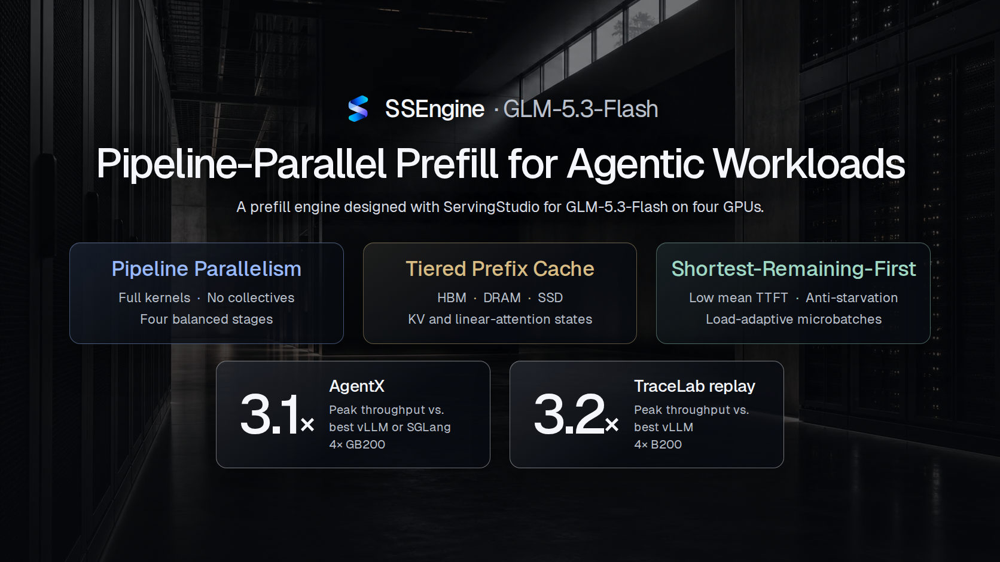

## Overview

In modern agentic workloads, inputs are long and outputs are short. For example, consider a coding agent. On every turn, it appends the user's message or the last tool result to the conversation and sends the entire conversation as input, which is tens to hundreds of thousands of tokens. However, the output of each turn is only a few hundred tokens. Across the coding-agent sessions in our [TraceLab](https://tracelab.cs.washington.edu/) trace, the prompts contain 52.56 billion tokens cached from earlier turns and 2.34 billion new input tokens, against only 186.9 million output tokens. We start with prefill, the processing of this input. Prefill efficiency rests on two things: reusing the cached prefix across turns, and prefilling the new tokens quickly.

To do both while keeping each turn's wait short, a prefill system for agents needs three properties, each tailored to the model it serves: (1) a parallel layout that runs every kernel efficiently, as on a single GPU, and keeps collective communication off the critical path; (2) a prefix cache that keeps each session's KV cache across turns, even though these KV caches together far exceed the GPUs' memory (HBM); and (3) a scheduler that minimizes the mean time-to-first-token (TTFT), because an agent waits for every turn before it sends the next. To our knowledge, no existing prefill engine provides all three.

Today, we release SSEngine-GLM5.3-Flash, a prefill engine for GLM-5.3-Flash on four GPUs that provides these three properties. We designed it with [ServingStudio](https://github.com/SyFI-ServingStudio/ServingStudio), our simulator for LLM serving. SSEngine makes three key decisions:

- SSEngine uses pipeline parallelism (PP) with balanced stages, allowing kernels to run efficiently without collectives on the critical path.
- SSEngine implements a custom prefix cache that spans HBM, DRAM and SSD to maximize the hit rate. The prefix cache also keeps the linear-attention states.
- SSEngine's scheduler runs the turn with the shortest remaining prefill first. It then sets the size of each microbatch from the current load. Finally, to prevent the starvation of long prefills, the scheduler bounds how long any turn waits.

On real hardware, SSEngine sustains 3.1 times (AgentX) and 3.2 times (TraceLab) the request rate of any vLLM or SGLang configuration we tested, including SGLang with PP.

SSEngine-GLM5.3-Flash is a first step. With ServingStudio, we will keep exploring designs for long-context workloads on other models and GPUs. For each of them, we will release reference performance results together with the simulation presets that produced them, so that anyone can evaluate a design quickly.

In this post, we first cover the background: agentic workloads, prefill–decode disaggregation, and the two kinds of attention in GLM-5.3-Flash. We then show that, of four ways to split the model over four GPUs, PP wastes the least GPU time and comes within a few percent of the least that four GPUs could spend. Next, we show why the prefix cache must extend from HBM to DRAM and SSD, and how SSEngine reads it back without stalling prefill. We then show how the scheduler lowers the mean TTFT while bounding the wait of long prompts. Finally, we compare SSEngine with vLLM and SGLang on real hardware and in simulation, compare its cost with API providers, and show where its remaining gap to the hardware lies.

## Background

### Agentic workloads: long contexts, few new tokens

Each turn's prompt is a long prefix from earlier turns plus a short append of new tokens, as Figure 1 shows for one TraceLab session. Across TraceLab, the median prompt holds 154k tokens, but the median turn appends only 1.2k. In SemiAnalysis's AgentX benchmark, the two medians are 74k and 1.9k.

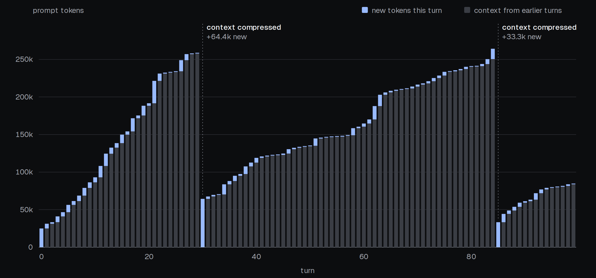

*Figure 1. Prompt size of each of the first 100 turns of one TraceLab session. Grey: prefix from earlier turns. Blue: tokens the turn appends. At the two dotted lines, the agent compresses its context, and the next turn starts with no prefix and prefills tens of thousands of tokens.*

The prefill work per turn, however, varies widely. Figure 2 plots each turn's prefix against its append. Most turns sit on a long cached prefix and append about a thousand tokens. When a session starts, when the agent compresses its context, or when the server has lost the cached prefix, the turn must instead prefill tens of thousands of tokens. These turns are rare but carry much of the work: the 1% of turns with the largest appends carry 20% of all appended tokens.

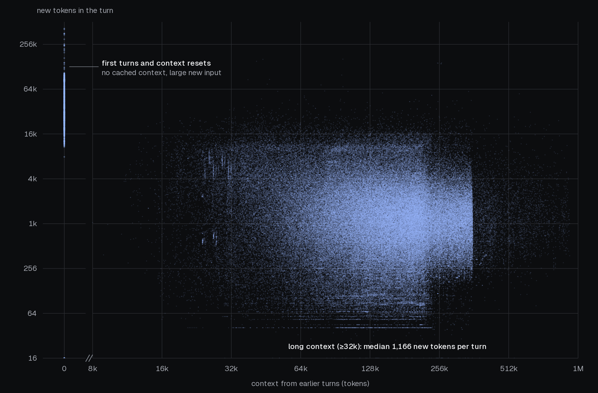

*Figure 2. Prefix and append of each turn in TraceLab (60,000 sampled turns; both axes log scale). The cloud on the right holds most turns; the column at prefix 0 holds first turns and turns after a context compression.*

TTFT is the time from sending a prompt until its first output token arrives. An agent prefills every turn, so every TTFT adds to the session's running time. For agents, the mean TTFT therefore matters more than the tail: a rare slow turn delays a session once, but a small, systematic delay repeats on every turn.

### Prefill–decode disaggregation

Serving a request has two phases: prefill and decode. Prefill processes the prompt and produces the first output token, so its latency is the TTFT. Decode then generates the remaining tokens one at a time, and its latency is the time per output token (TPOT). When the two phases are colocated on the same GPUs, they interfere. As the top of Figure 3 shows, in a mixed batch where decode and prefill requests run together, a long prefill stalls the decode steps that run with it and raises TPOT. Limiting prefill to protect TPOT instead raises TTFT. Prefill–decode (PD) disaggregation runs the two phases on separate GPUs, so each side can scale independently. More importantly, each side can choose its own parallelism, batching and scheduling for its own target. SSEngine is the prefill side of such a deployment: it prefills each prompt and returns the first token, and the decode GPUs generate the rest.

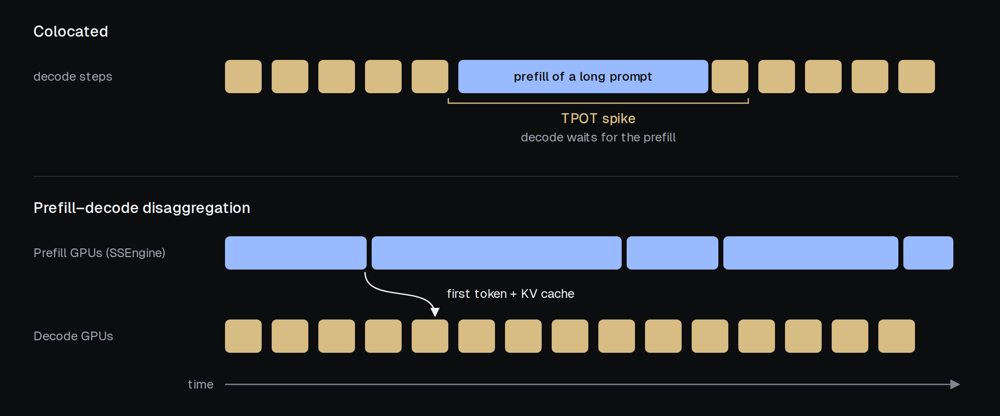

*Figure 3. Top: when prefill and decode are colocated, a long prefill runs inside a decode step and stalls every request in that step. Bottom: with PD disaggregation, the prefill GPUs hand the first token and the KV cache to the decode GPUs, which keep a steady pace.*

### GLM-5.3-Flash: two kinds of attention, two kinds of cached state

GLM-5.3-Flash is a mixture-of-experts (MoE) model with 320B parameters, of which 18B are active for each token. Of its 45 layers, the first 3 use a dense feed-forward layer, and the other 42 route each token to 8 of 288 experts plus one shared expert. The attention layers come in two kinds: 11 use DSA (DeepSeek sparse attention), in which each query attends to 2,048 selected earlier tokens, and the other 34 use KDA (Kimi Delta Attention), a linear attention. Our [post on attention variants](https://servingstudio.cs.washington.edu/blog/attention-variants/) explains both designs in detail. As Figure 4 shows, every fourth layer, from layer 3 to layer 43, is a DSA layer. The model supports contexts of up to 1M tokens. We target a checkpoint in which the routed experts are stored in the 4-bit NVFP4 format. The checkpoint takes 188.4 GB, more than the 180 GB of HBM on one NVIDIA B200.

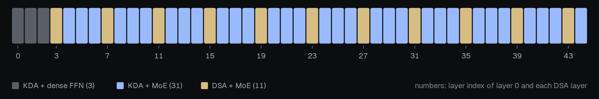

*Figure 4. Layer-type layout of GLM-5.3-Flash. Every fourth layer (3, 7, …, 43) is a DSA layer; the other 34 are KDA layers. The first three layers use a dense feed-forward layer, and the rest use MoE.*

The two kinds of attention keep context in two different ways. The DSA layers keep KV for every token, about 6.0 KB per token in total, so a context's KV grows with its length. The KDA layers instead keep one fixed-size state per layer, whatever the context length. Both are large: at the median TraceLab prompt, the KV takes 0.92 GB, and a saved state, one state for each KDA layer, takes 148 MB, equivalent to the KV of about 25k tokens. The two also behave differently when a prompt matches a cached prefix. A DSA layer can resume after any token of the prefix, because its KV is per token. A KDA layer overwrites its state at every update, so it can resume only at a token where the state was saved (Figure 5). A cache for this model must therefore keep each context's KV and also save states at the tokens where the next turns will resume.

*Figure 5. How the DSA and KDA layers keep a cached context, and where a later prompt that matches it up to the dotted line can resume. The DSA layers resume at the line; the KDA layers must go back to the last saved state and prefill again from there.*

## Choosing the parallelism

Of the four ways we consider to split GLM-5.3-Flash over four GPUs, PP wastes the least GPU time, because each GPU runs whole layers and exchanges only activations.

### Where a single GPU spends its time

Before splitting the model, we look at the work it needs. Suppose one ideal GPU had enough memory for the whole model and ran every kernel at its measured B200 speed. Figure 6 breaks the prefill time of one request on this GPU into kernel families. For prefixes up to 128k tokens, the time depends almost only on the number of new tokens, and three kernel families take 61–66% of it: the KDA projection GEMMs, the MoE experts and the KDA recurrent attention. The exception is the DSA indexer, which selects the tokens that each query attends to: its time also grows with the prefix, because it scores every earlier token for each new token. Its share grows from about 3% with no prefix to about a quarter at a 512k prefix, where it is the largest kernel family for 16k and 32k new tokens. The model's residual stream is four streams wide (manifold-constrained hyper-connections, mHC), and the kernels that mix these streams take 6–7% throughout.

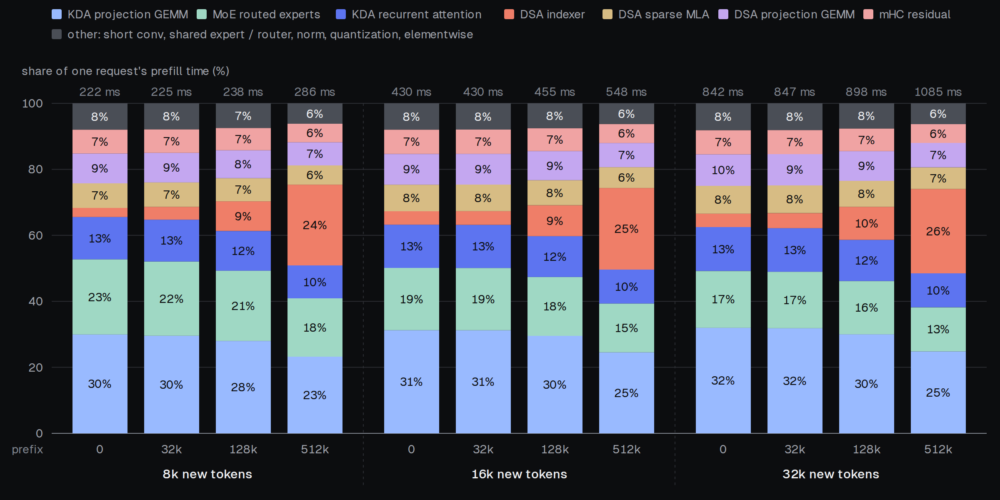

*Figure 6. Prefill time of one request on one ideal GPU, split by kernel family, for 8k, 16k and 32k new tokens and prefixes of 0 to 512k tokens. Only the DSA indexer's share grows with the prefix.*

### Four ways to split the model over four GPUs

This ideal GPU does not exist: the model's weights alone do not fit on one B200, and the cache needs room as well. The model must therefore be split over several GPUs. Figure 7 shows four ways to place the model on four GPUs. We name each design by how it splits attention and then the MoE layers. TP + TP applies tensor parallelism (TP) to both: it cuts every tensor into four slices, so each GPU runs a quarter of every kernel, and the GPUs combine their partial results with two all-reduces per layer. TP + EP splits attention the same way, but applies expert parallelism (EP) to the MoE layers: it spreads the 288 experts over the four GPUs, 72 per GPU. DP + EP spreads the experts in the same way as TP + EP, but applies data parallelism (DP) to attention, giving each GPU whole requests; every MoE layer then dispatches tokens to the GPUs that hold their experts and combines the results. Pipeline parallelism (PP) gives each GPU a contiguous range of whole layers, so each GPU is one stage of a pipeline. The stages process the tokens in groups called microbatches: a microbatch passes from stage to stage, and only its activations move from one GPU to the next.

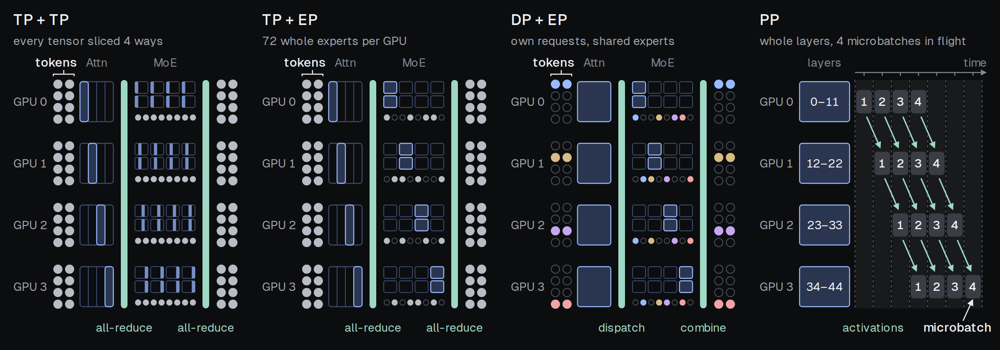

*Figure 7. Four ways to split GLM-5.3-Flash over four GPUs, with communication in teal: all-reduces under TP + TP and TP + EP, dispatch and combine under DP + EP, and only activations between the stages under PP, where four microbatches move through the stages at once.*

### Why PP wastes the least GPU time

Every design does the same necessary work, so the designs differ only in what they add to it: kernels that run less efficiently once split, communication, and idle time. Figure 8 measures this addition against four copies of the ideal GPU of Figure 6. On 20k TraceLab requests at full load, each prefilling only its new tokens, four ideal GPUs spend 1,564 GPU·s. PP spends 1,633 GPU·s, DP + EP 1,812, TP + EP 3,571 and TP + TP 3,708.

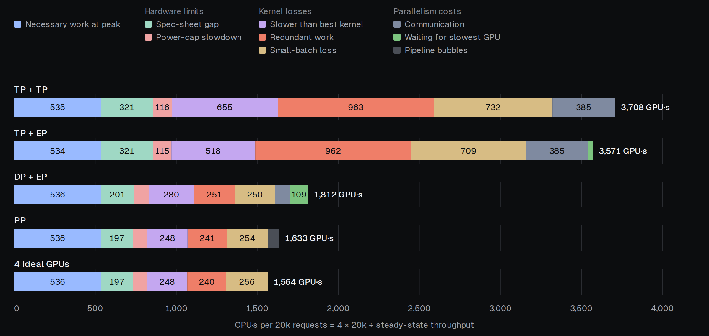

*Figure 8. GPU time per 20k requests at full load on four GPUs, split by cause. PP comes within 5% of four ideal GPUs; its only extra cost is pipeline bubbles, the idle time between stages.*

TP + TP adds the most, because cutting a layer four ways does not make its kernels four times faster. Figure 9 shows the GPU time of each kernel family under each design. Some kernels lose efficiency when they are cut: on TP + TP, KDA recurrent attention runs only 1.9× faster than on one GPU and the MoE experts 2.4×, against an ideal 4×. Other kernels do not shrink at all. The DSA indexer and the mHC kernels run in full on every GPU, and the sparse attention of the DSA layers (sparse MLA in Figure 9) takes about as long with a quarter of the heads as with all of them. On TP + TP, these kernels therefore take about four times their GPU time under PP. On top of this, every layer adds two all-reduces, 385 GPU·s in total, about a quarter of PP's total GPU time. TP + EP fares almost the same as TP + TP, because it slices attention the same way.

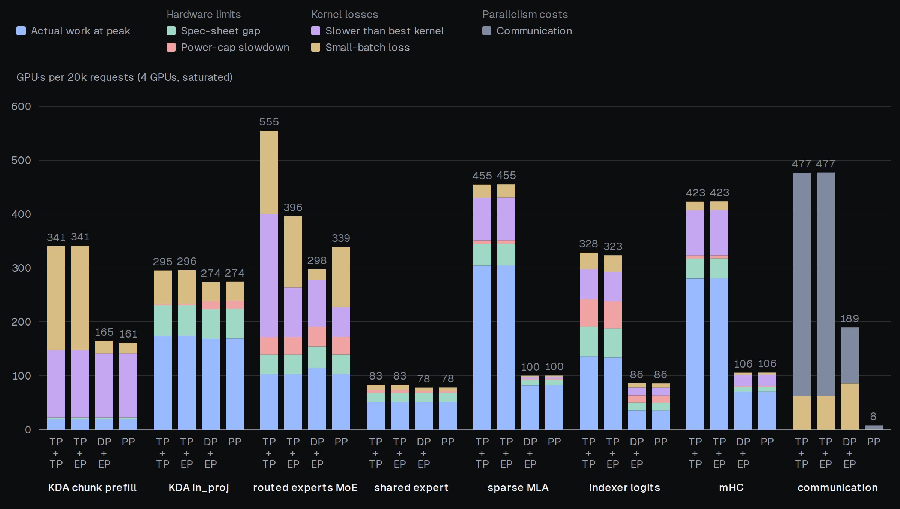

*Figure 9. GPU time of each kernel family per 20k requests at full load on four GPUs. The two TP designs spend more than PP in every family.*

DP + EP keeps attention whole on each GPU, so its attention kernels take nearly as long as on one GPU. It pays instead at the two points in every MoE layer where all GPUs synchronize. Before dispatch, every GPU waits for the one whose requests have the longest contexts, because the DSA indexer's cost grows with the context. Before combine, every GPU waits for the one whose experts received the most tokens. These waits, together with the dispatch and combine traffic, add 201 GPU·s.

PP does not split any kernel, so its kernel time matches that of the ideal GPUs. Instead, it suffers from idle time due to the pipeline bubbles: the stages differ in work, and every faster stage waits for the slowest one, which sets the rate of the whole pipeline. SSEngine therefore balances the stages. However, layers can only be assigned whole, so 45 layers over four stages leave one stage with a twelfth layer. SSEngine gives it to stage 0, whose first three layers have dense feed-forward layers, which cost less than MoE, and splits the layers 12/11/11/11. vLLM's default split, 11/11/12/11, instead gives the extra layer to stage 2, whose twelve layers all use MoE.

With SSEngine's split, the bubbles cost PP only 69 GPU·s, about 4% of its GPU time. In an eight-hour simulation of 1,500 TraceLab sessions, this split also raises the request rate by 2.5% over vLLM's and lowers the mean TTFT from 4.8 s to 4.3 s.

### Prefill throughput with a large enough prefix cache

We next compare the throughput and TTFT of the four designs in Figure 10. We assume a prefix cache large enough to hold every session's context, so each request reuses its whole earlier context and prefills only its new tokens. Requests arrive at a fixed average rate.

We define a design's throughput (the dashed tick on the x axis of Figure 10) as the highest request rate it sustains: above this rate, requests arrive faster than the design finishes them, so its queue grows without bound. As the reference, we use one ideal GPU that runs every kernel in a quarter of its B200 time. It serves as many requests as the four ideal GPUs of Figure 8, and it also finishes each request four times as fast. PP sustains 49.1 requests per second, 96% of the 51.2 that this ideal GPU sustains. DP + EP sustains 44.2, while TP + TP and TP + EP sustain only 21.5 and 22.4. These ratios match Figure 8, because at full load a design's throughput is inversely proportional to the GPU time it spends per request.

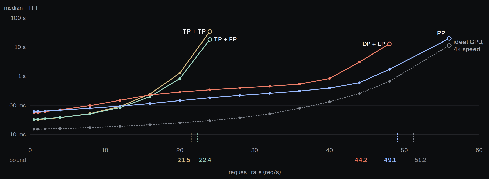

*Figure 10. Median TTFT against request rate on four GPUs, assuming a prefix cache large enough to hold every session's context. The ticks on the x axis mark the highest rate that each design sustains.*

PP's TTFT is higher than that of the other designs only at low load. Below about 12 requests per second, TP + TP and TP + EP respond faster than PP, and below about 3, DP + EP does too. At such low load, a request runs nearly alone, so its TTFT is the time it takes to pass through the model once. Under PP, it passes through the four stages one after another, which takes about as long as running the whole model on one GPU. Under TP + TP and TP + EP, all four GPUs work on every layer of the request at once. At 0.5 requests per second, the median TTFT is therefore about 61 ms under PP, 54 ms under DP + EP and 32 ms under TP + TP and TP + EP, against about 15 ms on the ideal GPU. The 30 ms between PP and the TP designs is too small for a user to notice, and it appears only at loads far below what a deployment is sized for.

In exchange, above about 12 requests per second, PP has the lowest median TTFT of the four designs at every rate we ran. At 40 requests per second, for example, its median TTFT is 0.39 s, against 0.83 s under DP + EP, and both TP designs are already overloaded. PP also sustains more than twice the request rate of TP + TP or TP + EP.

Long prompts do not pay this penalty. PP splits a long prompt into chunks that follow one another through the stages, so the four GPUs work on the same prompt at once, each running its kernels at their single-GPU size. A long prompt therefore finishes sooner under PP than under the designs that split every layer. The scheduling section shows how SSEngine sizes these chunks.

## Tiered prefix caching

Agent contexts outgrow HBM. SSEngine therefore keeps them in host DRAM and on SSD between turns, and reads them back asynchronously to keep the pipeline busy.

### The cache must outgrow HBM

An agent fleet keeps hundreds or thousands of sessions alive at once, and most of them wait between turns with their contexts cached. With the two saved KDA states that SSEngine keeps (explained below), a context at the median TraceLab prompt takes about 1.2 GB. After the weights, a B200 has about 100 GB of HBM left for contexts, and four of them hold only about 330 such contexts, far fewer than the active sessions.

Figure 11a follows the cache through eight hours of a simulated fleet of 1,500 TraceLab sessions on four B200 GPUs, each with 150 GB of DRAM and an 8 TB SSD. This is the load at which the GPUs serve the most requests per second. HBM and DRAM fill within seconds, because all 1,500 sessions start at once. The SSD then keeps filling: after eight hours, it holds 2.9 TB per GPU, 29 times what HBM holds, and it is still rising. Returning turns read their contexts from all three tiers: 20.7% find them in HBM, 55.6% in DRAM and 23.6% on the SSD. Without the SSD, the same fleet collapses. Nearly every turn must then prefill its whole context again, and the throughput falls from about 55 requests per second to below 1.

Real hardware shows the same limits (Figures 11b and 11c). We serve AgentX on four GB200 GPUs with three cache sizes: HBM only, HBM plus 100 GB of DRAM per GPU, and both plus a 512 GB SSD per GPU. We define the hit rate as the share of prompt tokens read from the cache instead of being prefilled. Up to 128 agents, the three sizes perform the same, because the contexts still fit in HBM. At 256 agents, HBM alone no longer holds them: with HBM only, the hit rate is 89% and the throughput 12.5 requests per second, against 94% and 15.0, respectively, with the larger caches. At 512 agents, DRAM is not enough either. With HBM only, the hit rate falls to 60% and the throughput to 4.7 requests per second; with DRAM, they fall to 88% and 13.7. Only with the SSD does the hit rate stay at 94% and the throughput rise to 24.0 requests per second.

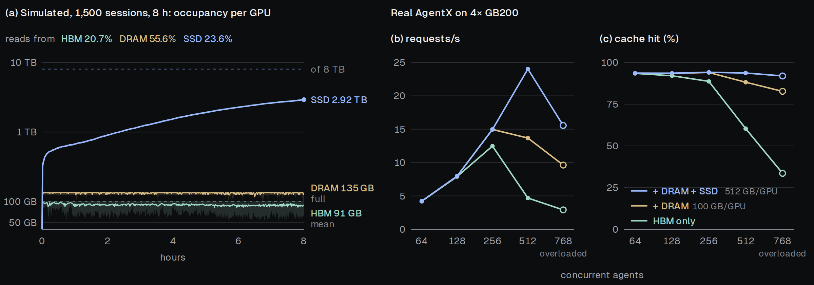

*Figure 11. (a) Per-GPU cache occupancy over eight simulated hours with 1,500 TraceLab sessions. (b, c) Request rate and hit rate of SSEngine on AgentX on real hardware with the three cache sizes. Each tier keeps the throughput rising only until the contexts outgrow it; at 512 agents, the SSD tier serves 1.8 times the request rate of HBM plus DRAM.*

### Exclusive DRAM, inclusive SSD

The two tiers below HBM follow opposite rules, because they run short of different things. DRAM is short of capacity, so it keeps no copy of what HBM holds. The SSD has capacity to spare, so it keeps its copies and avoids writing the same KV twice. With both choices, the reads and writes stay within what the PCIe links and current SSDs supply.

#### DRAM: exclusive

- **Capacity.** A GPU now has almost as much HBM for contexts as the host DRAM behind it, about 100 GB against 100 to 150 GB in our runs. A DRAM tier that also kept copies of what HBM holds would therefore add little capacity. SSEngine thus keeps DRAM exclusive: DRAM holds only contexts that HBM has evicted. In the run of Figure 11a, 135 GB of each GPU's 150 GB of DRAM holds contexts, and the rest is a loading area for reads from the SSD. The two tiers then hold about 235 GB of contexts per GPU, against 135 GB if DRAM also kept copies.
- **Bandwidth and wear-out.** Exclusive DRAM costs more writes. A context read back from DRAM leaves DRAM, so when HBM evicts it again, the whole context must be written to DRAM again. In the run of Figure 11a, these writes average 14.6 GB/s per GPU, or 1,260 TB per day. This is not a concern: DRAM does not wear out with writes, and the link has room for them.

#### SSD: inclusive

- **Capacity.** The SSD is far larger than DRAM, so it can afford copies. SSEngine therefore keeps the SSD inclusive: the SSD keeps its copy of a context when the context is read back. In Figure 11a, each GPU's SSD ends the eight hours less than half full, although it holds over 20 times as much as DRAM.
- **Bandwidth and wear-out.** Keeping the copy saves writes. A returning turn only extends its context, so the DSA KV that the SSD already holds stays valid. When the extended context is later evicted from DRAM to the SSD, only the new tokens' KV and the new KDA state are written. An exclusive SSD would have dropped its copy at the read and would have to write the whole DSA KV again, which spends SSD bandwidth and wears the drive.

Even so, the SSD absorbs a large volume of writes every day. In the run of Figure 11a, each GPU writes 0.76 GB/s to the SSD, which comes to 66 TB per day. With 8 TB of SSD per GPU, that is about 8 full drive writes per day, while data-center SSDs of this size are rated for 1 to 3 full drive writes per day over five years. Only the largest drives absorb these writes within their rating, and only barely: 66 TB is 0.54 full drive writes per day on a 122.88 TB drive such as the DapuStor R6060, which is rated for 0.6. Spreading the writes over more drives, as a distributed store does, lowers the writes per drive in the same way.

For a context that the SSD already holds, most of each write is KDA state. A returning turn adds about 2.7k new tokens on average, whose KV takes only about 4 MB per GPU, but its new KDA state takes 37 MB per GPU. To write even less to the SSD, the tiers can therefore optionally store each KDA state quantized. Small values in the state are stored as fp16 and the rest as fp32, with almost no error. In simulation, this option cuts SSD writes by 35–45%, to about 36 to 43 TB per day. More drives can then absorb the writes: a 61.44 TB drive rated for 1 full drive write per day, for example, takes 0.6 to 0.7 full drive writes per day.

#### Bandwidth: what the tiers must supply

Each returning turn must read its context back from DRAM or SSD before its prefill starts. The target request rate therefore sets the read bandwidth that the tiers must supply. To serve the load of Figure 11a, the four GPUs read 39 GB/s from DRAM and 18 GB/s from the SSD.

SSEngine spreads this bandwidth evenly over the four GPUs, as the implementation section explains. Each GPU therefore copies 14.3 GB/s from the host into HBM on average, including the SSD reads that pass through DRAM. Together with the DRAM writes described above, this is well within the 48 GB/s that each GPU can copy between host memory and HBM when all four GPUs copy at once. The SSD is the slowest tier, yet current drives supply what the SSD reads need. Each GPU reads 4.6 GB/s from the SSD on average, and in busy periods it reaches the 10 GB/s that the simulation allows per GPU. A single PCIe Gen5 NVMe drive reads about 14 GB/s.

### One or two saved KDA states per session

As noted above, a KDA layer can resume only at a token where its state was saved. A radix-tree prefix cache resumes after any shared prefix, so for this model it would need a saved state at every block. Agent sessions, however, do not need this flexibility, because most turns append to the previous prompt: of the turns that reuse earlier context, 99.98% on TraceLab and 92% on AgentX begin with the whole previous prompt. SSEngine therefore saves states only at prompt ends.

The remaining choice is how many prompt ends a session keeps. We compare the choices by their **extra prefill**: the tokens prefilled beyond a turn's new tokens, as a share of the new tokens. With one saved state per session at the end of its latest prompt (k1), the extra prefill on TraceLab is only 1.6%. On AgentX, however, the extra prefill reaches 135%. The cause is the 8% of AgentX turns that do not begin with the whole previous prompt: such a turn cannot resume from the saved state, so it prefills its whole context again. Some of these turns differ only because the trace hashes prompts in 64-token blocks, so a small change near the end of the previous prompt alters its last block. SSEngine therefore keeps a second state by default (k2): the state from which the latest turn resumed, saved at the end of the prompt before it. This cuts the extra prefill on AgentX to 39%.

### Implementing the tiers without stalling prefill

Tier transfers can slow prefill in two ways. They share the GPUs with prefill, and a returning turn cannot start its prefill until its KV cache has been read back into HBM. SSEngine's implementation therefore keeps the transfers off the GPUs' compute units, and it keeps reads from waiting on writes or holding up the turns that are ready to run.

Figure 12 gives an overview of the system, and the paragraphs below explain its parts. Only stage 0 receives a microbatch's tokens; the other stages receive its metadata from the host and their activations from the stage before.

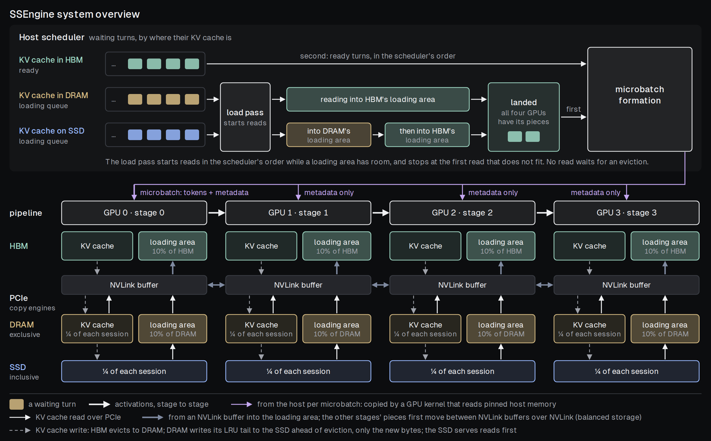

*Figure 12. SSEngine system overview. Top: the host scheduler, with its ready turns and loading queues. Middle: the four pipeline stages. Bottom: each GPU's HBM, DRAM and SSD, with the read paths (solid) and write paths (dashed) between them.*

**Balanced storage across stages.** Each pipeline stage holds different layers, so the stages' parts of a session's KV cache differ in size: stage 1, for example, has two DSA layers, and the other stages have three. If each GPU loaded the cache of its own layers, the GPUs with three DSA layers would become the bottleneck. SSEngine therefore cuts every part of a session's KV cache, such as one layer's KV or one KDA state, into four equal pieces, one per GPU, so each GPU stores and loads exactly a quarter of every session's KV cache. A GPU reads its quarter from host memory into its own HBM over its own PCIe link, and then forwards the pieces that belong to other stages over NVLink. This second hop costs little, because NVLink is more than ten times faster than PCIe.

**Copy engines for the KV cache, a kernel for metadata.** SSEngine moves the KV cache with the GPUs' copy engines, dedicated units that copy memory without using the compute units, so prefill runs at full speed during the copies. Before every microbatch, each stage also copies a small block of metadata from host memory, and this copy would otherwise queue behind the large KV cache copies on the copy engines. SSEngine therefore copies the metadata with a small GPU kernel that reads host memory directly. Likewise, SSD writes, which no turn waits for, yield to reads on the SSD.

**Asynchronous loading.** Reading a KV cache from DRAM or the SSD takes tens of milliseconds or more. If a turn entered a microbatch before its read had landed, it would hold up the turns behind it. SSEngine therefore loads the KV cache asynchronously: the turn waits in a loading queue, outside microbatch formation, until its KV cache has landed, and the GPUs meanwhile run the turns that are ready. A separate load pass starts these reads in the scheduler's order, into a loading area of 10% of HBM that is reserved for reads, so a read never waits for HBM to evict another session's KV cache. Once a read lands, its turn joins the next microbatch ahead of the other waiting turns. Without the loading area, reads waited for the eviction writes that free HBM blocks, while those writes waited for DRAM held by reads in flight. With 400 TraceLab sessions on real hardware, the throughput then fell by 12%.

## Scheduling

The scheduler decides which tokens go into each microbatch and how many, and these choices set the TTFT of every turn. SSEngine makes them so that short turns do not wait behind long ones.

### Shortest remaining prefill first against head-of-line blocking

As Figure 2 shows, a few turns have far more tokens to prefill than the rest. Under first-come-first-served (FCFS) scheduling, as in vLLM, a prompt with hundreds of thousands of new tokens occupies the pipeline for seconds, and every short turn that arrives behind it waits that long. We simulated SSEngine's four GPUs under FCFS for eight hours with 1,200 TraceLab sessions and the same DRAM and SSD as in Figure 11. In this run, a turn with only 23 new tokens arrived 4.3 s after a prompt with 840k new tokens. Twelve microbatches ran before the turn could start, and 96% of their tokens belonged to the long prompt. The turn therefore waited 4.1 s for its first microbatch, and its TTFT was 5.4 s. The median turn with fewer than 2k new tokens waited only 0.36 s in this run.

SSEngine's scheduler aims to lower the mean TTFT. The classic way to lower a mean wait is to run the job with the least work left first, so the scheduler runs the turn with the shortest remaining prefill first. A short turn that arrives behind a long prompt enters the next microbatch, and the long prompt yields to it, even if the long prompt's prefill has already started.

Shortest first alone can starve a long prompt, because the short turns that keep arriving run ahead of it. On real hardware, a 32k-token prompt that arrives among a steady stream of 1k-token prompts waits until the stream ends: its TTFT is 109 s under shortest first, against 0.41 s under FCFS. SSEngine therefore adds a rule against starvation, the 60 s rule: any turn that has waited 60 s enters the next microbatch, regardless of its size.

### Dynamic microbatch formation

The microbatch size trades throughput against TTFT. With larger microbatches, the GPUs process more tokens per second, but a short turn that arrives while a microbatch runs waits longer, so its TTFT rises. SSEngine therefore sets the microbatch size from the backlog, the number of tokens waiting to be prefilled.

**Microbatch size follows the load.** While the backlog is below 1M tokens, a microbatch holds at most 4,096 tokens, so a newly arrived short turn waits behind only a small microbatch at each stage. From 1M to 3M tokens, the limit grows linearly to 32,768 tokens, so the pipeline keeps up with the load.

**Balanced microbatch assignment.** SSEngine also caps each microbatch at a quarter of the backlog, so the waiting tokens spread evenly over four microbatches, one for each stage. This reduces pipeline bubbles, because the microbatches take similar times. It also splits a long prompt across consecutive microbatches, so the four GPUs work on it at once, as the parallelism section described.

### What the scheduler buys

Figure 13 compares SSEngine's scheduler with FCFS in the eight-hour simulation described above, at loads from 1,000 to 1,750 sessions. Below saturation, the scheduler cuts the mean TTFT by 3 to 6 times: in Figure 13a, the solid blue line lies far below the solid grey one at 1,000 and 1,200 sessions. With 1,000 sessions, the mean TTFT falls from 1.13 s to 0.18 s. With 1,200 sessions, where the GPUs still keep up with the load under FCFS, it falls from 1.72 s to 0.53 s, and the median from 1.18 s to 0.20 s. The GPUs also serve more requests per second at every load, 8% more with 1,200 sessions, because each session waits less and sends its next turn sooner.

The long prompts pay for this gain, but they are few, and their wait has a bound. Turns with over 100k tokens to prefill make up only 0.2% of all turns, and Figure 13b shows their TTFT. With 1,000 sessions, their median TTFT rises only from 2.4 s to 3.4 s. With 1,200 sessions, it rises from 2.7 s to 19 s, and the 60 s rule keeps the TTFT of every one of them below 77 s. Without the rule, starvation has no bound, as the gold line shows: with 1,200 sessions, one long prompt waited 1,310 s, and three were still waiting when the run ended. With 1,750 sessions, one long prompt's TTFT reaches 26,130 s.

Near saturation, no scheduler that serves every turn can keep the TTFT low, because turns arrive about as fast as the GPUs finish them and the queue stays long in any order. Under FCFS, the GPUs saturate between 1,500 and 1,750 sessions. With 1,750 sessions, the mean TTFT is 12.7 s under FCFS and still 10.1 s under SSEngine's scheduler. Then 6% of the turns wait longer than 60 s, and the TTFT of the longest prompts reaches about 100 s, because the turns that the rule forces also queue behind one another. The scheduler therefore cannot replace the capacity that such a load needs.

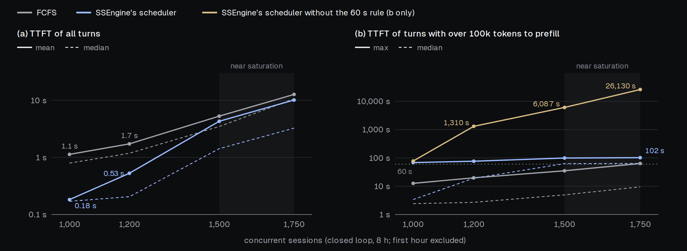

*Figure 13. FCFS against SSEngine's scheduler over eight simulated hours on four B200 GPUs, with 1,000 to 1,750 TraceLab sessions; the first hour is excluded. (a) TTFT of all turns. (b) TTFT of the turns with over 100k tokens to prefill, also for SSEngine's scheduler without its 60 s rule. Below saturation, SSEngine's scheduler lowers the mean TTFT, and the 60 s rule bounds the TTFT of the long prompts; near saturation (shaded), the TTFT rises under both schedulers.*

## Evaluation

We evaluate SSEngine on two agent workloads on real hardware and compare it with vLLM and SGLang, each in several designs and cache settings. When each system is taken at the load where it serves the most requests, SSEngine's request rate is about three times that of the best baseline. In an eight-hour simulation with the same cache and scheduler for every design, PP also sustains the highest request rate per GPU at a low TTFT. SSEngine's GPU cost is a small fraction of what API providers charge for the same requests.

### AgentX on real hardware

We ran SemiAnalysis's AgentX, which replays coding-agent sessions, on four GB200 GPUs, for 30 minutes at each number of concurrent agents. We compare SSEngine with vLLM and SGLang, each run as TP + TP and as DP + EP, two of the designs of Figure 7, and with SGLang run as PP. For each baseline design and number of agents, we report the cache setting with the highest request rate among those we ran: HBM only, HBM plus DRAM, and HBM plus DRAM and SSD.

Figure 14 plots the request rate and the median TTFT against the number of concurrent agents. With 64 agents, every system serves about 4 requests per second, because the GPUs are lightly loaded. As agents are added, every baseline reaches its highest rate with at most 256 agents and then falls. The highest baseline rate is that of SGLang PP: 7.7 requests per second with 256 agents, at a median TTFT of 22 s. SSEngine's rate keeps rising, to 24.0 requests per second with 512 agents, 3.1 times that rate, at a median TTFT of 1.7 s. With 512 agents, every baseline serves fewer than 3 requests per second, and with 768, SSEngine is overloaded as well: its median TTFT exceeds 60 s. Part of the gap comes from the cache: with 512 agents, SSEngine reads 94% of the prompt tokens from its cache, and the baselines at most 75%.

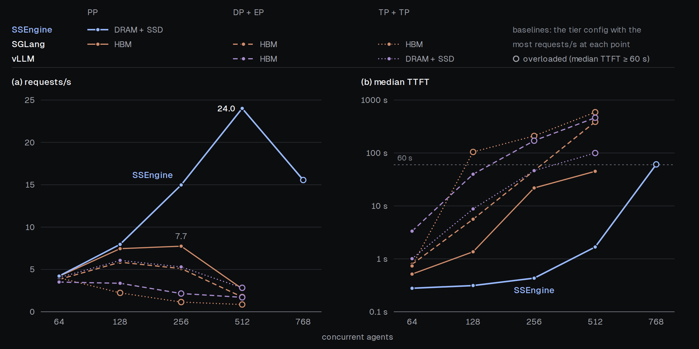

*Figure 14. SemiAnalysis AgentX on four GB200 GPUs, 30 minutes per point; each baseline uses its best cache setting at each point. (a) Requests per second. (b) Median TTFT; hollow points are overloaded. SSEngine's highest rate is about three times the highest of any baseline, at a far lower median TTFT.*

### TraceLab session replay on real hardware

We also replayed TraceLab sessions on four B200 GPUs, with 50 to 400 concurrent sessions for 20 minutes each, and we report minutes 10 to 20. SSEngine runs with 50 GB of DRAM and 128 GB of SSD per GPU. The baselines are vLLM DP + EP behind vLLM's cache-aware router and vLLM TP + TP, both with HBM only. We also ran vLLM DP + EP with its KV cache offloading to host memory, 50 GB of DRAM per engine, at 300 and 400 sessions, and its request rate changed by less than 6%.

Figure 15 plots the request rate and the median TTFT against the number of sessions. With 50 sessions, the three systems have about the same request rate, 4.6 to 4.9 requests per second, but SSEngine's median TTFT is 0.09 s, against 0.76 s for vLLM DP + EP and 0.35 s for vLLM TP + TP. As sessions are added, vLLM DP + EP reaches its highest rate, 12.6 requests per second, with 200 sessions, at a median TTFT of 5.2 s, and then falls to 4.6 with 400 sessions. vLLM TP + TP serves at most 7.3 requests per second, with 100 sessions. SSEngine's rate keeps rising: with 400 sessions, the highest load we ran, it serves 40.5 requests per second, 3.2 times the highest rate of vLLM DP + EP, at a median TTFT of 0.60 s.

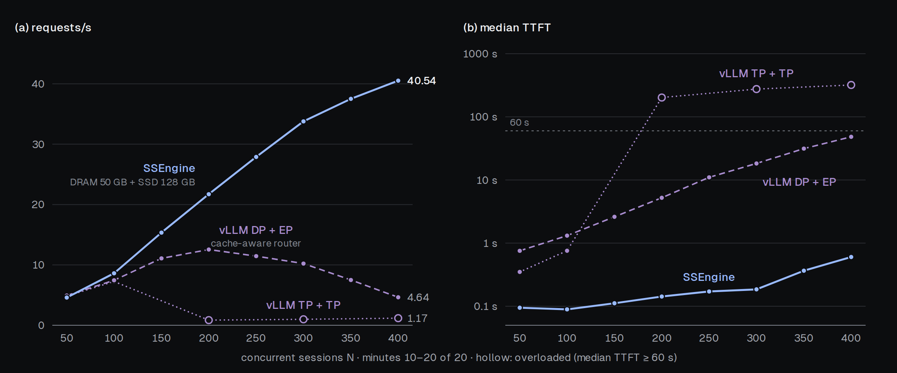

*Figure 15. TraceLab session replay on four B200 GPUs, minutes 10 to 20 of each 20-minute run. (a) Requests per second. (b) Median TTFT; hollow points are overloaded. SSEngine's request rate keeps rising with the number of sessions, while that of vLLM DP + EP falls beyond 200 sessions.*

### The four designs over eight hours in simulation

In the real runs, the baselines differ from SSEngine in more than the design: they also use other caches and schedulers. To compare the designs alone, we simulate the four designs of Figure 7 over eight hours of TraceLab sessions on four B200 GPUs, each design with the same three-tier cache and the same scheduler. Figure 16 plots each design's TTFT against its request rate per GPU, with one point per number of sessions. PP sustains the highest request rate at a low TTFT. At a 99th-percentile TTFT of 6 s, the dotted line in Figure 16b, it serves about 12.5 requests per second per GPU, 1.24 times the rate of DP + EP and 2.5 times that of TP + TP and TP + EP. Without a bound on the TTFT, DP + EP comes within 8% of PP's highest request rate, but only once its 99th-percentile TTFT exceeds 30 s. In Figure 16a, PP's median TTFT at the same request rate is also about a third of that under DP + EP: at about 11 requests per second per GPU, it is 0.19 s under PP and 0.59 s under DP + EP.

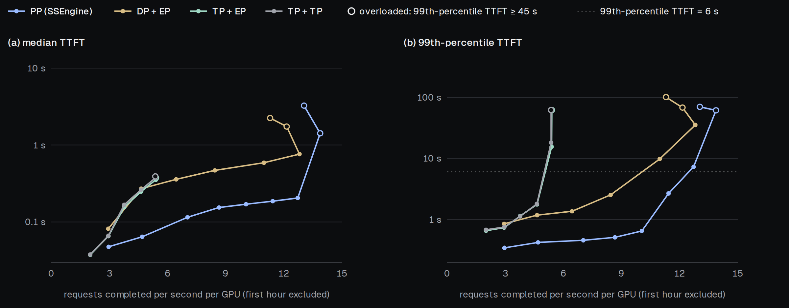

*Figure 16. The four designs of Figure 7 over eight simulated hours on four B200 GPUs, one point per number of TraceLab sessions. Hollow points are overloaded: their 99th-percentile TTFT is 45 s or more. At a 99th-percentile TTFT of 6 s (dotted line), PP serves the most requests per GPU.*

### Cost compared with API providers

At the request rate of the TraceLab replay with 400 sessions (Figure 15) and an on-demand price of $6.73 per B200 per hour, prefilling 1,000 requests costs about $0.18 of GPU time. vLLM DP + EP at its highest request rate costs about $0.60. Through Z.ai's API, the same 1,000 requests would cost about $4.7. As of November 2026, Z.ai charges $0.15 per million input tokens for GLM-5.3-Flash and $0.03 per million cached input tokens, and in this replay each request carries about 143k prompt tokens, of which about 3.3k are new. SSEngine's GPU cost is thus about 1/25 of the API price. The comparison counts only the GPUs that prefill: it leaves out decode, host memory and SSD, idle capacity, and a provider's margin.

Figure 17 shows where the API price comes from. In both API bars, the new tokens cost only a small part; most of the bill is for the cached prefix tokens, because every request sends its whole earlier context again. Even at the lowest input price on OpenRouter, with cached tokens billed at Z.ai's rate, the bill is about 23 times SSEngine's GPU cost. The API bills also assume that every prefix hits the provider's cache; each miss would raise them further.

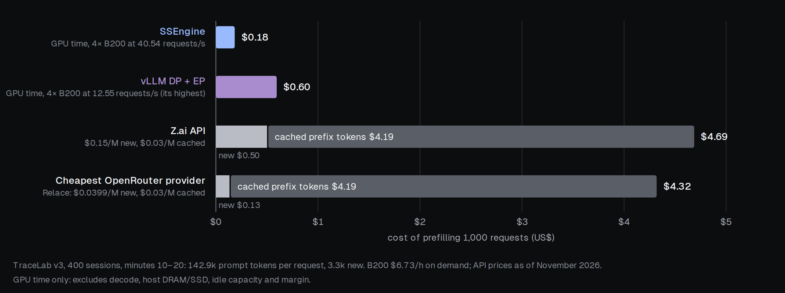

*Figure 17. Cost of prefilling 1,000 requests of the TraceLab replay, with each engine's GPU time taken at its highest request rate. Most of the API price is for cached prefix tokens.*

### Where the remaining gap is

Finally, we ask how far SSEngine is from what the hardware allows, at the load where it serves the most requests: 1,500 sessions in the eight-hour simulation. To answer this, we split SSEngine's GPU time into losses that better scheduling and kernels could recover and time that no software can remove. Figure 18a splits the GPU time by cause: the time the model's necessary computation would take at the B200's peak compute or memory bandwidth, and each loss on top of it.

The recoverable losses add up to 51% of the GPU time. Pipeline bubbles take 5.5%, and microbatches smaller than the size at which each kernel runs fastest cost another 12.6%. Kernels that run slower than a single large GEMM or copy at the same precision cost 18.1%. Kernels that do more work than the model needs cost 14.5%, mostly because they are not fused enough: each kernel writes its intermediate results to HBM, and the next kernel reads them back. The other 49% of the GPU time cannot be recovered by better software. The model's necessary work takes 32%. The rest is lost because even the fastest kernels do not reach the peak in the B200's specification: 6.1% because the GPU slows down under its power limit when kernels run back to back, and 11.2% because the fastest measured kernels are still below that peak.

Figure 18b shows which kernel families cause the three largest recoverable losses. Most of the time lost to slow kernels is in KDA's chunked attention and the routed-expert MoE, 6.8% and 6.2% of the GPU time. Most of the extra work is in the mHC residual mixing, 4.1%, and in the small kernels between larger operations, such as quantization and normalization, 3.4%; fusing them into their neighbors would remove their HBM traffic. Small microbatches cost the most in the projection GEMMs and the MoE kernels, 3.7% and 3.6%.

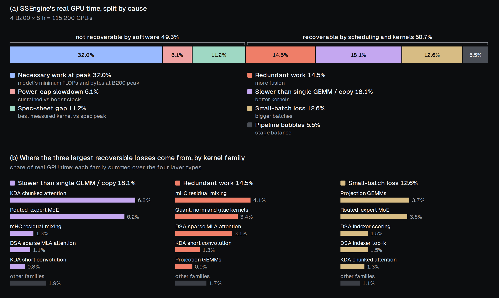

*Figure 18. SSEngine's GPU time at 1,500 sessions in the eight-hour simulation, split by cause. (a) The necessary work and each loss on top of it. (b) The kernel families behind the three largest recoverable losses.*

## Get started

SSEngine-GLM5.3-Flash is open source at [github.com/SyFI-ServingStudio/SSEngine-GLM5.3-Flash](https://github.com/SyFI-ServingStudio/SSEngine-GLM5.3-Flash). It serves the NVFP4 or the FP8 checkpoint of GLM-5.3-Flash on four B200 GPUs behind an OpenAI-compatible API. It is meant to be the prefill side of a deployment whose decode runs elsewhere: it has no decode path, and each request returns one token. Its README explains how to run it with Docker or from source, size each tier, and reproduce the real-hardware results in this post.

To explore designs for other models and GPUs, or to rerun the simulations in this post, use [ServingStudio](https://github.com/SyFI-ServingStudio/ServingStudio). Its Analyzer splits the GPU time of any simulated design by cause, as in Figure 18.
